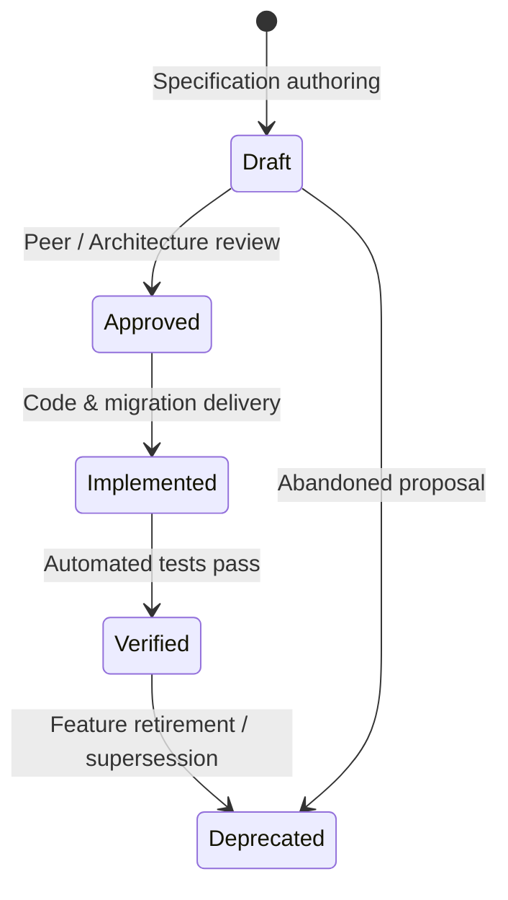

# Specification-Driven Development (SDD) Foundation

## 1. What is Specification-Driven Development (SDD)?

Specification-Driven Development (SDD) is an engineering practice and governance framework where architectural boundaries, functional behaviors, business rules, API contracts, domain models, and operational characteristics are explicitly defined, verified, and maintained as living documentation within the repository.

SDD bridges the gap between source code, test suites, architecture decision records (ADRs), and operational playbooks. It turns specifications into the primary architectural interface for both human engineers and AI coding agents.

### Specification First, Implementation Second
Under the SDD paradigm:
1. **Specification First**: Before new features, contract adjustments, schema modifications, or behavioral changes are implemented in application source code, the corresponding specification files under `docs/sdd/services/<service>/` must be authored or updated.
2. **Implementation Second**: Source code, database migrations, configuration files, and test suites are subsequently implemented to satisfy the requirements, acceptance criteria, and invariants established in the specification.
3. **Continuous Reconciliation**: Every specification change must be delivered in the same Pull Request (PR) as its implementing code and tests. Specifications must never lag behind runtime code or drift into obsolescence.

### The Authority Rule
> [!IMPORTANT]
> **The Authority Rule**: When documentation, source code, and tests diverge, the validated SDD specification is the authoritative source of truth for **intended** behavior. 
> - If current source code exhibits behavior contrary to an **Approved** specification requirement, that divergence is classified as a suspected defect, documented with an evidence status and linked to an Open Question (`<SVC>-Q-<NNN>`). Fixes must only be submitted via unapproved Proposed Changes (`<SVC>-PROP-<NNN>`).
> - For existing systems undergoing baseline reverse-specification (such as the pilot phase), the specification must objectively record **current observed behavior** backed by concrete evidence from source, tests, configuration, and migrations. Existing prose documentation (such as legacy service READMEs or sequence diagrams) must be treated as discovery material and verified against code before being accepted as factual truth.

---

## 2. Directory Layout and Structure Map

The SDD foundation is organized under `docs/sdd/` as follows:

```
docs/sdd/
├── README.md                          # SDD overview, governance rules, and layout map (this file)
├── guidelines/                        # Normative authoring and lifecycle guidelines
│   ├── requirement-authoring.md       # Guidelines for writing testable FR, BR, NFR, Q, PROP
│   ├── evidence-and-discovery.md      # Grounding claims in code, test, config; discovery hierarchy
│   ├── change-management.md           # Specification updates, versioning, change-proposal workflow
│   ├── implementation-workflow.md     # 7-step engineering workflow for humans and AI agents
│   └── validation-guidelines.md       # Manual validation checklist for completeness and traceability
├── templates/                         # Service-agnostic specification templates
│   ├── README.md                      # Template index and usage guidance
│   ├── sections/                      # Section-by-section specification templates
│   │   ├── service-overview.md        # Service purpose, ownership, URLs, metadata
│   │   ├── domain-model.md            # Domain models, entities, DTOs, invariants
│   │   ├── functional-requirements.md # Functional requirements (FR) with GWT scenarios
│   │   ├── business-rules.md          # Domain rules, state transitions, validation invariants
│   │   ├── api-contracts.md           # REST / HTTP contracts, endpoints, error responses
│   │   ├── data-model.md              # Database tables, schemas, indexes, migrations
│   │   ├── workflows.md               # End-to-end processing flows, sagas, state machines
│   │   ├── integrations.md            # Messaging contracts (Kafka), event schemas, retries/DLQ
│   │   ├── architecture.md            # Modularity, components, dependencies, technology stack
│   │   ├── non-functional-requirements.md # Performance, security, scalability, reliability
│   │   ├── operations.md              # Deployment, configuration, observability, Kubernetes
│   │   ├── testing.md                 # Test coverage mapping, strategy, test categories
│   │   ├── traceability-matrix.md     # Comprehensive FR/BR/NFR to code and test traceability
│   │   └── open-questions.md          # Unresolved questions (Q) and proposed changes (PROP)
│   └── diagrams/                      # Standard Mermaid diagram templates
│       ├── context-diagram.md         # System/Service context diagram
│       ├── component-diagram.md       # Internal component architecture diagram
│       ├── er-diagram.md              # Entity-Relationship diagram
│       ├── saga-sequence-diagram.md   # Distributed transaction/saga sequence diagram
│       └── state-diagram.md           # Entity or lifecycle state machine diagram
└── services/                          # Service specifications (per microservice)
    └── inventory-service/             # Inventory Service pilot specification
        ├── README.md                  # Service overview, version, change log, file index
        ├── ...                        # 13 section files
        └── diagrams/                  # Mermaid diagram sources
```

---

## 3. Specification Areas and File Mapping

Every microservice documented under `docs/sdd/services/<service>/` must maintain its specification across the standard section files. The table below delineates mandatory versus optional areas:

| File Name | Functional Area / Topic | Status | Purpose & Coverage |
| :--- | :--- | :--- | :--- |
| `README.md` | Service Overview & Index | **Mandatory** | Service mission, ownership boundaries, base URLs, specification version, change log, and file navigation index. |
| `domain-model.md` | Domain Entities & DTOs | **Mandatory** | Ubiquitous language glossary, aggregate roots, domain entities, value objects, request/response DTOs, and core invariants. |
| `functional-requirements.md` | Functional Requirements | **Mandatory** | Granular functional specifications (`<SVC>-FR-<NNN>`) with Given/When/Then acceptance criteria and scenario mapping. |
| `business-rules.md` | Business Rules & Invariants | **Mandatory** | Domain validation rules, lifecycle state constraints, stock calculations, idempotency, and integrity invariants (`<SVC>-BR-<NNN>`). |
| `api-contracts.md` | Synchronous API Contracts | **Mandatory** | REST/HTTP endpoints, route paths, query parameters, headers, request/response bodies, RFC 7807 error details, and Swagger delta. |
| `data-model.md` | Persistence & Migrations | **Mandatory** | Database schema tables, columns, primary/foreign keys, indexes, Liquibase migrations, rollbacks, and transaction boundaries. |
| `workflows.md` | Business Workflows & Sagas | **Mandatory** | Step-by-step workflow specifications, distributed transactions (sagas), state transitions, preconditions, postconditions, and compensation logic. |
| `integrations.md` | Asynchronous Messaging & Events | **Mandatory** | Kafka topics, event schemas, key/payload serialization, Modulith outbox bindings, consumer group topologies, retries, and DLT handling. |
| `architecture.md` | Structural Architecture | **Mandatory** | Package structure, Spring Modulith boundaries, component responsibilities, framework dependencies, reachability hints, and architecture diagrams. |
| `non-functional-requirements.md` | Quality Attributes & NFRs | **Mandatory** | Performance targets (SLOs/latencies), scalability, high availability, security context, resilience, and compliance (`<SVC>-NFR-<NNN>`). |
| `operations.md` | Operations & Deployment | **Mandatory** | Spring profiles, Config Server configuration, Kubernetes deployment manifests, probes, resource limits, autoscaling, and runbook cross-references. |
| `testing.md` | Test Suite & Verification | **Mandatory** | Unit, integration, architecture, and end-to-end test inventory, Testcontainers setup, verification commands, and test naming discrepancies. |
| `traceability-matrix.md` | Traceability Coverage | **Mandatory** | Bidirectional mapping connecting every FR, BR, and NFR to specific source classes/methods, automated test cases, and evidence statuses. |
| `open-questions.md` | Open Issues & Proposals | **Mandatory** | Formal tracking of ambiguities, undocumented behaviors, suspected defects (`<SVC>-Q-<NNN>`), and proposed changes (`<SVC>-PROP-<NNN>`). |
| `diagrams/*.md` | Visual System Diagrams | **Optional** | Standalone Mermaid diagrams (context, component, ER, sequence, and state diagrams) linked directly into narrative sections. |

---

## 4. Identification Conventions (`<SVC>-<CAT>-<NNN>`)

To ensure precise traceability across requirements, code, tests, and change proposals, all SDD artifacts adhere to a standardized identification syntax:

$$\mathbf{<SVC>}-\mathbf{<CAT>}-\mathbf{<NNN>}$$

### Identifiers Breakdown
1. **`<SVC>` (Service Prefix)**: A 3-to-4 uppercase character service identifier registered in this foundation.
2. **`<CAT>` (Category Code)**:
   - `FR`: Functional Requirement
   - `BR`: Business Rule / Invariant
   - `NFR`: Non-Functional Requirement
   - `Q`: Open Question / Discovery Gap / Suspected Defect
   - `PROP`: Proposed Specification or Architecture Change
3. **`<NNN>` (Numeric Index)**: A 3-digit zero-padded sequential integer (e.g., `001`, `002`, `010`).

### Service Registry
The following service prefixes are formally registered:
- `INV`: Inventory Service (`inventory-service`) — Pilot implementation
- `ORD`: Order Service (`order-service`) — *Placeholder*
- `CAT`: Catalog Service (`catalog-service`) — *Placeholder*
- `PAY`: Payment Service (`payment-service`) — *Placeholder*
- `GW`: API Gateway (`api-gateway`) — *Placeholder*
- `CFG`: Config Server (`config-server`) — *Placeholder*
- `REG`: Service Registry Eureka (`service-registry`) — *Placeholder*
- `WEB`: Retail Store WebApp (`retail-store-webapp`) — *Placeholder*

### Governance Rules for Identifiers
- **No ID Reuse**: Once an identifier is assigned to a requirement or question, it must never be reassigned to a different concept, even if the original requirement is deleted or superseded.
- **No Renumbering**: Renumbering IDs across releases is strictly forbidden. Sequence gaps resulting from deprecated or removed requirements are expected and accepted.
- **Deprecation**: Requirements that are retired, superseded, or obsolete must have their status updated to `Deprecated` with a pointer to the superseding requirement (e.g., `Superseded by INV-FR-025`).

---

## 5. Requirement Lifecycle and Evidence Statuses

Every requirement (`FR`, `BR`, `NFR`), question (`Q`), and proposal (`PROP`) progresses through a formal lifecycle and is backed by an evidence status.



### Lifecycle States
1. **`Draft`**: Requirement is being drafted, refined, or reverse-engineered; not yet finalized or formally approved.
2. **`Approved`**: Requirement is reviewed and authorized for implementation or accepted as baseline truth.
3. **`Implemented`**: Code, migrations, and configurations satisfying the requirement have been merged into the codebase.
4. **`Verified`**: Automated tests (unit, integration, or end-to-end) confirm that the system adheres to the specification.
5. **`Deprecated`**: Requirement is no longer active, has been decommissioned, or has been replaced by a newer specification.

### Evidence Status Definitions
When documenting system behaviors, every claim and requirement must explicitly declare its grounding evidence status:
- **`Verified`**: Confirmed by passing automated test suites (unit tests, integration tests with Testcontainers, or e2e tests).
- **`Implemented`**: Confirmed present in production application source code or database migrations, but lacking dedicated automated test assertion.
- **`Configured`**: Established by application configuration (`application.yml`), Kubernetes deployment manifests, or environment variables.
- **`Target`**: A desired future operational or architectural objective (e.g., an SLO latency target) not yet enforced by existing configuration or infrastructure.
- **`Inferred`**: Deduced logically from framework defaults, conventions, or secondary behaviors, but not explicitly specified in codebase files.
- **`Needs-Clarification`**: Incomplete, ambiguous, or contradictory behavior across source, tests, or documentation; flagged for investigation via an open question (`<SVC>-Q-<NNN>`).

### Source and Test Referencing Syntax
To avoid rapid obsolescence due to routine line insertions or formatting, references to source code and test files must adhere to the following convention:
- **Format**: Repository-relative path followed by `#Class` or `#Class#method` (or `#method`).
- **Prohibited**: **Never include source file line numbers** (e.g., do not write `.../InventoryController.java:54`). Line numbers become stale immediately upon refactoring or formatting.
- **Examples**:
  - `inventory-service/src/main/java/com/example/inventoryservice/inventory/web/controllers/InventoryController.java#InventoryController#getInventoryByProductCode`
  - `inventory-service/src/test/java/com/example/inventoryservice/inventory/web/controllers/InventoryControllerTest.java#shouldFindInventoryByProductCode`
  - `inventory-service/src/main/resources/db/changelog/migration/01-create_inventories_table.json#create_inventory_table`

> [!NOTE]
> These identification conventions, lifecycle states, evidence categories, and source symbol syntax rules are newly introduced for the SDD foundation across the repository.
