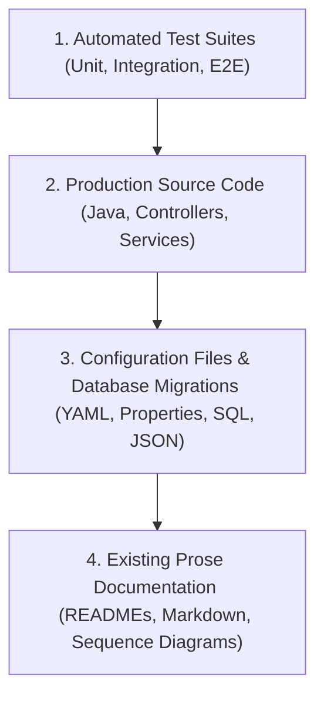

# Evidence and Discovery Guidelines

Grounding specification statements in indisputable code facts is the core pillar of Specification-Driven Development. This document establishes the strict evidence hierarchy, discovery rules, and handling of ambiguous or conflicting documentation.

---

## 1. Grounding Claims in Code Facts

Every claim regarding system behavior, protocol support, schema structure, or operational behavior must be explicitly anchored in the repository. Speculative authoring or assuming industry-standard behavior without codebase verification is prohibited.

If an author or AI agent has not read a specific configuration file, deployment manifest, or service class, any claim derived from that file must be marked as `Needs-Clarification` until the file is inspected.

---

## 2. Strict Evidence Hierarchy

When investigating existing services to formulate or verify specifications, evidence must be evaluated in the following strict descending order:



1. **Automated Test Suites (Highest Authority)**:
   - Automated tests (`*Test.java`, `*IT.java`) provide executable verification of actual behavior under specific conditions. What the tests verify is proven runtime reality.
2. **Production Source Code**:
   - Java classes, annotations, validation constraints, and business logic define what the application currently does when executed.
3. **Configuration and Migrations**:
   - Liquibase migrations (`.json`, `.sql`, `.yaml`) define exact database structures, indexes, and constraints.
   - Configuration files (`application.yml`, Config Server properties, Kubernetes manifests) dictate runtime boundaries, thread pools, and networking.
4. **Existing Prose Documentation (Lowest Authority / Discovery Material Only)**:
   - Markdown documents, legacy READMEs, inline block comments, and standalone Mermaid sequence diagrams must be treated **strictly as discovery material**.
   - Prose documents often suffer from documentation drift, representing outdated iterations of the architecture or aspirational designs that were never implemented.

---

## 3. Treating Existing Prose as Discovery Material (Example: Inventory Topic-Name Conflict)

To understand how prose must be reconciled against code, consider the concrete example observed in the codebase regarding Kafka topic names in `inventory-service`:

### The Discrepancy
- **Legacy Documentation Claim**:
  In `inventory-service/README.md` and `inventory-service/InventoryService-Sequence-Diagram.md`, the documentation states that failed order processing messages are retried across topics named `orders-retry-0,1,2` and delivered to dead-letter topic `orders-dlt`.
- **Code & Configuration Reality**:
  Inspection of production source code in `KafkaListenerConfig.java` reveals the explicit annotations:
  ```java
  @RetryableTopic(
      backOff = @BackOff(delay = 1000, multiplier = 2.0),
      retryTopicSuffix = "-retry-inventory",
      dltTopicSuffix = "-dlt-inventory",
      topicSuffixingStrategy = TopicSuffixingStrategy.SUFFIX_WITH_INDEX_VALUE)
  @KafkaListener(id = "inventory-orders", topics = AppConstants.ORDERS_TOPIC, groupId = "stock")
  public void onEvent(ConsumerRecord<String, String> record) { ... }
  ```
  The listener consumes from `orders`, but retries are directed to `orders-retry-inventory-0`, `orders-retry-inventory-1`, etc., and dead-letter messages go to `orders-dlt-inventory`. Furthermore, the product topic consumer uses `-retry-product` and `-dlt-product`.

### Resolution under SDD
Under SDD discovery rules:
1. The source code (`KafkaListenerConfig.java`) takes precedence over the legacy README and sequence diagram.
2. The authoritative specification (`integrations.md`) documents the actual topic suffixes: `-retry-inventory`, `-dlt-inventory`, `-retry-product`, `-dlt-product`.
3. The legacy README and diagram claims are flagged as stale documentation in `open-questions.md` (`INV-Q-001`).
4. A notice is added to the top of the legacy documents directing readers to the authoritative SDD specification.

---

## 4. Evidence Status Assignment Matrix

Use this matrix to assign evidence statuses when writing specifications:

| Evidence Status | Grounding Criteria |
| :--- | :--- |
| **`Verified`** | The behavior is verified by an automated test case. The exact test class and method must be referenced. |
| **`Implemented`** | The behavior is visible in Java source code or Liquibase migrations, but no automated test asserts this exact case. |
| **`Configured`** | The behavior is controlled via `application.yml`, Config Server repository, or Kubernetes manifests. |
| **`Target`** | Desired operational objective (e.g., target SLO response time) defined in governance documents but not yet enforced. |
| **`Inferred`** | Behavior is deduced from framework defaults (e.g., Spring Boot default retry counts, Jackson serializers) without explicit configuration. |
| **`Needs-Clarification`** | The codebase contains contradictory evidence, unread manifests, or ambiguous logic requiring architectural investigation. |
