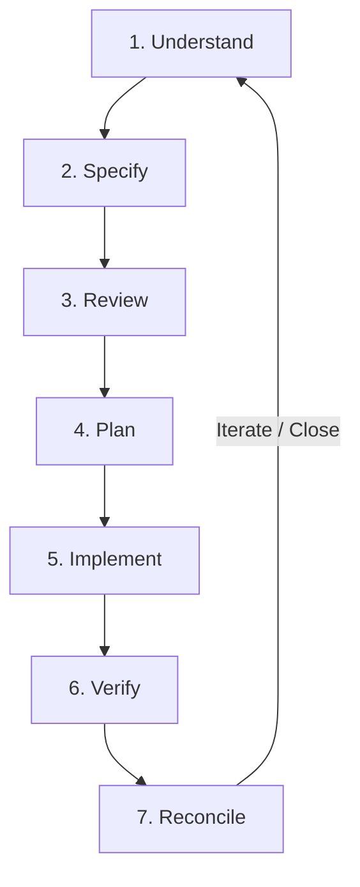

# Implementation Workflow Guidelines

This document details the standardized 7-step engineering workflow for delivering changes under Specification-Driven Development, along with specific operational instructions for AI agents.

---

## 1. The 7-Step SDD Workflow

The SDD lifecycle follows a rigorous loop designed to prevent architectural drift, ensure specification authority, and guarantee test-backed delivery:

### Step 1: Understand
- **Inputs**: User request, issue description, existing service code, tests, and configuration.
- **Activities**: Investigate the codebase according to the evidence hierarchy. Inspect source classes, annotations, database changelogs, and existing tests.
- **Roles**: Engineer / AI Agent.
- **Exit Criteria**: Problem is thoroughly understood; existing behavior is documented without speculative assumptions.

### Step 2: Specify
- **Inputs**: Findings from the Understand phase, existing specification files.
- **Activities**: Author or update requirements (`FR`), business rules (`BR`), API contracts, or data models in the appropriate `docs/sdd/services/<service>/` section files. Formulate testable Given/When/Then scenarios.
- **Roles**: Specification Author / AI Agent.
- **Exit Criteria**: Specification changes are fully drafted using standard templates and IDs.

### Step 3: Review
- **Inputs**: Drafted specification diff.
- **Activities**: Review specification against domain invariants, API compatibility rules, and downstream cross-service contracts. Identify risks, breaking changes, and migration needs.
- **Roles**: Peer Reviewer / Maintainer / Lead Agent.
- **Exit Criteria**: Specification changes are reviewed and approved.

### Step 4: Plan
- **Inputs**: Approved specification.
- **Activities**: Formulate the implementation plan: sequence of code changes, Liquibase migrations, DTO adjustments, and test cases.
- **Roles**: Implementer / AI Agent.
- **Exit Criteria**: Step-by-step task breakdown with clear verification checkpoints.

### Step 5: Implement
- **Inputs**: Implementation plan and approved specification.
- **Activities**: Implement production code, DTOs, controllers, repository methods, and configuration files to fulfill the specification.
- **Roles**: Implementer / AI Agent.
- **Exit Criteria**: Code compiles cleanly and adheres to project styling standards (Spotless, Checkstyle).

### Step 6: Verify
- **Inputs**: Implemented code and test suites.
- **Activities**: Execute unit tests, Spring Modulith verification tests, and Testcontainers integration tests (`./mvnw verify`). Confirm positive and negative Given/When/Then scenarios.
- **Roles**: Implementer / Test Runner / CI Pipeline.
- **Exit Criteria**: All tests pass cleanly (`0 failures, 0 errors`).

### Step 7: Reconcile
- **Inputs**: Passing test execution results, merged implementation.
- **Activities**: Update specification evidence statuses to `Verified` or `Implemented`. Ensure traceability matrix rows are linked to newly created source symbols and test methods. Bump specification version in service `README.md` and append change log entry.
- **Roles**: Specification Maintainer / AI Agent.
- **Exit Criteria**: Specification and code are in 100% synchronization within the pull request.

---

## 2. Instructions for AI Coding Agents

When interacting with this repository, AI agents must adhere to the following rules:

1. **Read Specification First**: Before writing, modifying, or refactoring code in any microservice, read the corresponding service specification under `docs/sdd/services/<service>/` to understand domain boundaries, business rules, and contract obligations.
2. **Consult Open Questions**: Review `open-questions.md` to avoid re-investigating known ambiguities or triggering documented suspected defects.
3. **No Unilateral Code Fixes**: If a bug or code defect is suspected, document it as an open question (`<SVC>-Q-<NNN>`) and an unapproved change proposal (`<SVC>-PROP-<NNN>`). Do not unilaterally rewrite application code without explicit user or maintainer approval.
4. **Preserve Compatibility**: Adhere to REST and Kafka compatibility standards outlined in `.github/copilot-instructions.md`.
5. **Atomic Commit & Reconcile**: Always deliver code changes, test additions, and specification updates in the exact same branch and commit/PR.
