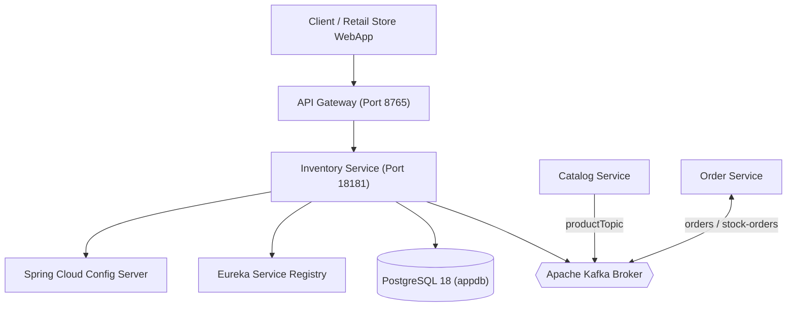
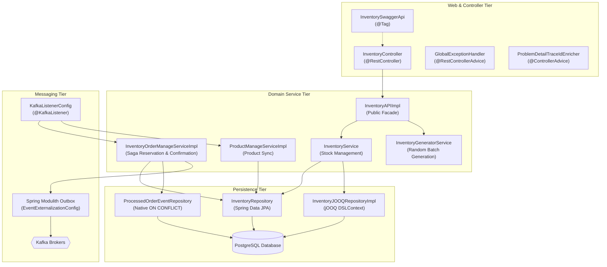

# Structural Architecture Specification: Inventory Service

- **Service**: `inventory-service` (`INV`)
- **Document Status**: `Approved`

---

## 1. Modular Structure & Spring Modulith Layout

`inventory-service` is organized as an explicit Spring Modulith module rooted at `com.example.inventoryservice.inventory`:

```
com.example.inventoryservice
├── InventoryServiceApplication.java      # Application bootstrap entry point
└── inventory/                             # Modulith logical module root
    ├── InventoryAPI.java                  # Public Module API interface
    ├── InventoryOrderManageService.java   # Public Order coordination interface
    ├── ProductManageService.java          # Public Product catalog management interface
    ├── ApplicationProperties.java         # Service configuration properties
    ├── package-info.java                  # Modulith package descriptor
    ├── config/                            # Module configuration beans
    │   ├── EventExternalizationConfig.java# Modulith outbox routing & Kafka converter
    │   ├── KafkaListenerConfig.java       # Inbound Kafka listeners & retry topics
    │   ├── RestTemplateConfig.java        # HTTP client configuration
    │   ├── SwaggerConfig.java             # OpenAPI documentation metadata
    │   └── WebMvcConfig.java              # MVC web configuration
    ├── domain/models/                     # Domain DTOs
    │   ├── InventoryRequest.java          # REST request record
    │   └── InventoryResponse.java         # REST response record
    ├── events/                            # Externalized domain events
    │   └── InventoryProcessedEvent.java   # Outbox order outcome event
    ├── exception/                         # Error handling & exceptions
    │   ├── GlobalExceptionHandler.java    # Controller advice for RFC 7807 ProblemDetail
    │   └── ProductAlreadyExistsException.java # Duplicate product code exception
    ├── utils/                             # Shared constants
    │   └── AppConstants.java              # Topic names, default paging, profiles
    └── web/                               # Internal implementation (package-private)
        ├── api/
        │   └── InventorySwaggerApi.java   # OpenAPI contract annotations
        ├── controllers/
        │   └── InventoryController.java   # REST controller adapter
        └── service/                       # Persistence, strategies & service logic
            ├── Inventory.java             # JPA Entity
            ├── InventoryAPIImpl.java      # Facade implementing InventoryAPI
            ├── InventoryGeneratorService.java # Random batch generator
            ├── InventoryJOOQRepository.java # jOOQ query interface
            ├── InventoryJOOQRepositoryImpl.java # jOOQ query implementation
            ├── InventoryMapper.java       # MapStruct entity/DTO mapper
            ├── InventoryOrderManageServiceImpl.java # Order reservation/confirmation
            ├── InventoryRepository.java   # Spring Data JPA repository (write-only)
            ├── InventoryRetryHandler.java # Custom retry & concurrency fallback handler
            ├── InventoryService.java      # Internal domain service (CQRS orchestrator)
            ├── ProcessedOrderEvent.java   # JPA Deduplication Entity
            ├── ProcessedOrderEventId.java # Composite Key
            ├── ProcessedOrderEventRepository.java # JPA Native Upsert Repository
            ├── ProductManageServiceImpl.java # Product catalog handler
            ├── OrderStockActionStrategy.java # Strategy interface
            ├── ConfirmedOrderStockActionStrategy.java # Strategy for CONFIRMED
            ├── RollbackOrderStockActionStrategy.java # Strategy for ROLLBACK
            └── Initializer.java           # Local profile seed runner
```

### Architectural Modularity Verification & CQRS Separation
- **CQRS Read/Write Separation**:
  - All read operations (single record queries, existence checks, paginated lookups, and batch queries) are executed via **jOOQ** (`InventoryJOOQRepositoryImpl`).
  - All write operations (insert, update, delete) are executed via **Spring Data JPA** (`InventoryRepository`).
  - Concurrent modification conflicts and optimistic lock issues are handled by `InventoryRetryHandler` with custom fallback retry logic.
- **Modularity Verification**:
  - Modularity rules are automatically verified using Spring Modulith test:
  - **Test Reference**: `inventory-service/src/test/java/com/example/inventoryservice/ModularityTests.java#verifiesModularStructure`
  - Enforces that internal sub-packages (`web.service`, `web.controllers`) are encapsulated and accessed only through designated module interfaces (`InventoryAPI`).

---

## 2. Technology Stack and POM Dependencies

- **Java Version**: `25`
- **Spring Boot**: `4.1.2`
- **Spring Cloud**: `2025.1.4`
- **Springdoc OpenAPI**: `3.2.0`
- **MapStruct**: `1.6.3`
- **Hypersistence Utils**: `hypersistence-utils-hibernate-73:3.16.0` (for `@Tsid`)
- **Shared Common Library**: `io.github.rajadilipkolli:microservices-common:0.1.5`
- **Code Quality**:
  - Spotless `3.11.0`
  - Maven Checkstyle Plugin `3.6.0` (using `build-config/checkstyle/checkstyle.xml`)
  - Sonar Maven Plugin `5.8.0.7211`
  - JaCoCo `0.8.16` (minimum coverage threshold: 80%)
- **GraalVM Native Reachability Hints**:
  - Configured in `inventory-service/src/main/resources/META-INF/native-image/com.example.inventoryservice/inventory-service-additional-hints/reachability-metadata.json`.

---

## 3. Architecture Diagrams

### 3.1 System Context Diagram
See standalone Mermaid file at [diagrams/context-diagram.md](diagrams/context-diagram.md).



### 3.2 Internal Component Architecture Diagram
See standalone Mermaid file at [diagrams/component-diagram.md](diagrams/component-diagram.md).


