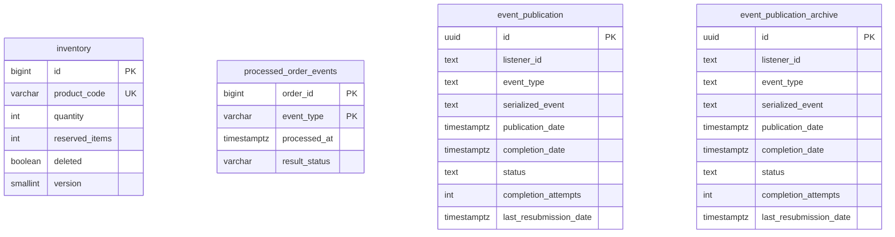

# Data Model and Persistence Specification: Inventory Service

- **Service**: `inventory-service` (`INV`)
- **Document Status**: `Approved`
- **Database Engine**: PostgreSQL 18
- **Schema Management**: Liquibase (`db.changelog-master.yaml` with JSON/SQL changelogs)

---

## 1. Relational Database Tables

The service maintains four tables in the database:

### 1.1 Table: `inventory`
- **Purpose**: Core entity store for product stock levels and soft-deletion flags.
- **Primary Key**: `id` (`BIGINT`) - Generated via Hypersistence TSID (no DB sequence/identity).
- **Unique Constraint**: `inventory_product_code_key` on column `product_code`.

| Column | Type | Nullable | Default | Constraints / Purpose |
| :--- | :--- | :--- | :--- | :--- |
| `id` | `BIGINT` | No | None | Primary Key (`inventory_pkey`). |
| `product_code` | `VARCHAR(255)` / `TEXT` | No | None | Unique business identifier. |
| `quantity` | `INTEGER` | Yes | `0` | Unreserved stock quantity. |
| `reserved_items` | `INTEGER` | Yes | `0` | Stock currently reserved by orders. |
| `deleted` | `BOOLEAN` | No | `false` | Soft-deletion indicator. |
| `version` | `SMALLINT` | Yes | `0` | JPA `@Version` optimistic locking. |

> [!NOTE]
> **No Foreign Keys & No Database ID Generation**: The `inventory` table has no foreign keys to external tables. TSID generation occurs entirely inside the application runtime (`TsidFactorySupplier`). Version increments are managed solely by JPA Hibernate, not by DB triggers.

---

### 1.2 Table: `processed_order_events`
- **Purpose**: Idempotency and deduplication ledger for order saga commands and replies.
- **Composite Primary Key**: `(order_id, event_type)`

| Column | Type | Nullable | Default | Purpose |
| :--- | :--- | :--- | :--- | :--- |
| `order_id` | `BIGINT` | No | None | Order identifier. |
| `event_type` | `VARCHAR(100)` | No | None | Deduplication marker (`RESERVE`, `CONFIRM_<status>`, `RESERVE_REPLY:<attemptId>`). |
| `processed_at` | `TIMESTAMP WITH TIME ZONE` | No | None | Timestamp of event claim. |
| `result_status` | `VARCHAR(50)` | Yes | None | Stored outcome (`ACCEPT`, `REJECT`). |

---

### 1.3 Table: `event_publication`
- **Purpose**: Spring Modulith Transactional Outbox table for unpublished or pending events.
- **Primary Key**: `id` (`UUID`)

| Column | Type | Nullable | Purpose |
| :--- | :--- | :--- | :--- |
| `id` | `UUID` | No | Primary Key. |
| `listener_id` | `TEXT` | No | Event listener or routing target identifier. |
| `event_type` | `TEXT` | No | Fully qualified event class name. |
| `serialized_event` | `TEXT` | No | JSON payload of the event. |
| `publication_date` | `TIMESTAMP WITH TIME ZONE` | No | Initial publication timestamp. |
| `completion_date` | `TIMESTAMP WITH TIME ZONE` | Yes | Timestamp when publication finished. |
| `status` | `TEXT` | Yes | Publication status. |
| `completion_attempts`| `INT` | Yes | Number of dispatch attempts. |
| `last_resubmission_date`| `TIMESTAMP WITH TIME ZONE`| Yes | Last retry timestamp. |

**Indexes**:
- `event_publication_serialized_event_hash_idx` USING hash (`serialized_event`)
- `event_publication_by_completion_date_idx` (`completion_date`)

---

### 1.4 Table: `event_publication_archive`
- **Purpose**: Spring Modulith archive table storing completed outbox events (`completion-mode: archive`).
- **Schema & Indexes**: Identical to `event_publication`.

---

## 2. Liquibase Migration Changelog History

- **Master Changelog**: `inventory-service/src/main/resources/db/changelog/db.changelog-master.yaml`
- Includes all files under `migration/` using `includeAll: { path: "migration/", relativeToChangelogFile: true }`.

| Changelog File | Changeset ID | Author | Content / Operations | Rollback Status |
| :--- | :--- | :--- | :--- | :--- |
| `01-create_inventories_table.json` | `create_inventory_table` | `rajakolli` | Creates `inventory` table with `id`, `product_code`, `quantity`, `reserved_items`, `version`. Adds unique constraint `inventory_product_code_key`. | None |
| `02-insert-sample-inventory.json` | `insert-sample-inventory` | `system` | Context `sample-data`. Inserts seed records: `P001` (qty: 50000, res: 5), `P002` (qty: 10000, res: 0), `P003` (qty: 50, res: 2), `P004` (qty: 40, res: 1), `P005` (qty: 50000, res: 10). | None |
| `03-create-event_publication.sql` | `03-create-event_publication` | N/A | SQL script creating `event_publication` table and 2 indexes. | None |
| `04-create-event_publication_archive.sql` | `04-create-event_publication_archive` | N/A | SQL script creating `event_publication_archive` table and 2 indexes. | None |
| `05-create-processed-order-events.sql` | `05-create-processed-order-events` | N/A | Creates `processed_order_events` with PK `(order_id, event_type)`. | None |
| `06-add-inventory-deleted-column.json` | `06-add-inventory-deleted-column` | `rajakolli` | Adds `deleted BOOLEAN NOT NULL DEFAULT false` to `inventory`. | **Supported**: Drops column `deleted`. |
| `07-add-result-status-to-processed-order-events.sql` | `07-add-result-status-to-processed-order-events` | `raja` | Adds `result_status VARCHAR(50)` to `processed_order_events`. Alters `event_type` to `VARCHAR(100)`. | **Supported**: Drops `result_status`, reverts `event_type` to 50. |

### Local Seeding via `Initializer.java`
Under profile `local`, if `inventoryRepository.count() == 0`, `Initializer.java` runs on startup and inserts 100 sample records (`Product0` to `Product99` with random quantities up to 1000).

---

## 3. Transaction Boundaries and Concurrency Details

<!-- coderabbit-ai-generated:v1 -->

<!-- coderabbit-ai-generated-section:v1:f0b1e248c24a55d48c4bc042f73ab647ca74562ba2f693671997f230261cc89c -->

- **Class-Level Annotations**: `InventoryService` declares `@Transactional(propagation = Propagation.SUPPORTS, readOnly = true)`. Retried write entry points delegate to `InventoryRetryHandler` for a fresh `REQUIRES_NEW` transaction per attempt.

<!-- /coderabbit-ai-generated:v1 -->
- **Atomic Deduplication**: `ProcessedOrderEventRepository#claim` uses native `INSERT ... ON CONFLICT (order_id, event_type) DO NOTHING`, returning 1 on insertion and 0 on conflict.
- **Check-Then-Delete Non-Atomicity**: `InventoryController#deleteInventory` invokes `existsInventoryById(id)` followed by `deleteInventoryById(id)` in two distinct transactions. A concurrent delete can cause the second step to be a no-op.
- **Query / Count Separation**: Paged retrieval in `InventoryJOOQRepositoryImpl` executes two separate queries: a filtered data query with `limit`/`offset`, and a separate `fetchCount` query.

---

## 4. Entity-Relationship (ER) Diagram

See standalone Mermaid file at [diagrams/er-diagram.md](diagrams/er-diagram.md).

### Optimistic-lock retries
`InventoryRetryHandler` wraps each complete write operation in a programmatic `REQUIRES_NEW` transaction. The retry loop surrounds transaction completion, so flush and commit conflicts roll back before another attempt rereads inventory. Order claims, stock changes, result markers and outbox publication share the attempt transaction. <!-- coderabbit-ai-generated:v1 -->

<!-- coderabbit-ai-generated-section:v1:9253011dd0272dfc325c30a57cd5df70680b2303bcd119f775cfdee9c8ed94f3 -->

`InventoryService#saveWithCustomFallback` delegates directly to `inventoryRepository.save(inventory)`; it neither retries nor refreshes the version. Retries are handled by `InventoryRetryHandler`. Duplicate-create integrity failures are classified by the caller only after the retry transaction has ended, including flush or commit failures. Deletion failures propagate.

`InventoryGeneratorService` invokes a separate retry-wrapped transaction for each item through `updateInventoryByProductCode`; the batch is not one transaction. If a later item fails with a non-optimistic runtime exception, earlier item updates remain committed, processing stops, and the generation key is removed to allow retry. Exhausted optimistic-lock failures are ignored per item.

<!-- /coderabbit-ai-generated:v1 -->
