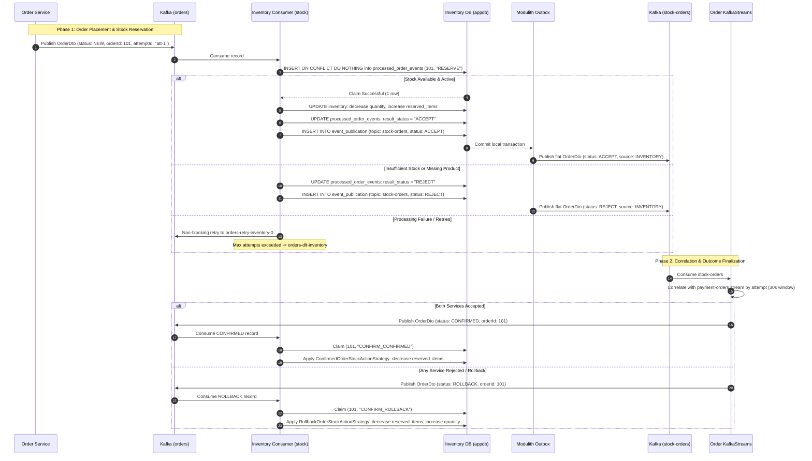

# Saga Sequence Diagram: Inventory Service

This diagram illustrates the two-phase distributed reservation saga between `order-service`, `inventory-service`, and `payment-service` mediated via Apache Kafka. Correct runtime topic names (`orders`, `stock-orders`, `-retry-inventory`, `-dlt-inventory`) are used.

