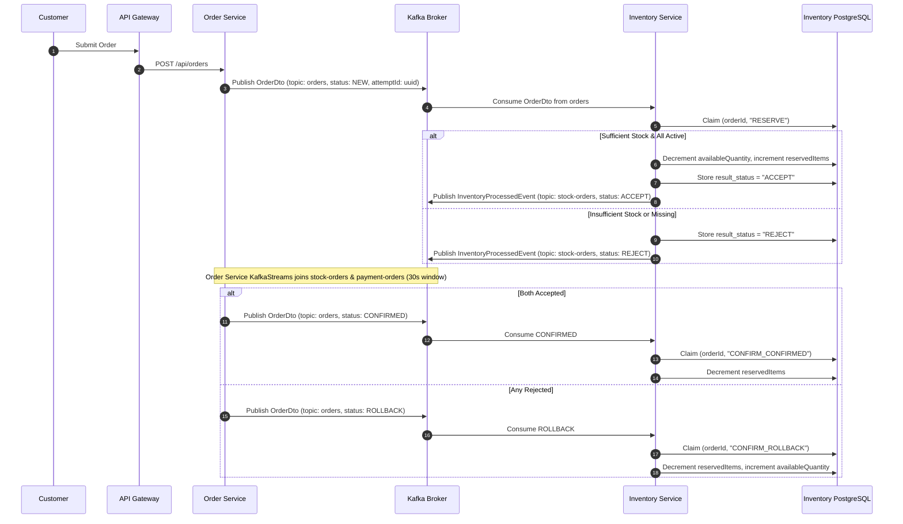
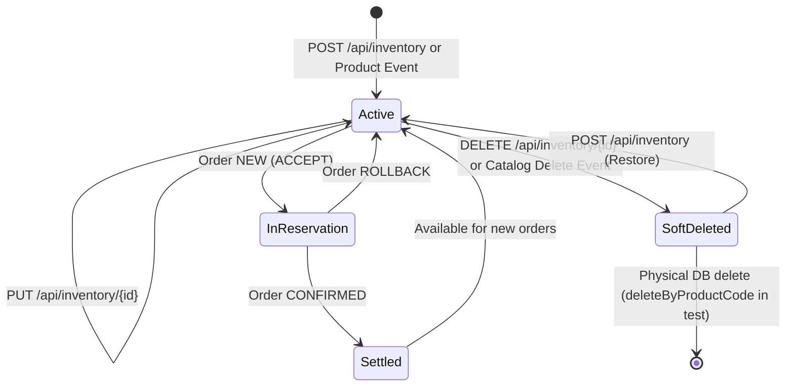

# Workflows and Sagas Specification: Inventory Service

- **Service**: `inventory-service` (`INV`)
- **Document Status**: `Approved`

This document specifies the end-to-end workflows, distributed sagas, state machines, and compensation sequences implemented in `inventory-service`.

---

## 1. Core Workflows

### 1.1 Order Stock Reservation Workflow
- **Trigger**: Kafka consumer receives message on topic `orders` with `status = "NEW"`.
- **Transaction Boundary**: Single local database transaction (`@Transactional`) inside `InventoryOrderManageServiceImpl#reserve`.
- **Deduplication**: Atomic claim on `(orderId, "RESERVE")`.

#### Workflow Steps:
1. **Status Check**: Verify `orderDto.status().equals("NEW")`. If not `NEW`, ignore.
2. **Duplicate Detection**:
   - For non-null `orderId`, attempt to claim `(orderId, "RESERVE")`.
   - If claim returns 0 (already processed):
     - Check `orderDto.attemptId()`. If non-blank and not yet claimed in `RESERVE_REPLY:<attemptId>`, query stored `result_status` from `processed_order_events`, claim `RESERVE_REPLY:<attemptId>`, publish event with stored outcome, and return.
     - Otherwise, return immediately without stock updates or event publication.
3. **Product Validation**:
   - Query active records matching line items via `inventoryRepository.findByProductCodeInAndDeletedFalse(productCodes)`.
   - Rejection checks:
     - Are any requested product codes missing from active records?
     - Are there duplicate product codes in the order item list?
     - Does any item request a quantity greater than available stock ($quantity > availableQuantity$)?
4. **Outcome Execution**:
   - **If Rejected**:
     - No stock quantities change.
     - If `orderId` is non-null, update `processed_order_events` setting `result_status = "REJECT"`.
     - Increment `inventory_failures` counter.
     - Publish `InventoryProcessedEvent` with `status: "REJECT"`, `source: "INVENTORY"`.
   - **If Accepted**:
     - For each line item: decrease `availableQuantity`, increase `reservedItems`.
     - Save updated inventories via `inventoryRepository.saveAll`.
     - If `orderId` is non-null, update `processed_order_events` setting `result_status = "ACCEPT"`.
     - Increment `inventory_reservations` counter.
     - Publish `InventoryProcessedEvent` with `status: "ACCEPT"`, `source: "INVENTORY"`.
5. **Reply Claim**: If `orderId` and `attemptId` are valid, claim `RESERVE_REPLY:<attemptId>` to ensure at-most-once reply publication per attempt.

---

### 1.2 Order Confirmation & Rollback Workflow
- **Trigger**: Kafka consumer receives message on topic `orders` with `status != "NEW"`.
- **Transaction Boundary**: Single local database transaction (`@Transactional`) in `InventoryOrderManageServiceImpl#confirm`.
- **Strategies**:
  - `ConfirmedOrderStockActionStrategy`: Matches `status = "CONFIRMED"`. Decreases `reservedItems` by ordered quantity.
  - `RollbackOrderStockActionStrategy`: Matches `status = "ROLLBACK"` and `source != "INVENTORY"`. Moves ordered quantity from `reservedItems` back to `availableQuantity`.

#### Invariants & Edge Cases:
- **Missing Products Skipped**: If an ordered product is missing from the database, it is safely ignored.
- **Deleted Products Included**: Confirmation and rollback query `findByProductCodeIn` without filtering `deleted = false`. This ensures reservations for products soft-deleted during the saga still complete or release cleanly.
- **Source Filter**: If `orderDto.source()` is `"INVENTORY"`, the rollback strategy evaluates to false and does nothing. This prevents Inventory Service from rolling back its own reservations if an event loops back.
- **Duplicate Suppression**: Claims `(orderId, "CONFIRM_" + orderDto.status())`. If already claimed, skips processing.

---

### 1.3 Product Catalog Synchronization Workflow
- **Trigger**: Kafka consumer receives message on topic `productTopic`.
- **Handler**: `ProductManageServiceImpl#manage(ProductDto)`.

#### Workflow Steps:
1. **Catalog Deletion (`isDeleted = true`)**:
   - If matching inventory exists and is active, set `deleted = true` and save.
   - If matching inventory is already soft-deleted or missing, do nothing.
2. **Catalog Creation (`isDeleted = false`)**:
   - Check if inventory exists for `productCode` (including soft-deleted).
   - If present, do nothing (existing records are never overwritten).
   - If absent, create new `Inventory` with `quantity = 0`, `reserved_items = 0`, `deleted = false`.
   - Catch `DataIntegrityViolationException`: If another thread or pod created it concurrently, verify existence and swallow the conflict to maintain idempotency.

---

### 1.4 Active $\rightarrow$ Deleted $\rightarrow$ Restored Lifecycle Workflow
- **Initial State**: Record created via `POST /api/inventory` or catalog event $\rightarrow$ `deleted = false`.
- **Deletion**: User calls `DELETE /api/inventory/{id}` $\rightarrow$ `deleted = true`. Quantities remain in database.
- **Restoration**: User calls `POST /api/inventory` with existing product code $\rightarrow$ `saveInventory` detects soft-deleted record, sets `availableQuantity` to request quantity, sets `deleted = false`, and preserves original `id` and `reserved_items`.

---

## 2. Distributed Saga Sequence Diagrams

### 2.1 Order Checkout Reservation & Confirmation Saga
See standalone Mermaid diagram at [diagrams/saga-sequence-diagram.md](diagrams/saga-sequence-diagram.md).

---

## 3. Lifecycle State Diagrams

### 3.1 Inventory Record State Lifecycle
See standalone Mermaid diagram at [diagrams/state-diagram.md](diagrams/state-diagram.md).

