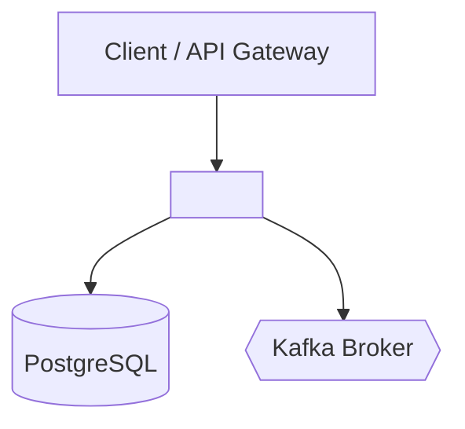
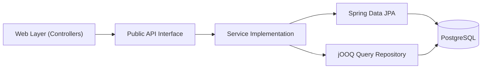

# Structural Architecture Specification

- **Service**: `<service-name>` (`<SVC>`)
- **Document Status**: `Draft` | `Approved`

---

## 1. Modular Architecture & Package Layout *(Mandatory)*

This service is structured as a Spring Modulith modular service:
- Root application package: `com.example.<service>`
- Internal modules and sub-packages enforce logical domain boundaries and package-private visibility.

### Verification of Modularity
- Enforced via Spring Modulith test: `<repo-relative-path>#ModularityTests` (`ApplicationModules.of(...).verify()`).

---

## 2. Component Responsibilities *(Mandatory)*

| Component | Stereotype | Primary Responsibility |
| :--- | :--- | :--- |
| `[Name]Controller` | `@RestController` | HTTP endpoint adapter, input validation, status mapping. |
| `[Name]Service` | `@Service` | Core business transactions, domain rule enforcement. |
| `[Name]Repository` | `@Repository` / JPA | Spring Data JPA entity persistence and query methods. |
| `[Name]JOOQRepository` | `@Repository` / jOOQ | Type-safe complex queries, pagination, count queries. |
| `KafkaListenerConfig` | `@Configuration` | Kafka message consumer listeners, topic retry routing. |

---

## 3. Technology Stack & Dependencies *(Mandatory)*

- **Java Version**: 25
- **Spring Boot**: 4.1.2
- **Spring Cloud**: 2025.1.4
- **Persistence**: Spring Data JPA, Hibernate 7, jOOQ, Liquibase
- **Messaging**: Spring Kafka, Spring Modulith Events
- **Observability**: Micrometer Tracing, OpenTelemetry, Prometheus

---

## 4. Architecture Diagrams *(Mandatory)*

### 4.1 System Context Diagram
See [diagrams/context-diagram.md](../diagrams/context-diagram.md).

### 4.2 Component Architecture Diagram
See [diagrams/component-diagram.md](../diagrams/component-diagram.md).

