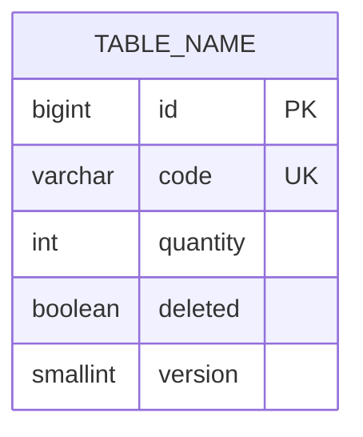

# Data Model and Persistence Specification

- **Service**: `<service-name>` (`<SVC>`)
- **Document Status**: `Draft` | `Approved`
- **Database Engine**: PostgreSQL
- **Migration Framework**: Liquibase

---

## 1. Database Tables and Schemas *(Mandatory)*

### 1.1 Table: `[table_name]`
- **Purpose**: Primary persistence store for [Domain Concept].
- **Primary Key**: `id`
- **Natural Key / Unique Constraints**: `unique_column`
- **Soft Deletion**: Supported via `deleted` boolean column.

| Column Name | Data Type | Nullable | Default | Constraints / Indexes |
| :--- | :--- | :--- | :--- | :--- |
| `id` | `BIGINT` | No | None | Primary Key |
| `code` | `VARCHAR(255)` / `TEXT` | No | None | Unique constraint |
| `quantity` | `INTEGER` | Yes | `0` | Default 0 |
| `deleted` | `BOOLEAN` | No | `false` | Soft-deletion indicator |
| `version` | `SMALLINT` | Yes | `0` | Optimistic lock version |

---

## 2. Liquibase Migration Changelog History *(Mandatory)*

- **Master Changelog**: `<repo-relative-path>/db.changelog-master.yaml`

| Changelog File | Changeset ID | Author | Description | Rollback Supported |
| :--- | :--- | :--- | :--- | :--- |
| `01-create_table.json` | `create_table` | developer | Initial table creation | No |
| `02-insert-sample.json` | `insert-sample` | system | Sample seed data (`sample-data` context) | No |

---

## 3. Transaction Boundaries & Concurrency Semantics *(Mandatory)*
- **Default Isolation / Propagation**: `@Transactional(propagation = Propagation.SUPPORTS, readOnly = true)` on services; write operations declare `@Transactional`.
- **Optimistic Locking**: Enforced at the JPA layer via `@Version`. Database level does not enforce version incrementing for direct SQL updates.
- **Idempotency Claims**: Atomic deduplication via native queries such as `INSERT INTO ... ON CONFLICT DO NOTHING`.
- **Query Separation**: Paginated endpoints perform separate content queries and count queries.

---

## 4. Entity-Relationship (ER) Diagram *(Mandatory)*

See the complete diagram at [diagrams/er-diagram.md](../diagrams/er-diagram.md).

