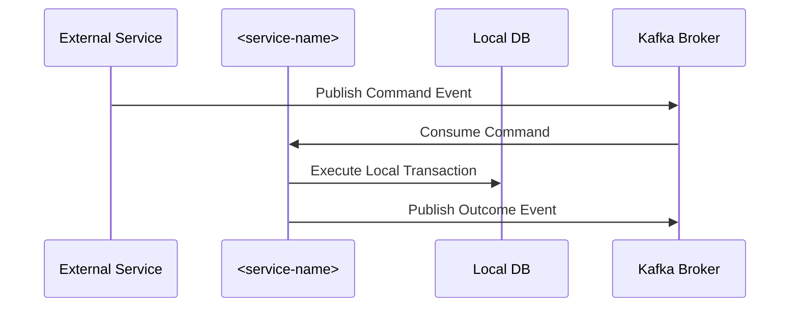
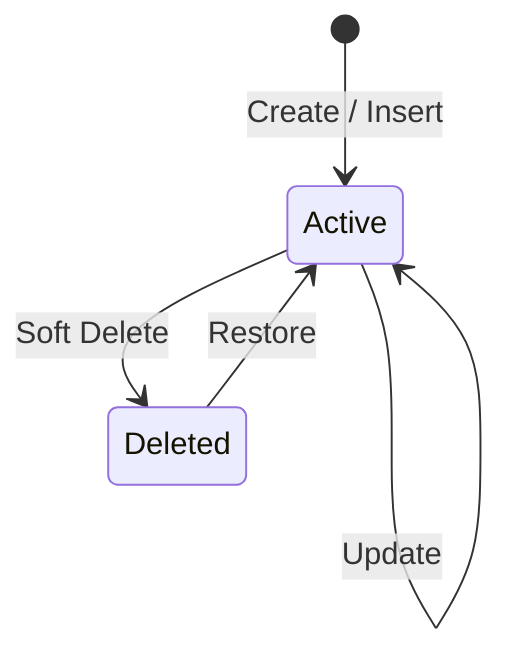

# Workflows and Sagas Specification

- **Service**: `<service-name>` (`<SVC>`)
- **Document Status**: `Draft` | `Approved`

This document details the multi-step business processes, distributed transactions (sagas), and state machines implemented by `<service-name>`.

---

## 1. Core Business Workflows *(Mandatory)*

### 1.1 Workflow: `[Workflow Name]`
- **Initiator / Trigger**: Inbound REST request / Kafka event.
- **Transaction Boundary**: Single local database transaction (`@Transactional`).
- **Idempotency Strategy**: Deduplication via tracking table or idempotency header.

#### Preconditions
- [Precondition 1]
- [Precondition 2]

#### Execution Steps
1. **Validation**: Check incoming request or event parameters.
2. **State Evaluation**: Query persistent store to verify current state.
3. **Execution**: Apply business mutations and state transitions.
4. **Publication**: Emit internal or external domain events.

#### Postconditions & Failure Behavior
- **Success Outcome**: Database updated, reply event published.
- **Business Failure Outcome**: Error status assigned, compensation event emitted.
- **Technical Failure**: Transaction rolled back; message retry initiated via Kafka `@RetryableTopic`.

---

## 2. Distributed Saga Participation *(Mandatory)*

Document distributed sagas involving this service and external collaborators.

### Sequence Diagram
See [diagrams/saga-sequence-diagram.md](../diagrams/saga-sequence-diagram.md).

---

## 3. Entity Lifecycle State Machines *(Mandatory)*

See [diagrams/state-diagram.md](../diagrams/state-diagram.md).

