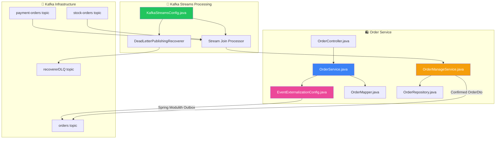
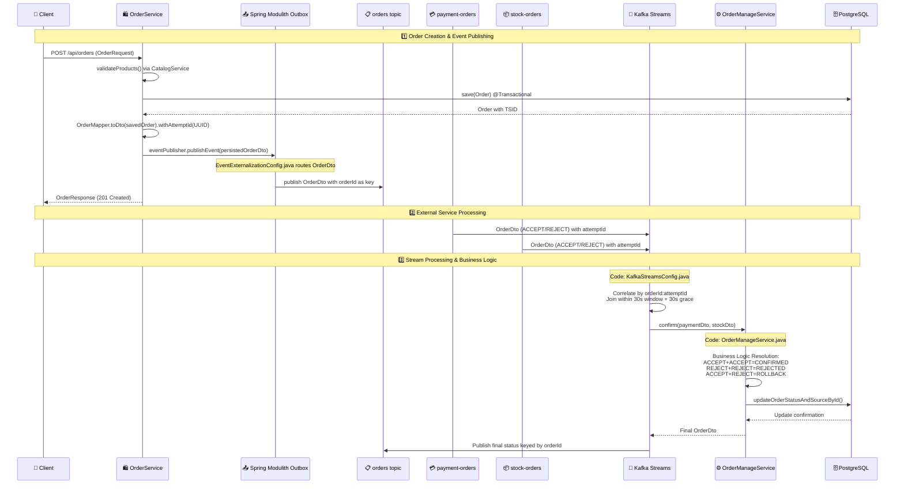
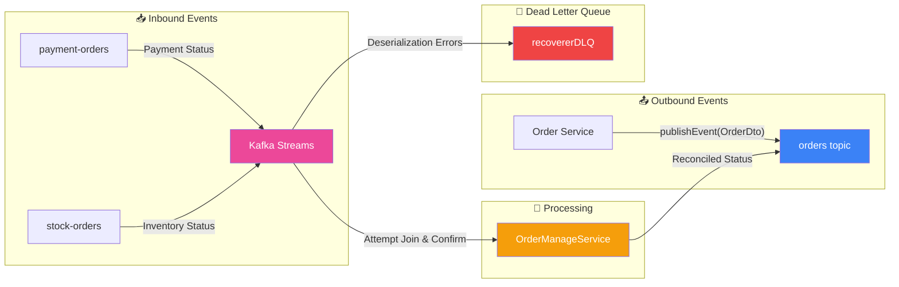

# 📡 Event-Driven Architecture Deep Dive

## Overview
The Order Service implements a sophisticated event-driven architecture using Apache Kafka for asynchronous communication, stream processing, and distributed transaction management.

## 🎯 Table of Contents
1. [Architecture Components](#architecture-components)
2. [Event Flow Sequence](#event-flow-sequence)
3. [Code Implementation Mapping](#code-implementation-mapping)
4. [Topic Configuration & Usage](#topic-configuration-usage)
5. [Configuration Deep Dive](#configuration-deep-dive)
6. [Performance Characteristics](#performance-characteristics)

> 📚 **For comprehensive Kafka Streams concepts, configurations, and best practices, see:** [**02-Kafka-Streams-Deep-Dive.md**](./02-Kafka-Streams-Deep-Dive.md)
> 
> 📊 **For detailed data flow analysis, sample data structures, and storage mechanisms, see:** [**03-Kafka-Streams-Data-Flow-Analysis.md**](./03-Kafka-Streams-Data-Flow-Analysis.md)

---

## 🏗️ Architecture Components



## 🔄 Event Flow Sequence



## 📋 Code Implementation Mapping

### 1. Spring Modulith Outbox Event Externalization
**File:** `EventExternalizationConfig.java`
```java
@Configuration(proxyBeanMethods = false)
class EventExternalizationConfig {

    @Bean
    EventExternalizationConfiguration eventExternalizationConfiguration() {
        return EventExternalizationConfiguration.externalizing()
                .selectByType(OrderDto.class)
                .route(
                        OrderDto.class,
                        it ->
                                RoutingTarget.forTarget(ORDERS_TOPIC)
                                        .andKey(String.valueOf(it.orderId())))
                .build();
    }
}
```

**Integration Point:** Called from `OrderService.persistOrder()`:
```java
OrderDto persistedOrderDto =
        this.orderMapper.toDto(savedOrder).withAttemptId(UUID.randomUUID().toString());
eventPublisher.publishEvent(persistedOrderDto);
```

### 2. Kafka Streams Topology Configuration
**File:** `KafkaStreamsConfig.java`
```java
@Bean
KStream<String, OrderDto> stream(
        StreamsBuilder kafkaStreamBuilder, Serde<@NonNull OrderDto> orderSerde) {

    KStream<String, OrderDto> paymentStream =
            kafkaStreamBuilder.stream(
                    PAYMENT_ORDERS_TOPIC, Consumed.with(Serdes.String(), orderSerde));

    correlateByAttempt(paymentStream)
            .join(
                    correlateByAttempt(
                            kafkaStreamBuilder.stream(
                                    STOCK_ORDERS_TOPIC,
                                    Consumed.with(Serdes.String(), orderSerde))),
                    orderManageService::confirm,
                    JoinWindows.ofTimeDifferenceAndGrace(
                            Duration.ofSeconds(30), Duration.ofSeconds(30)),
                    StreamJoined.with(Serdes.String(), orderSerde, orderSerde))
            .filter((key, order) -> order != null)
            .selectKey((key, order) -> order.orderId().toString())
            .peek((k, o) -> log.debug("Output of Stream : {} for key :{}", o, k))
            .to(ORDERS_TOPIC, Produced.with(Serdes.String(), orderSerde));

    paymentStream.print(Printed.toSysOut());

    return paymentStream;
}

private KStream<String, OrderDto> correlateByAttempt(KStream<String, OrderDto> stream) {
    return stream.filter(
                    (key, order) ->
                            order != null
                                    && order.orderId() != null
                                    && order.attemptId() != null
                                    && !order.attemptId().isBlank())
            .selectKey((key, order) -> order.orderId() + ":" + order.attemptId());
}
```

**Key Configuration Features:**
- **Correlation by Attempt:** Keyed by `orderId:attemptId` to ensure retried attempts do not collide with stale responses.
- **Windowing:** 30-second time difference with a 30-second grace period (`JoinWindows.ofTimeDifferenceAndGrace`).
- **Exactly-Once Processing:** `EXACTLY_ONCE_V2` guarantee.
- **Error Handling:** `RecoveringDeserializationExceptionHandler` routing poison pills to `recovererDLQ`.
- **Serde:** `JacksonJsonSerde<>(OrderDto.class).noTypeInfo()` and `Serdes.String()`.

### 3. Business Logic Resolution
**File:** `OrderManageService.java`
```java
public @Nullable OrderDto confirm(OrderDto orderPayment, OrderDto orderStock) {
    if (orderPayment.orderId() == null
            || !Objects.equals(orderPayment.orderId(), orderStock.orderId())
            || orderPayment.attemptId() == null
            || orderPayment.attemptId().isBlank()
            || !Objects.equals(orderPayment.attemptId(), orderStock.attemptId())) {
        throw new IllegalArgumentException("Order responses must belong to the same attempt");
    }
    OrderDto orderDto = getOrderDto(orderPayment, orderStock);
    int rows = this.orderRepository.updateOrderStatusAndSourceById(
            orderDto.orderId(),
            OrderStatus.valueOf(orderDto.status()),
            orderDto.source());
    if (rows == 0) {
        var persisted = orderRepository.findById(orderDto.orderId())
                .orElseThrow(() -> new OrderNotFoundException(orderDto.orderId()));
        if (persisted.isTerminal()) {
            return null;
        }
        return orderDto.withStatusAndSource(persisted.getStatus().name(), persisted.getSource());
    }
    if ("CONFIRMED".equals(orderDto.status())) {
        this.ordersCompletedCounter.increment();
    } else if ("REJECTED".equals(orderDto.status()) || AppConstants.ROLLBACK.equals(orderDto.status())) {
        this.ordersFailedCounter.increment();
    }
    return orderDto;
}
```

### 4. Dead Letter Queue & Error Handling
**File:** `KafkaStreamsConfig.java`
```java
@Bean
DeadLetterPublishingRecoverer deadLetterPublishingRecoverer(KafkaProperties properties) {
    Map<String, Object> props = properties.buildProducerProperties();
    props.put(ProducerConfig.KEY_SERIALIZER_CLASS_CONFIG, ByteArraySerializer.class);
    props.put(ProducerConfig.VALUE_SERIALIZER_CLASS_CONFIG, ByteArraySerializer.class);

    DefaultKafkaProducerFactory<byte[], byte[]> factory =
            new DefaultKafkaProducerFactory<>(props);

    return new DeadLetterPublishingRecoverer(
            new KafkaTemplate<>(factory),
            (record, ex) -> new TopicPartition(RECOVER_DLQ_TOPIC, -1));
}
```

## 🎯 Topic Configuration & Usage

### Topic Definitions
**File:** `AppConstants.java`
```java
public static final String ORDERS_TOPIC = "orders";
public static final String PAYMENT_ORDERS_TOPIC = "payment-orders";
public static final String STOCK_ORDERS_TOPIC = "stock-orders";
public static final String RECOVER_DLQ_TOPIC = "recovererDLQ";
```

### Message Flow Pattern


## 🔧 Configuration Deep Dive

### Stream Processing Configuration
**File:** `KafkaStreamsConfig.java`
```java
streamsConfiguration.put(
        StreamsConfig.DESERIALIZATION_EXCEPTION_HANDLER_CLASS_CONFIG,
        RecoveringDeserializationExceptionHandler.class.getName());
streamsConfiguration.put(
        RecoveringDeserializationExceptionHandler.RECOVERER,
        deadLetterPublishingRecoverer);

streamsConfiguration.put(StreamsConfig.REQUEST_TIMEOUT_MS_CONFIG, "60000");
streamsConfiguration.put(StreamsConfig.COMMIT_INTERVAL_MS_CONFIG, "1000");
streamsConfiguration.put(
        StreamsConfig.PROCESSING_GUARANTEE_CONFIG, StreamsConfig.EXACTLY_ONCE_V2);
streamsConfiguration.put(
        StreamsConfig.STATESTORE_CACHE_MAX_BYTES_CONFIG, "10485760"); // 10MB
streamsConfiguration.put(StreamsConfig.METRICS_RECORDING_LEVEL_CONFIG, "INFO");
```

## 📊 Performance Characteristics

### Throughput & Resilience Metrics
- **Message Processing:** ~1000 messages/second per thread
- **Join Window:** 30-second time difference with 30-second grace period for late arrivals
- **Attempt Correlation:** Re-attempts keyed with distinct UUID attempt IDs to avoid stale join conflicts
- **State Store Cache:** 10MB for rocksdb memory caching
- **Commit Interval:** 1000ms configured in `KafkaStreamsConfig` for balancing durability and throughput
- **Processing Guarantee:** `exactly_once_v2` ensuring zero duplicate order decisions

This event-driven architecture provides robust, scalable message processing with transactional consistency guarantees across Order, Payment, and Inventory microservices.