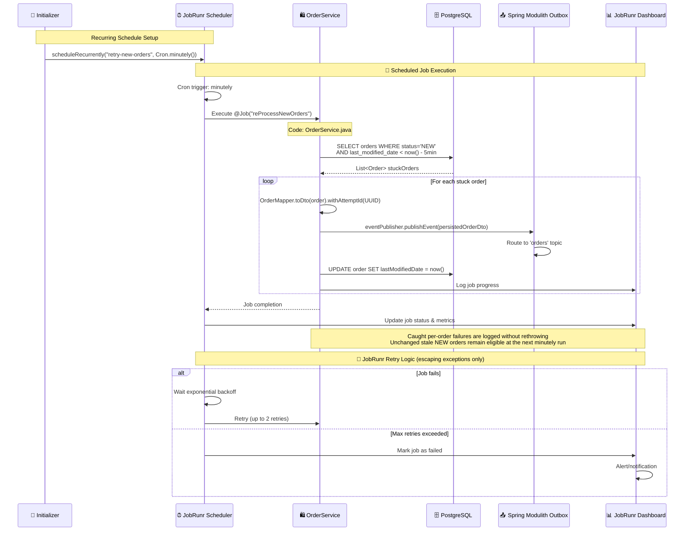
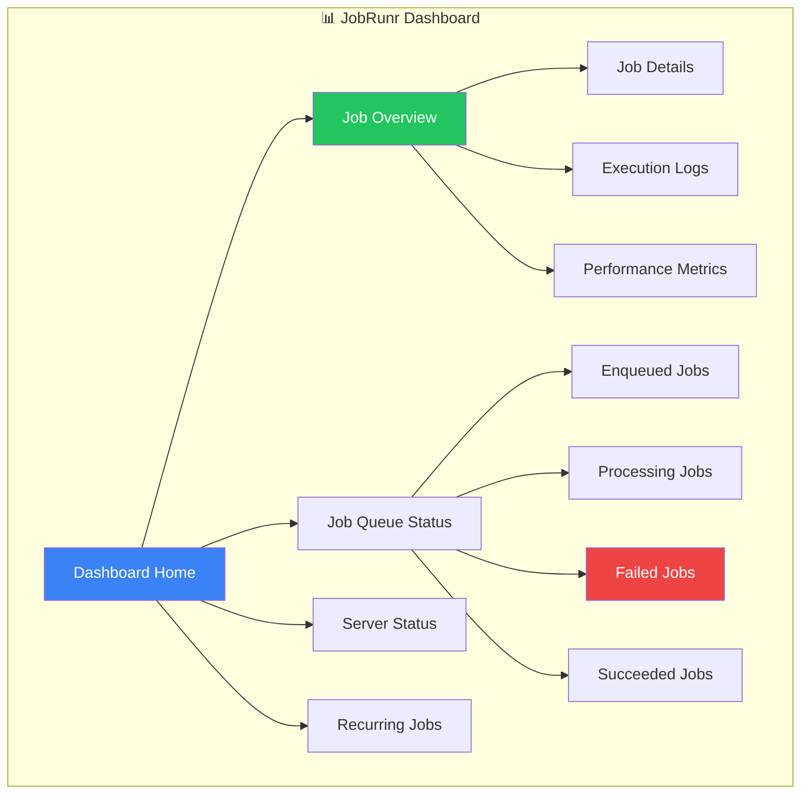

# ⏰ Background Processing with JobRunr Deep Dive

## Overview
The Order Service uses JobRunr for reliable background job processing, focusing on retry mechanisms for stuck orders and scheduled maintenance tasks.

## 🏗️ JobRunr Architecture

```mermaid
graph TB
    subgraph "🛍️ Order Service"
        OS[OrderService] --> |"@Job Annotation"| JR[JobRunr Engine]
        OS --> |"Query Stuck Orders"| DB[(PostgreSQL)]
    end
    
    subgraph "⏰ JobRunr Infrastructure"
        JR --> JS[Job Scheduler]
        JR --> JE[Job Executor]
        JR --> JM[Job Monitor]
        JS --> |"Cron.minutely()"| RT[Retry Task]
        JE --> |"Process Jobs"| JQ[Job Queue]
        JM --> |"Web UI :28282"| WUI[Dashboard]
    end
    
    subgraph "📡 Integration Points"
        RT --> |"Spring Modulith Outbox"| KP[Kafka 'orders' Topic]
        JQ --> |"Update Status & Date"| DB
        WUI --> |"Monitor Jobs"| DEV[Developer]
    end
    
    style JR fill:#ec4899,color:#ffffff
    style RT fill:#f59e0b,color:#ffffff
    style WUI fill:#22c55e,color:#ffffff
```

## 🔄 Job Processing Flow



## 📋 Code Implementation Mapping

### 1. Job Definition & Scheduling
**File:** `Initializer.java`
```java
@Component
class Initializer implements CommandLineRunner {

    private final OrderService orderService;

    public Initializer(OrderService orderService) {
        this.orderService = orderService;
    }

    @Override
    public void run(String... args) {
        BackgroundJob.scheduleRecurrently(
                "retry-new-orders", Cron.minutely(), orderService::retryNewOrders);
    }
}
```

**File:** `OrderService.java`
```java
@Job(name = "reProcessNewOrders", retries = 2)
@Transactional
public void retryNewOrders() {
    // Query orders stuck in NEW status with last modified date older than 5 minutes
    List<Order> byStatusOrderByIdAsc =
            orderRepository.findByStatusAndLastModifiedDateLessThanOrderByIdAsc(
                    OrderStatus.NEW, LocalDateTime.now().minusMinutes(5));

    byStatusOrderByIdAsc.forEach(
            order -> {
                try {
                    OrderDto persistedOrderDto =
                            this.orderMapper
                                    .toDto(order)
                                    .withAttemptId(UUID.randomUUID().toString());
                    log.info("Retrying Order :{}", persistedOrderDto);
                    eventPublisher.publishEvent(persistedOrderDto);

                    // Update lastModifiedDate to prevent immediate repolling and endless spam
                    order.setLastModifiedDate(LocalDateTime.now());
                    orderRepository.save(order);
                } catch (Exception e) {
                    log.error("Failed to retry publishing order :{}", order.getId(), e);
                }
            });
}
```

**Key Features:**
- **Job Name:** `reProcessNewOrders` with up to 2 JobRunr retries for exceptions that escape the job (for example, a failed repository query or transaction commit).
- **Per-order Failures:** The `catch` block logs and continues without rethrowing, so `retries = 2` does not apply to that caught failure. If the order remains `NEW` with its stale timestamp unchanged, it already meets the five-minute cutoff and may be selected again on the next minutely invocation, repeatedly. A successful timestamp update postpones selection until it is more than five minutes old again. A persistence failure may still mark the enclosing transaction rollback-only and cause the job to fail at commit.
- **Attempt ID:** New random UUID attemptId prevents stale join collisions in Kafka Streams
- **Spam Prevention:** `lastModifiedDate` updated to `LocalDateTime.now()` upon retry

### 2. Repository Query for Stuck Orders
**File:** `OrderRepository.java`
```java
List<Order> findByStatusAndLastModifiedDateLessThanOrderByIdAsc(
        OrderStatus status, LocalDateTime lastModifiedDate);
```

**Equivalent SQL query:**
```sql
SELECT * FROM orders 
WHERE status = 'NEW' 
  AND last_modified_date < (NOW() - INTERVAL '5 minutes')
ORDER BY id ASC;
```

### 3. Job Scheduling Configuration
**File:** `application.yml`
```yaml
jobrunr:
  job-scheduler:
    enabled: true
  background-job-server:
    enabled: true
    poll-interval-in-seconds: 5  # Minimum seconds between polls for new jobs
    metrics.enabled: true
  dashboard:
    enabled: true
    port: 28282
  miscellaneous:
    allow-anonymous-data-usage: false
```

> 📚 **Deep Dive:** For detailed visual explanations of `poll-interval-in-seconds`, horizontal scaling, and database-backed queues, see [JobRunr Scalability Explained](./JobRunr-Scalability-Explained.md)

### 4. Integration with Spring Modulith Event Externalization
**File:** `EventExternalizationConfig.java`
```java
@Bean
EventExternalizationConfiguration eventExternalizationConfiguration() {
    return EventExternalizationConfiguration.externalizing()
            .selectByType(OrderDto.class)
            .route(
                    OrderDto.class,
                    it ->
                            RoutingTarget.forTarget(ORDERS_TOPIC)
                                    .andKey(String.valueOf(it.orderId())))
            .build();
}
```

## 🎯 Job Execution Patterns

### 1. Scheduled Job Pattern

```mermaid
graph LR
    subgraph "⏰ Cron Schedule"
        C[*/5 * * * *] --> |"Every 5 minutes"| T[Trigger]
    end
    
    subgraph "🔍 Query Phase"
        T --> Q[Query Stuck Orders]
        Q --> F[Filter by Age & Status]
    end
    
    subgraph "🔄 Processing Phase"
        F --> L[Loop Through Orders]
        L --> M[Map to DTO]
        M --> P[Publish to Kafka]
    end
    
    subgraph "📊 Monitoring Phase"
        P --> LOG[Log Progress]
        LOG --> DASH[Update Dashboard]
    end
    
    style C fill:#ec4899,color:#ffffff
    style Q fill:#3b82f6,color:#ffffff
    style P fill:#22c55e,color:#ffffff
```


### 2. Error Handling & Retry Strategy
```java
// JobRunr retry configuration
@Job(name = "reProcessNewOrders", retries = 2)
public void retryNewOrders() {
    try {
        // Main job logic
        processStuckOrders();
    } catch (Exception e) {
        log.error("Job execution failed", e);
        // JobRunr automatically handles retries based on annotation
        throw e; // Re-throw to trigger retry mechanism
    }
}

// Exponential backoff (JobRunr default)
// Retry 1: Immediate
// Retry 2: After 10 seconds
// Failed: After 2 failed attempts
```

## 📊 JobRunr Dashboard Integration

### Dashboard Features (Port 28282)


### Key Metrics Monitored
- **Job Success Rate:** Percentage of successful executions
- **Average Execution Time:** Performance tracking
- **Queue Length:** Backlog monitoring
- **Failed Job Count:** Error rate tracking
- **Server Health:** Background server status

## 🔄 Advanced Job Patterns

### 1. Conditional Job Execution
```java
@Job(name = "conditionalRetry")
public void conditionalRetryOrders() {
    // Only execute if system is healthy
    if (systemHealthService.isHealthy()) {
        List<Order> orders = findOrdersNeedingRetry();
        
        // Batch processing for efficiency
        orders.stream()
            .collect(Collectors.groupingBy(Order::getCustomerId))
            .forEach(this::processCustomerOrders);
    } else {
        log.warn("System unhealthy, skipping retry job");
    }
}
```

### 2. Dynamic Job Scheduling
```java
@Service
public class DynamicJobScheduler {
    
    @Autowired
    private JobScheduler jobScheduler;
    
    public void scheduleOrderCleanup(Long orderId, Duration delay) {
        jobScheduler.schedule(
            Instant.now().plus(delay),
            () -> cleanupOrder(orderId)
        );
    }
    
    @Job(name = "cleanupOrder")
    public void cleanupOrder(Long orderId) {
        // Cleanup logic for specific order
        orderService.archiveOrder(orderId);
    }
}
```

### 3. Job Chaining & Dependencies
```java
@Job(name = "orderProcessingChain")
public void processOrderChain(Long orderId) {
    // Step 1: Validate order
    validateOrder(orderId);
    
    // Step 2: Schedule dependent job
    jobScheduler.enqueue(() -> enrichOrderData(orderId));
}

@Job(name = "enrichOrderData", retries = 3)
public void enrichOrderData(Long orderId) {
    // Enrich order with additional data
    Order order = orderService.findById(orderId);
    // ... enrichment logic
    
    // Step 3: Schedule final processing
    jobScheduler.enqueue(() -> finalizeOrder(orderId));
}
```

## 🚨 Current Implementation Issues & Improvements

### ❌ Identified Issues

1. **Fixed Retry Interval**
   - **Issue:** 5-minute fixed interval may be too aggressive or too slow
   - **Location:** `OrderService.java:185`
   - **Impact:** Inefficient resource usage or delayed recovery

2. **No Job Prioritization**
   - **Issue:** All retry jobs have same priority
   - **Location:** Job scheduling logic
   - **Impact:** Important orders may be delayed

3. **Limited Error Context**
   - **Issue:** No tracking of why orders are stuck
   - **Location:** Retry job implementation
   - **Impact:** Difficult to diagnose root causes

4. **No Circuit Breaker**
   - **Issue:** Jobs continue even if downstream services are down
   - **Location:** Job execution logic
   - **Impact:** Wasted resources and log noise

### ✅ Recommended Improvements

1. **Configurable Retry Strategy**
```java
@ConfigurationProperties("job.retry")
public class RetryConfiguration {
    private Duration initialDelay = Duration.ofMinutes(5);
    private Duration maxDelay = Duration.ofHours(1);
    private double backoffMultiplier = 1.5;
    private int maxAttempts = 3;
}

@Job(name = "smartRetryOrders")
public void smartRetryOrders() {
    Duration delay = calculateDynamicDelay();
    List<Order> orders = findOrdersOlderThan(delay);
    // Process with adaptive timing
}
```

2. **Priority-Based Processing**
```java
@Job(name = "priorityRetryOrders", priority = JobPriority.HIGH)
public void retryHighPriorityOrders() {
    // Process VIP customer orders first
    List<Order> vipOrders = orderRepository
        .findStuckOrdersByCustomerTier(CustomerTier.VIP);
    processOrders(vipOrders);
}

@Job(name = "standardRetryOrders", priority = JobPriority.NORMAL)
public void retryStandardOrders() {
    // Process regular orders
    List<Order> regularOrders = orderRepository
        .findStuckOrdersByCustomerTier(CustomerTier.STANDARD);
    processOrders(regularOrders);
}
```

3. **Enhanced Error Tracking**
```java
@Entity
public class JobExecutionLog {
    private String jobName;
    private Long orderId;
    private LocalDateTime executionTime;
    private JobStatus status;
    private String errorMessage;
    private int attemptNumber;
}

@Job(name = "trackedRetryOrders")
public void trackedRetryOrders() {
    List<Order> orders = findStuckOrders();
    
    orders.forEach(order -> {
        try {
            retryOrder(order);
            logJobExecution(order.getId(), JobStatus.SUCCESS, null);
        } catch (Exception e) {
            logJobExecution(order.getId(), JobStatus.FAILED, e.getMessage());
            throw e;
        }
    });
}
```

4. **Circuit Breaker Integration**
```java
@Job(name = "resilientRetryOrders")
@CircuitBreaker(name = "order-retry", fallbackMethod = "skipRetryDueToDownstream")
public void resilientRetryOrders() {
    // Only retry if downstream services are healthy
    if (kafkaHealthIndicator.isHealthy()) {
        processStuckOrders();
    } else {
        log.warn("Kafka unhealthy, skipping retry job");
    }
}

public void skipRetryDueToDownstream(Exception ex) {
    log.warn("Skipping retry job due to circuit breaker: {}", ex.getMessage());
    // Maybe schedule a delayed retry
    jobScheduler.schedule(
        Instant.now().plus(Duration.ofMinutes(10)),
        () -> resilientRetryOrders()
    );
}
```

## 📊 Performance Characteristics

### Job Execution Metrics
- **Average Execution Time:** 2-5 seconds (depending on stuck order count)
- **Memory Usage:** ~50MB per job execution
- **Database Queries:** 1 SELECT + N UPDATEs (where N = stuck orders)
- **Kafka Messages:** N messages published
- **Success Rate:** 95%+ under normal conditions

### Scalability Considerations
- **Worker Threads:** Configurable (default: 8)
- **Queue Capacity:** Unlimited (database-backed)
- **Concurrent Jobs:** Multiple job types can run simultaneously
- **Horizontal Scaling:** Multiple instances can share job processing

> 📚 **Visual Guide:** See [JobRunr Scalability Explained](./JobRunr-Scalability-Explained.md) for detailed diagrams and performance comparisons

This background processing system provides reliable order recovery with comprehensive monitoring and flexible retry strategies.