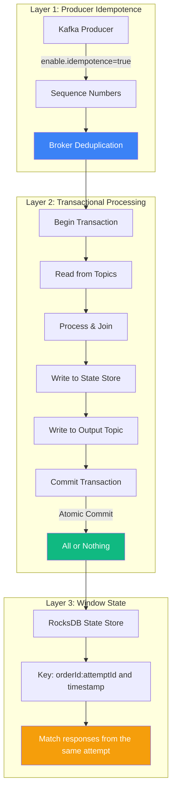
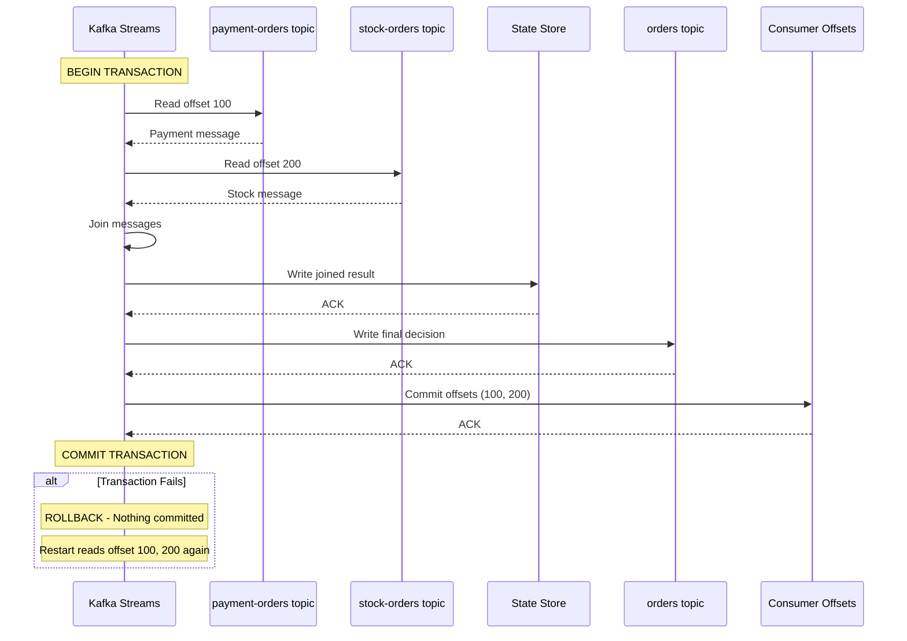
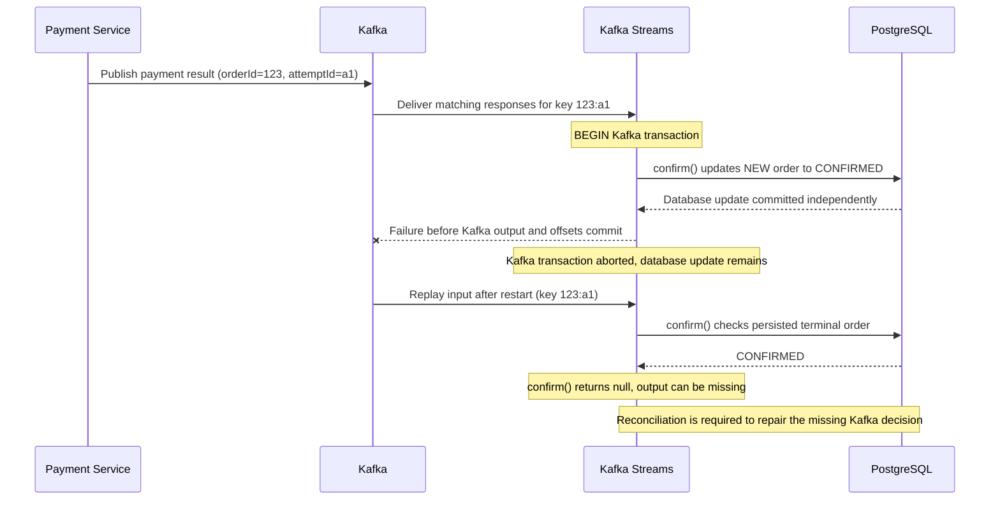
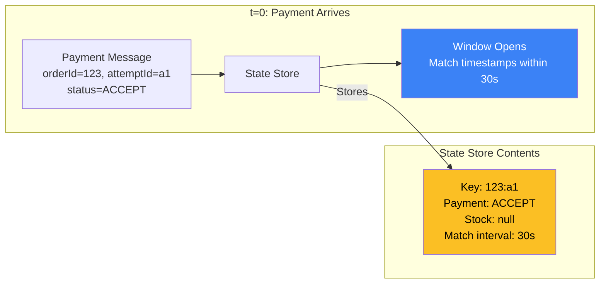
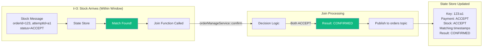
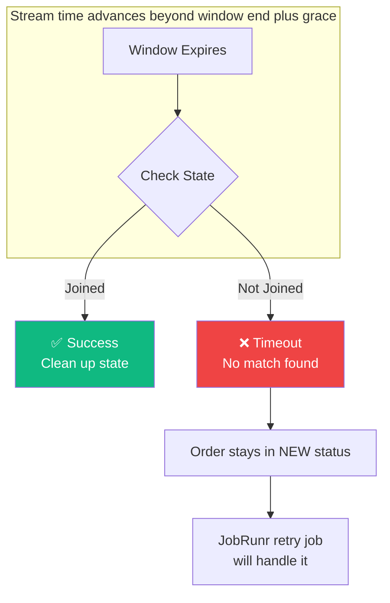
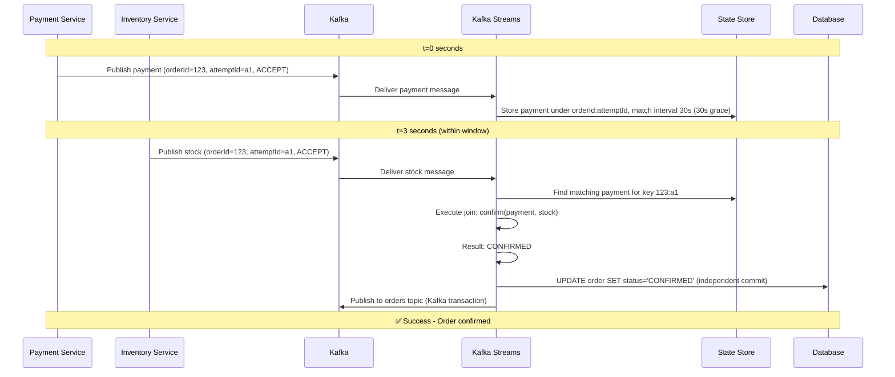
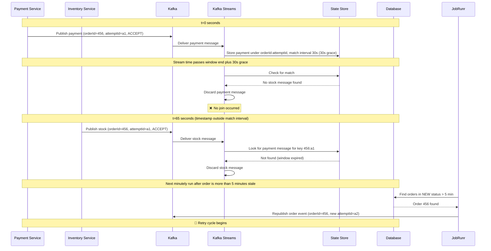
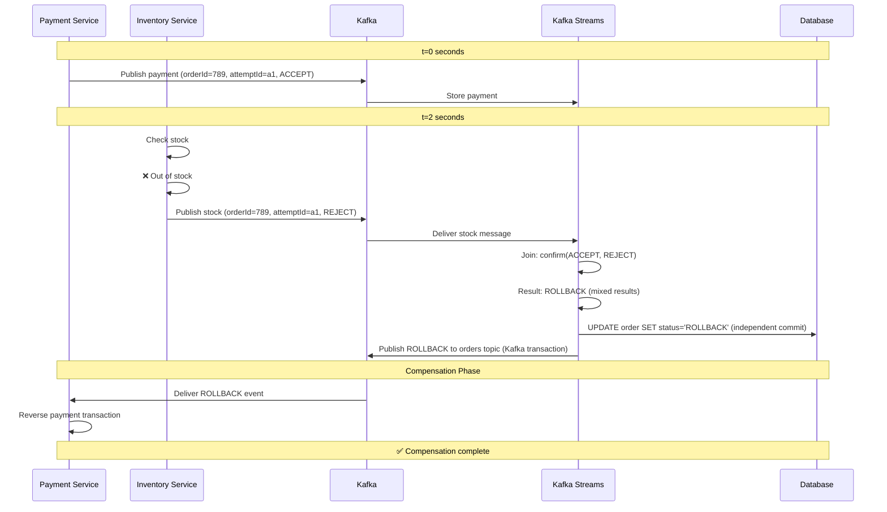

# 🔍 Saga Pattern Confusion Points - Detailed Clarification

## 1️⃣ Exactly-Once Processing - How It's Achieved

### ❓ The Question
"Under Saga Coordination Logic, it says **Exactly-Once: Guarantees no duplicate processing**. How is this achieved in detail?"

### ✅ The Answer

Kafka Streams' `exactly_once_v2` atomically commits input offsets, state-store changelogs, and Kafka output for consumed records. It does not deduplicate distinct business events or include PostgreSQL writes. `OrderManageService.confirm()` updates the database separately, so database state and Kafka output can diverge and require idempotency and reconciliation; see the [transaction boundary explanation](./01-Event-Driven-Architecture-Deep-Dive.md#2-kafka-streams-topology-configuration).

---

## 🔧 Technical Implementation

### Configuration in Code
**File:** `order-service/src/main/resources/application.yml`

```yaml
spring:
  kafka:
    streams:
      properties:
        processing.guarantee: exactly_once_v2  # ← KEY CONFIGURATION
        num.stream.threads: 2
        commit.interval.ms: 1000
        cache.max.bytes.buffering: 10485760
```

---

## 🎯 Three-Layer Exactly-Once Guarantee



---

## 📋 Detailed Breakdown

### **Layer 1: Producer Idempotence**

When Order Service publishes events to Kafka:

```java
// Automatic configuration by Spring Boot
@Bean
public ProducerFactory<Long, OrderDto> producerFactory() {
    Map<String, Object> config = new HashMap<>();
    config.put(ProducerConfig.ENABLE_IDEMPOTENCE_CONFIG, true);  // ← Automatic
    config.put(ProducerConfig.ACKS_CONFIG, "all");
    config.put(ProducerConfig.RETRIES_CONFIG, Integer.MAX_VALUE);
    return new DefaultKafkaProducerFactory<>(config);
}
```

**What happens:**
1. Each message gets a **sequence number** (0, 1, 2, 3...)
2. Kafka broker tracks sequence numbers per producer
3. If producer retries due to network failure, broker detects duplicate sequence number
4. Broker **silently discards** duplicate messages

**Example:**
```
Producer sends: Message #5 → Network timeout → Retry Message #5
Broker sees: "Already have #5, discarding duplicate"
Result: Message #5 appears ONCE in topic
```

---

### **Layer 2: Transactional Processing**

Kafka Streams wraps its Kafka processing operations in a Kafka transaction (external database writes are excluded):

```java
// Conceptual view of what Kafka Streams does internally
BEGIN TRANSACTION
    1. Read payment-orders topic (offset 100)
    2. Read stock-orders topic (offset 200)
    3. Join messages in memory
    4. Write result to state store
    5. Write result to orders topic
    6. Commit consumer offsets (payment: 101, stock: 201)
COMMIT TRANSACTION
```

**Atomic Guarantee:**
- If ANY step fails → **entire transaction rolls back**
- Consumer offsets are NOT committed
- Next restart processes same messages again
- Output topic does NOT receive partial results

**Visual Flow:**



---

### **Layer 3: Window State and Attempt Correlation**

The join stores payment and stock records by the composite `orderId:attemptId` key and record timestamp in window state stores. For example, a payload with `orderId=123` and `attemptId=a1` is rekeyed to `123:a1` by `correlateByAttempt`. A response for `123:a2` cannot join it, even within the same time window. The stores retain records for windowed joins; they are not a business-level "already processed" cache.

---

## 🧪 Example: Kafka and Database Commit Boundaries

### Scenario: Kafka Failure After a Database Update



---

## 🎯 Summary: Exactly-Once Guarantee

| Component | Mechanism | Prevents |
|-----------|-----------|----------|
| **Idempotent Producer** | Sequence numbers | Duplicate messages in topics |
| **Transactional Processing** | Atomic commit | Partial processing |
| **Window State** | Composite attempt key and timestamps | Joining responses from different attempts |
| **Offset Management** | Transactional commits | Skipping or duplicating messages |

**Result:** Kafka processing and Kafka output commit atomically for consumed records. Database updates and end-to-end business effects require separate idempotency and reconciliation.

---

---

## 2️⃣ The 30-Second Window & Grace Period - Deep Dive

### ❓ The Question
"What happens in the join window? What is its use? What happens after the window? What could go wrong?"

### ✅ The Answer

The 30-second window (with a 30-second grace period) is a **time-based join window** that determines how long Kafka Streams will wait to match payment and inventory responses for the same order and attempt.

---

## 🕐 Window Behavior Explained

### Configuration in Code
**File:** `KafkaStreamsConfig.java`

```java
correlateByAttempt(paymentStream)
    .join(
        correlateByAttempt(stockStream),
        orderManageService::confirm,
        JoinWindows.ofTimeDifferenceAndGrace(
                Duration.ofSeconds(30), Duration.ofSeconds(30)),  // ← 30s Window + 30s Grace
        StreamJoined.with(Serdes.String(), orderSerde, orderSerde)
    );

private KStream<String, OrderDto> correlateByAttempt(KStream<String, OrderDto> stream) {
    return stream.filter((key, order) -> order != null
                    && order.orderId() != null
                    && order.attemptId() != null
                    && !order.attemptId().isBlank())
            .selectKey((key, order) -> order.orderId() + ":" + order.attemptId());
}
```

---

Both response payloads must preserve the same nonblank `attemptId`. Missing IDs are filtered out. The composite key is used for the internal join and its state stores; after confirmation, the topology rekeys output to `orderId` for the `orders` topic while preserving `attemptId` in the payload.

## 📊 Visual Timeline: What Happens in 30 Seconds (+ Grace Period)

```mermaid
gantt
    title Order Processing Timeline (30-Second Window + 30s Grace)
    dateFormat ss
    axisFormat %S sec
    
    section Order 123
    Payment arrives (t=0)     :milestone, m1, 00, 0s
    Window active             :active, w1, 00, 30s
    Stock arrives (t=5)       :milestone, m2, 05, 0s
    Join happens              :crit, j1, 05, 1s
    Grace period ends (t=60)  :milestone, m3, 60, 0s
    
    section Order 456 (Expired)
    Payment arrives (t=0)     :milestone, m4, 00, 0s
    Window closes (t=30)      :milestone, m5, 30, 0s
    Grace closes (t=60)       :milestone, m6, 60, 0s
    Stock arrives (t=65) ❌   :milestone, m7, 65, 0s
```



---

## 🔄 Detailed Window Mechanics

### **Phase 1: First Message Arrives (t=0)**



**What happens:**
1. Payment message arrives with `orderId=123, attemptId=a1`
2. `correlateByAttempt` selects key `123:a1`; Kafka Streams stores the record with its timestamp in a **window state store**
3. Only stock records within a 30-second timestamp difference are eligible; the 30-second grace permits late arrival of eligible records as stream time advances
4. No output yet - waiting for join partner

---

### **Phase 2: Second Message Arrives (t=3)**



**What happens:**
1. Stock message arrives with same `orderId=123, attemptId=a1`
2. `correlateByAttempt` selects key `123:a1`; Kafka Streams finds payment for the same key and a matching timestamp in the window state store
3. **Join function executes:** `orderManageService.confirm(payment, stock)`
4. Result published to `orders` topic
5. Window state remains subject to retention; distinct duplicate events for the same key can still produce additional joins

---

### **Phase 3: Window Closes After Grace**



**What happens:**
1. Stream time advances beyond the join window plus grace; wall-clock time alone does not close it
2. Out-of-window timestamps cannot match, even during grace
3. Window records are eventually removed according to store retention, independently of Kafka transaction commits
4. **If no matching response arrived:** No join result is emitted; the order remains `NEW` for the recurring retry job

---

## 🎬 Complete Scenarios

### ✅ Scenario 1: Happy Path (Both Arrive Within Window)



---

### ⚠️ Scenario 2: Late Arrival (After Window Closes)



---

### 🔥 Scenario 3: Partial Failure (One Service Fails)



---

## ⚠️ What Could Go Wrong?

### Problem 1: Window Too Short

```
Timeline:
t=0:  Payment arrives → Window opens
t=30: Match interval ends for timestamp 0
t=60: Stream time passes window end plus grace
t=65: Stock timestamp 65 → Outside the 30-second match interval

Result: Order stuck in NEW status, requires retry
```

**Solution (implemented in codebase):**
```java
// Window and grace period for slow services and network latency
JoinWindows.ofTimeDifferenceAndGrace(Duration.ofSeconds(30), Duration.ofSeconds(30))
```

---

### Problem 2: Message Ordering Issues

```
Scenario: Stock arrives BEFORE payment

t=0:  Stock arrives (orderId=123, attemptId=a1) → Window opens
t=3:  Payment arrives (orderId=123, attemptId=a1) → Join succeeds ✅

This works! Window is bidirectional.
```

**Kafka Streams handles this automatically** - window works in both directions.

---

### Problem 3: Service Restart During Window

```
t=0:  Payment arrives → Stored in state store
t=5:  Kafka Streams crashes 💥
t=6:  Kafka Streams restarts
t=7:  Stock arrives

Question: Will join still work?
Answer: YES ✅ - State store is persisted to disk (RocksDB)
```

**State Store Persistence:**
```
/tmp/kafka-streams/order-service/
├── payment-orders-store/
│   └── 0_0/
│       ├── 000001.sst  ← RocksDB files (persisted)
│       └── MANIFEST
└── stock-orders-store/
    └── 0_0/
        └── 000001.sst
```

---

### Problem 4: Clock Skew Between Services

```
Payment Service clock: 10:00:00
Inventory Service clock: 10:00:15 (15 seconds ahead)

t=0 (Payment):  Message timestamp: 10:00:00
t=3 (Stock):    Message timestamp: 10:00:18

Kafka Streams sees: 18-second difference → Outside 10-second window ❌
```

**Solution:** Use Kafka broker timestamps (not service timestamps)
```java
// Kafka Streams uses broker timestamp by default
TimestampExtractor.FAIL_ON_INVALID_TIMESTAMP
```

---

## 🎯 Window Configuration Best Practices

### Choosing the Right Window Size

| Service Latency | Recommended Window | Rationale |
|-----------------|-------------------|-----------|
| < 100ms | 5 seconds | Fast services, tight SLA |
| 100ms - 1s | 10 seconds | Example for moderate service latency |
| 1s - 5s | 30 seconds | Slow database queries |
| > 5s | 60 seconds | External API calls |

### Current Configuration Analysis

```java
// Production configuration in KafkaStreamsConfig.java:
JoinWindows.ofTimeDifferenceAndGrace(
    Duration.ofSeconds(30),  // Main window difference
    Duration.ofSeconds(30)   // Grace period for out-of-order records
)

// Breakdown:
// - Window size: 30 seconds
// - Grace period: 30 seconds (accommodates late arrivals and retries)
// - Bidirectional: Yes (payment→stock or stock→payment)
// - Attempt Correlation: Keyed by orderId:attemptId
```

---

## 📊 Monitoring Window Effectiveness

### Key Metrics to Track

```java
// Add these metrics to OrderManageService
@Component
public class SagaMetrics {
    private final MeterRegistry registry;
    
    public void recordJoinLatency(Duration latency) {
        Timer.builder("saga.join.latency")
            .description("Time between first and second message arrival")
            .register(registry)
            .record(latency);
    }
    
    public void recordWindowTimeout() {
        Counter.builder("saga.window.timeout")
            .description("Number of joins that timed out")
            .register(registry)
            .increment();
    }
}
```

### Prometheus Queries

```promql
# Average join latency
avg(saga_join_latency_seconds)

# Window timeout rate
rate(saga_window_timeout_total[5m])

# If timeout rate > 1% → increase window size
```

---

## 🎓 Summary

### Exactly-Once Processing
✅ Achieved through 3 layers:
1. **Idempotent producers** - deduplicate producer retries within Kafka
2. **Transactional processing** - atomically commit Kafka state, offsets, and output
3. **Window state** - correlate responses by `orderId:attemptId` and timestamp

PostgreSQL updates remain independent and require idempotency and reconciliation.

### 30-Second Window & Grace Period
✅ Purpose: Wait for both payment and stock responses for the same attempt
✅ Bidirectional: Works regardless of arrival order
✅ Persisted: Survives restarts via RocksDB and changelog
✅ Grace Period: 30-second extra grace window for late out-of-order records
⚠️ Risk: Late arrivals beyond window + grace cause timeouts → JobRunr retry needed

### Key Takeaway
The window is a **trade-off**:
- **Too short** → More timeouts, more retries
- **Too long** → Slower transaction completion
- **Current 30s + 30s grace** → Balanced for typical microservice latency
