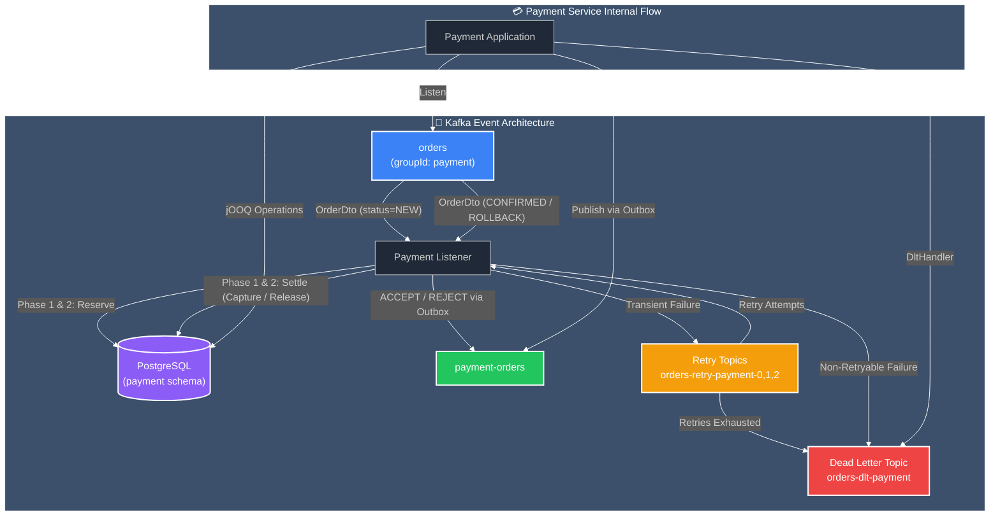
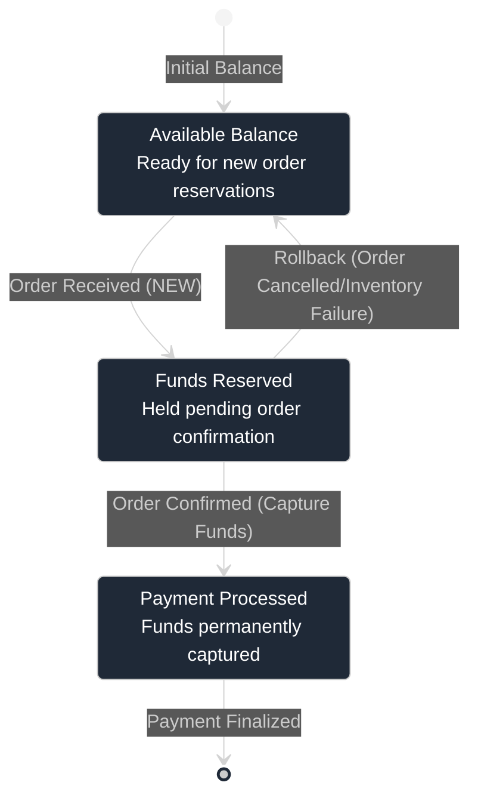

# Payment Service - Detailed Sequence Diagram

## Complete Payment Processing Flow with Event-Driven Architecture

```mermaid
%%{init: {'theme':'dark', 'themeVariables': {'primaryColor':'#1f2937', 'primaryTextColor':'#ffffff', 'primaryBorderColor':'#374151', 'lineColor':'#ffffff', 'sectionBkColor':'#374151', 'altSectionBkColor':'#4b5563', 'gridColor':'#6b7280', 'secondaryColor':'#374151', 'tertiaryColor':'#4b5563', 'background':'#111827', 'mainBkg':'#1f2937', 'secondBkg':'#374151', 'tertiaryBkg':'#4b5563'}}}%%
sequenceDiagram
    participant Client as 🛒 Client<br/>(WebApp/API)
    participant Gateway as 🌐 API Gateway<br/>(Port: 8765)
    participant PaymentAPI as 💳 Payment Service<br/>(Port: 18085)
    participant PaymentDB as 🗄️ PostgreSQL<br/>(payment schema / jOOQ)
    participant Kafka as 📡 Kafka Broker
    participant OrdersTopic as 🛍️ Orders Topic<br/>(orders)
    participant PaymentTopic as 💳 Payment Topic<br/>(payment-orders)
    participant KafkaListener as 🎧 Kafka Listener<br/>(Payment Consumer)
    participant RetryTopic as 🔄 Retry Topics<br/>(orders-retry-payment-0,1,2)
    participant DLT as ☠️ Dead Letter Topic<br/>(orders-dlt-payment)

    Note over Client, DLT: 👤 Customer Management Flow
    
    rect rgba(59, 130, 246, 0.3)
        Note over Client, PaymentAPI: <span style="color: white">Customer Registration & Creation</span>
        Client->>Gateway: POST /payment-service/api/customers<br/>(CustomerRequest)
        Gateway->>PaymentAPI: Forward request
        PaymentAPI->>PaymentAPI: @Loggable + @Valid<br/>Validate customer data
        
        PaymentAPI->>PaymentDB: SELECT EXISTS(...) FROM payment.customers<br/>WHERE email = LOWER(?)
        PaymentDB-->>PaymentAPI: boolean exists
        
        alt Customer already exists with email
            PaymentAPI-->>Gateway: CustomerExistsException (409 Conflict ProblemDetail)
            Gateway-->>Client: Error response
        else New customer
            PaymentAPI->>PaymentAPI: customerRequest.toCustomersRecord()<br/>(Generate TSID ID, normalize email)
            PaymentAPI->>PaymentDB: INSERT INTO payment.customers<br/>(@Transactional, version=1)
            PaymentDB-->>PaymentAPI: CustomersRecord (saved)
            PaymentAPI->>PaymentAPI: CustomerResponse.toResponse(savedRecord)
            PaymentAPI-->>Gateway: CustomerResponse (201 Created with Location header)
            Gateway-->>Client: Customer confirmation
        end
    end

    rect rgba(34, 197, 94, 0.3)
        Note over Client, PaymentAPI: <span style="color: white">Customer Retrieval Operations</span>
        
        Client->>Gateway: GET /payment-service/api/customers/{id}
        Gateway->>PaymentAPI: Forward request
        PaymentAPI->>PaymentDB: SELECT * FROM payment.customers<br/>WHERE id = ? AND deleted = false
        PaymentDB-->>PaymentAPI: Optional<CustomersRecord>
        PaymentAPI-->>Gateway: CustomerResponse (200 OK)
        Gateway-->>Client: Customer details
        
        Client->>Gateway: GET /payment-service/api/customers/name/{name}
        Gateway->>PaymentAPI: Forward request
        PaymentAPI->>PaymentDB: jOOQ query by name<br/>(CUSTOMERS.NAME.eq(name))
        PaymentDB-->>PaymentAPI: Optional<CustomersRecord>
        PaymentAPI-->>Gateway: CustomerResponse (200 OK)
        Gateway-->>Client: Customer by name

        Client->>Gateway: GET /payment-service/api/customers/by-email?email={email}
        Gateway->>PaymentAPI: Forward request
        PaymentAPI->>PaymentDB: jOOQ query by email<br/>(CUSTOMERS.EMAIL.eq(LOWER(email)))
        PaymentDB-->>PaymentAPI: Optional<CustomersRecord>
        PaymentAPI-->>Gateway: CustomerResponse (200 OK)
        Gateway-->>Client: Customer by email
        
        Client->>Gateway: GET /payment-service/api/customers?pageNo=0&pageSize=10
        Gateway->>PaymentAPI: Forward paginated request
        PaymentAPI->>PaymentAPI: FindCustomersQuery(pageNo, pageSize, sortBy, sortDir)
        PaymentAPI->>PaymentDB: countActive() & findActiveAll(offset, pageSize, orderFields)<br/>WHERE deleted = false ORDER BY ? LIMIT ? OFFSET ?
        PaymentDB-->>PaymentAPI: List<CustomersRecord>
        PaymentAPI->>PaymentAPI: CustomerMapper.toListResponse()
        PaymentAPI-->>Gateway: PagedResult<CustomerResponse> (200 OK)
        Gateway-->>Client: Paginated customers

        Client->>Gateway: GET /payment-service/api/customers/{id}/orders?pageNo=0&pageSize=10
        Gateway->>PaymentAPI: Forward request
        PaymentAPI->>PaymentDB: findActiveById(id)
        PaymentDB-->>PaymentAPI: Optional<CustomersRecord>
        PaymentAPI->>Gateway: OrderServiceProxy.getOrdersByCustomerId (RestClient + CircuitBreaker)
        Gateway-->>PaymentAPI: PagedResult<OrderResponse>
        PaymentAPI-->>Gateway: PagedResult<OrderResponse> (200 OK)
        Gateway-->>Client: Customer orders
    end

    Note over Client, DLT: 🎧 Event-Driven Payment Processing
    
    rect rgba(236, 72, 153, 0.3)
        Note over Kafka, PaymentAPI: <span style="color: white">Order Payment Reservation Flow (Operation Engine & Outbox)</span>
        
        Kafka->>OrdersTopic: OrderDto published (status="NEW", attemptId="...")
        OrdersTopic->>KafkaListener: @KafkaListener(topics="orders")<br/>groupId="payment"
        KafkaListener->>KafkaListener: Check orderDto.status == "NEW" & validate attemptId
        
        KafkaListener->>PaymentAPI: paymentOrderManageService.reserve()
        PaymentAPI->>PaymentAPI: PaymentOperationEngine.processReserve()
        
        Note over PaymentAPI, PaymentDB: Phase 1: Arrival Transaction (@Transactional)
        PaymentAPI->>PaymentDB: Verify customer exists & is active
        PaymentAPI->>PaymentDB: INSERT ON CONFLICT DO NOTHING (payment_operations)
        PaymentAPI->>PaymentDB: SELECT FOR UPDATE (operation row lock)
        PaymentAPI->>PaymentDB: Verify fingerprint & register AWAITING_RESULT outbox reply
        PaymentAPI->>PaymentDB: Attempt conditional claim (increment fencing_token)
        
        alt Claim Succeeded
            Note over PaymentAPI: Phase 2: Provider Execution (Non-Transactional Boundary)
            PaymentAPI->>PaymentDB: InternalLedgerAdapter (@Transactional REQUIRES_NEW)
            PaymentAPI->>PaymentDB: Advisory lock pg_advisory_xact_lock & check idempotency
            PaymentAPI->>PaymentDB: Atomic reserveFunds & insert ledger_entries
            
            Note over PaymentAPI, PaymentDB: Phase 3: Completion Transaction (@Transactional)
            PaymentAPI->>PaymentDB: Fenced complete (status="COMPLETED", outcome)
            PaymentAPI->>PaymentDB: Promote AWAITING_RESULT reply to PENDING
        else Already Terminal or In-Flight
            PaymentAPI-->>KafkaListener: Replay terminal reply or await background completion
        end
        
        Note over PaymentAPI, Kafka: Asynchronous Outbox Delivery
        PaymentAPI->>PaymentDB: OutboxPublisher claims PENDING (SKIP LOCKED)
        PaymentAPI->>PaymentTopic: Send outcome to payment-orders topic
        PaymentAPI->>PaymentDB: Mark PUBLISHED with version guard
    end

    rect rgba(251, 146, 60, 0.3)
        Note over Kafka, PaymentAPI: <span style="color: white">Order Confirmation/Rollback Settlement Flow</span>
        
        Kafka->>OrdersTopic: Final OrderDto<br/>(status="CONFIRMED" or "ROLLBACK")
        OrdersTopic->>KafkaListener: @KafkaListener receives<br/>CONFIRMED or ROLLBACK status
        KafkaListener->>KafkaListener: Check orderDto.status != "NEW"
        
        KafkaListener->>PaymentAPI: paymentOrderManageService.confirm(orderDto)
        PaymentAPI->>PaymentAPI: Determine settlementType:<br/>CONFIRMED -> "CAPTURE"<br/>ROLLBACK -> "RELEASE"
        PaymentAPI->>PaymentAPI: PaymentOperationEngine.processSettlement()
        
        PaymentAPI->>PaymentDB: SELECT FROM payment_operations<br/>WHERE operation_key = 'payment:{orderId}:RESERVE'
        PaymentDB-->>PaymentAPI: PaymentOperationsRecord (reserveOp)
        
        alt Reservation absent or not COMPLETED
            PaymentAPI-->>KafkaListener: ReservationNotFoundException (retryable)
        else Reservation was REJECT
            PaymentAPI->>PaymentDB: recordNotApplicableSettlement()<br/>(no provider execution needed)
        else Reservation was ACCEPT
            Note over PaymentAPI, PaymentDB: Phase 1: Settlement Arrival (@Transactional)
            PaymentAPI->>PaymentDB: INSERT / SELECT FOR UPDATE (payment:{orderId}:SETTLE)<br/>with stored reserve amount
            PaymentAPI->>PaymentDB: Attempt conditional claim (increment fencing_token)
            
            alt Claim Succeeded
                Note over PaymentAPI: Phase 2: Provider Execution (Non-Transactional Boundary)
                PaymentAPI->>PaymentDB: InternalLedgerAdapter (@Transactional REQUIRES_NEW)
                PaymentAPI->>PaymentDB: Advisory lock pg_advisory_xact_lock(downstreamKey)
                
                alt SettlementType = "CAPTURE" (Order Confirmed)
                    PaymentAPI->>PaymentDB: customerRepository.captureFunds(customerId, amount)<br/>UPDATE payment.customers SET amount_reserved = amount_reserved - amount<br/>WHERE id = ? AND amount_reserved >= amount
                else SettlementType = "RELEASE" (Order Rollback)
                    PaymentAPI->>PaymentDB: customerRepository.releaseFunds(customerId, amount)<br/>UPDATE payment.customers SET amount_reserved = amount_reserved - amount,<br/>amount_available = amount_available + amount<br/>WHERE id = ? AND amount_reserved >= amount
                end
                
                PaymentAPI->>PaymentDB: INSERT INTO payment.ledger_entries<br/>(entry_type, amount, status)
                
                Note over PaymentAPI, PaymentDB: Phase 3: Settlement Completion (@Transactional)
                PaymentAPI->>PaymentDB: Fenced complete settlement operation<br/>(status="COMPLETED", outcome)
            else Already Terminal or In-Flight
                PaymentAPI-->>KafkaListener: Return without execution
            end
        end
    end

    Note over Client, DLT: 🔄 Error Handling & Resilience
    
    rect rgba(239, 68, 68, 0.3)
        Note over KafkaListener, DLT: <span style="color: white">Retry & Dead Letter Processing</span>
        
        alt Scheduled Active Reconciliation
            PaymentAPI->>PaymentDB: PaymentReconciler claims UNKNOWN/Expired IN_FLIGHT (SKIP LOCKED)
            PaymentAPI->>PaymentDB: Provider lookup(downstreamKey)
            alt Definitive Outcome Found
                PaymentAPI->>PaymentDB: Complete & promote outbox reply
            else NOT_FOUND & attempts remain
                PaymentAPI->>PaymentDB: Execute with persisted downstreamKey
            else NOT_FOUND & attempts exhausted
                PaymentAPI->>PaymentDB: Mark FAILED (publish REJECT for reservation)
            end
        end

        alt Processing fails (transient error)
            KafkaListener-->>RetryTopic: @RetryableTopic<br/>@Backoff(delay=1000, multiplier=2.0)
            RetryTopic->>RetryTopic: orders-retry-payment-0 (1s delay)
            RetryTopic->>RetryTopic: orders-retry-payment-1 (2s delay)
            RetryTopic->>RetryTopic: orders-retry-payment-2 (4s delay)
            
            alt All retries exhausted
                RetryTopic->>DLT: @DltHandler<br/>orders-dlt-payment topic
                DLT->>KafkaListener: dlt(OrderDto, topic)
                KafkaListener->>KafkaListener: Log error with operationKey + CountDownLatch
            end
        end
        
        alt Non-retryable (CustomerNotFoundException, OperationConflictException, IllegalArgumentException)
            KafkaListener-->>DLT: Direct to orders-dlt-payment<br/>(bypasses retries)
        end
    end

    Note over Client, DLT: 🔄 Customer Update & Soft Delete Operations
    
    rect rgba(34, 197, 94, 0.3)
        Note over Client, PaymentAPI: <span style="color: white">Customer Update</span>
        Client->>Gateway: PUT /payment-service/api/customers/{id}<br/>(CustomerRequest)
        Gateway->>PaymentAPI: Forward request
        PaymentAPI->>PaymentDB: SELECT * FROM payment.customers<br/>WHERE id = ? AND deleted = false
        PaymentDB-->>PaymentAPI: Existing CustomersRecord
        
        alt Customer exists
            PaymentAPI->>PaymentAPI: CustomerMapper.mapCustomerWithRequest()
            PaymentAPI->>PaymentDB: UPDATE payment.customers SET ... WHERE id = ? AND version = ?<br/>(@Transactional, optimistic locking)
            PaymentDB-->>PaymentAPI: Updated CustomersRecord
            PaymentAPI->>PaymentAPI: CustomerResponse.toResponse()
            PaymentAPI-->>Gateway: CustomerResponse (200 OK)
            Gateway-->>Client: Updated customer
        else Customer not found
            PaymentAPI-->>Gateway: CustomerNotFoundException (404 Not Found)
            Gateway-->>Client: ProblemDetail error response
        end
    end

    rect rgba(239, 68, 68, 0.3)
        Note over Client, PaymentAPI: <span style="color: white">Customer Soft Delete</span>
        Client->>Gateway: DELETE /payment-service/api/customers/{id}
        Gateway->>PaymentAPI: Forward request
        PaymentAPI->>PaymentDB: SELECT * FROM payment.customers<br/>WHERE id = ? AND deleted = false
        PaymentDB-->>PaymentAPI: Existing CustomersRecord
        
        alt Customer exists
            PaymentAPI->>PaymentDB: UPDATE payment.customers SET deleted = true, version = version + 1<br/>WHERE id = ? AND deleted = false (@Transactional soft delete)
            PaymentDB-->>PaymentAPI: Row updated (1 row affected)
            PaymentAPI-->>Gateway: CustomerResponse (200 OK with pre-deletion state)
            Gateway-->>Client: Deleted customer data
        else Customer not found
            PaymentAPI-->>Gateway: CustomerNotFoundException (404 Not Found)
            Gateway-->>Client: ProblemDetail error response
        end
    end

    Note over Client, DLT: 📊 Payment State Management
    
    rect rgba(139, 92, 246, 0.3)
        Note over PaymentAPI, PaymentDB: <span style="color: white">Customer Balance Tracking</span>
        
        Note over PaymentAPI: Customer Financial State:<br/>• amountAvailable: Spendable balance<br/>• amountReserved: Funds on hold<br/>• Total = Available + Reserved
        
        Note over PaymentAPI: State Transitions:<br/>NEW → Reserve funds (Available→Reserved)<br/>CONFIRMED → Capture funds (Deduct from Reserved)<br/>ROLLBACK → Release funds (Reserved→Available)
        
        PaymentAPI->>PaymentDB: Atomic balance updates via jOOQ<br/>with @Transactional safety
        PaymentDB-->>PaymentAPI: Consistent state maintained
    end
```



## Key Architecture Components

### 🏗️ **Core Service Architecture**
- **Runtime & Framework**: Java 25, Spring Boot 4.1.2, Spring Cloud 2025.1.4
- **Port & Context**: Runs on port `18085` with context path `/payment-service`
- **Main Class**: `com.example.paymentservice.PaymentApplication`
- **REST API**: Spring MVC with comprehensive customer CRUD operations and order proxy client
- **Database**: PostgreSQL with jOOQ for type-safe queries and generated records (no JPA `@Entity`)
- **Event Processing**: Kafka consumer with retry mechanism and dead letter topic (DLT)
- **Observability**: Micrometer tracing, Prometheus metrics, OpenTelemetry, and structured logging

### 💰 **Payment Processing Logic**
- **Fund Reservation**: Two-phase reservation pattern separating available and reserved balances
- **Three-Phase Durable Engine**:
  1. *Arrival Phase*: Atomic registration, fingerprint verification, outbox reply setup, and fencing token claim
  2. *Provider Phase*: Independent `REQUIRES_NEW` transaction executing ledger balance movements with advisory locks
  3. *Completion Phase*: Fenced status completion and outbox promotion
- **Balance Management**: Atomic SQL updates via jOOQ preventing race conditions and overdrafts
- **Settlement**: Captures funds on `CONFIRMED` orders or releases reserved funds back to available on `ROLLBACK`

### 🎧 **Event-Driven Architecture**
- **Kafka Consumer**: Listens to `orders` topic with consumer group `payment`
- **Producer**: Publishes outcome events to `payment-orders` topic for saga orchestration
- **Transactional Outbox**: Asynchronous delivery via `OutboxPublisher` polling `payment.outbox_events` (`SKIP LOCKED`)
- **Active Reconciliation**: `PaymentReconciler` automatically handles indeterminate (`UNKNOWN`) or expired provider operations using ShedLock

### 🔄 **Resilience Patterns**
- **Retry Topics**: `orders-retry-payment-0`, `orders-retry-payment-1`, `orders-retry-payment-2` (exponential backoff)
- **Dead Letter Topic**: `orders-dlt-payment` handles exhausted retries or non-retryable failures
- **Exception Filtering**: `CustomerNotFoundException`, `OperationConflictException`, and `IllegalArgumentException` bypass retries straight to DLT
- **Circuit Breaker**: Resilience4j protects downstream calls to `order-service`
- **Fencing Tokens**: Guard against zombie workers attempting delayed completions

### 📊 **Data Management**
- **jOOQ Integration**: Type-safe SQL query generation via `testcontainers-jooq-codegen-maven-plugin`
- **Generated Records**: `CustomersRecord`, `PaymentOperationsRecord`, `LedgerEntriesRecord`, `OutboxEventsRecord`
- **TSID Primary Keys**: Hypersistence TSID for collision-free, time-sorted 64-bit integer identifiers
- **Liquibase Migrations**: Database schema versioning with XML changesets under schema `payment`
- **Optimistic Locking**: Enforced via `version` column on `payment.customers` and `payment_operations`

## Service Endpoints Summary

All endpoints are hosted under context path `/payment-service`:

| Endpoint | Method | Description | Features |
|----------|--------|-------------|----------|
| `/payment-service/api/customers` | GET | Get paginated active customers | Pagination, sorting, jOOQ `findActiveAll` |
| `/payment-service/api/customers/{id}` | GET | Get active customer by ID | Direct jOOQ lookup (`findActiveById`) |
| `/payment-service/api/customers/name/{name}` | GET | Get customer by name | Type-safe jOOQ query (`findByName`) |
| `/payment-service/api/customers/by-email` | GET | Get customer by normalized email | Query parameter `email`, lowercase matching |
| `/payment-service/api/customers` | POST | Create new customer | Unique email check (409 Conflict if duplicate), TSID generation |
| `/payment-service/api/customers/{id}` | PUT | Update customer details | Optimistic locking via `version` column |
| `/payment-service/api/customers/{id}` | DELETE | Soft delete customer | Sets `deleted = true`, increments version |
| `/payment-service/api/customers/{id}/orders` | GET | Get customer orders via Order Service | RestClient with Resilience4j circuit breaker |

## Kafka Event Flow & Topics



## Database Schema

Database migrations are managed by Liquibase under the `payment` schema. The DDL below shows the required normalized-email uniqueness: `email` is stored in lowercase and is unique independently of `name`.

**Migration gap:** The current `01-create_customers_table.xml` still defines `UNIQUE (name, email)`, which permits concurrent inserts of the same email under different names. Applying this correction requires a new Liquibase migration that resolves existing normalized-email duplicates, normalizes stored emails, and replaces the composite constraint. The schema below describes the corrected contract, not a migration already present in the repository.

```sql
-- Schema: payment

-- Customers table with financial tracking and soft delete
CREATE TABLE payment.customers (
    id BIGINT PRIMARY KEY, -- TSID generated
    name TEXT NOT NULL,
    email TEXT NOT NULL,
    phone TEXT NOT NULL,
    address_line1 TEXT NOT NULL,
    address_line2 TEXT,
    city TEXT NOT NULL,
    state TEXT NOT NULL,
    zip_code TEXT NOT NULL,
    country TEXT NOT NULL,
    amount_available NUMERIC(19,2) NOT NULL DEFAULT 0.00,
    amount_reserved NUMERIC(19,2) NOT NULL DEFAULT 0.00,
    version INTEGER NOT NULL DEFAULT 0,
    deleted BOOLEAN NOT NULL DEFAULT FALSE,
    CONSTRAINT ck_customers_email_normalized CHECK (email = lower(email)),
    CONSTRAINT uc_customers_name_email_key UNIQUE (email)
);

-- Payment operations table for durable idempotency and engine state
CREATE TABLE payment.payment_operations (
    id BIGINT PRIMARY KEY,
    operation_key TEXT NOT NULL UNIQUE,
    order_id BIGINT NOT NULL,
    customer_id BIGINT NOT NULL,
    operation_type TEXT NOT NULL,
    amount NUMERIC(19,2) NOT NULL,
    fingerprint TEXT NOT NULL,
    downstream_key TEXT NOT NULL UNIQUE,
    status TEXT NOT NULL, -- RECEIVED, IN_FLIGHT, COMPLETED, UNKNOWN, FAILED, NOT_APPLICABLE
    result TEXT,          -- ACCEPT, REJECT
    fencing_token BIGINT NOT NULL DEFAULT 0,
    lease_until TIMESTAMP WITH TIME ZONE,
    owner_id TEXT,
    attempt_count INT NOT NULL DEFAULT 0,
    next_reconcile_at TIMESTAMP WITH TIME ZONE,
    created_at TIMESTAMP WITH TIME ZONE DEFAULT CURRENT_TIMESTAMP NOT NULL,
    updated_at TIMESTAMP WITH TIME ZONE DEFAULT CURRENT_TIMESTAMP NOT NULL
);

-- Ledger entries table for double-entry tracking of all balance movements
CREATE TABLE payment.ledger_entries (
    id BIGINT PRIMARY KEY,
    customer_id BIGINT NOT NULL,
    operation_id BIGINT NOT NULL,
    downstream_key TEXT NOT NULL UNIQUE,
    entry_type TEXT NOT NULL, -- RESERVE, CAPTURE, RELEASE
    amount NUMERIC(19,2) NOT NULL,
    status TEXT NOT NULL,     -- ACCEPT, REJECT
    created_at TIMESTAMP WITH TIME ZONE DEFAULT CURRENT_TIMESTAMP NOT NULL
);

-- Outbox events table for reliable event publishing
CREATE TABLE payment.outbox_events (
    id BIGINT PRIMARY KEY,
    event_key TEXT NOT NULL UNIQUE,
    aggregate_type TEXT NOT NULL,
    aggregate_id BIGINT NOT NULL,
    topic TEXT NOT NULL,
    payload TEXT NOT NULL,
    status TEXT NOT NULL,     -- AWAITING_RESULT, PENDING, PUBLISHED, FAILED
    created_at TIMESTAMP WITH TIME ZONE DEFAULT CURRENT_TIMESTAMP NOT NULL,
    updated_at TIMESTAMP WITH TIME ZONE DEFAULT CURRENT_TIMESTAMP NOT NULL
);

-- ShedLock table for distributed locks across instances
CREATE TABLE payment.shedlock (
    name VARCHAR(64) PRIMARY KEY,
    lock_until TIMESTAMP NOT NULL,
    locked_at TIMESTAMP NOT NULL,
    locked_by VARCHAR(255) NOT NULL
);
```

## Payment State Machine



## Key Features

### 🔒 **Financial Consistency**
- **Two-Phase Commit**: Reserve → Confirm (Capture) / Rollback (Release) pattern
- **Atomic Operations**: Database transactions and conditional SQL balance updates ensure precision and consistency
- **Balance Tracking**: Explicit separation between available spendable balance and held reserved balance
- **Idempotent Processing**: Safe message reprocessing via `operation_key`, `downstream_key`, and input `fingerprint`

### 🎯 **Event Processing**
- **Selective Processing**: Differentiates `NEW` orders (requiring reserve) from `CONFIRMED`/`ROLLBACK` outcomes (settlement)
- **Retry Strategy**: Exponential backoff with `@RetryableTopic` using topic suffixes `-retry-payment` and `-dlt-payment`
- **Exception Filtering**: Non-retryable domain exceptions (`CustomerNotFoundException`, `OperationConflictException`, `IllegalArgumentException`) route immediately to DLT
- **Monitoring**: `CountDownLatch` for DLT testing and verification, with Micrometer counters for started, successful, and failed payments

### 🚀 **Performance & Modern Tech Stack**
- **jOOQ Integration**: Type-safe, compile-time verified SQL queries without JPA/Hibernate overhead
- **Connection Pooling**: Optimized PostgreSQL connection management via HikariCP
- **Virtual Threads**: Enabled (`spring.threads.virtual.enabled=true`) for lightweight concurrency
- **Pagination**: Efficient active customer listing with sorting support
