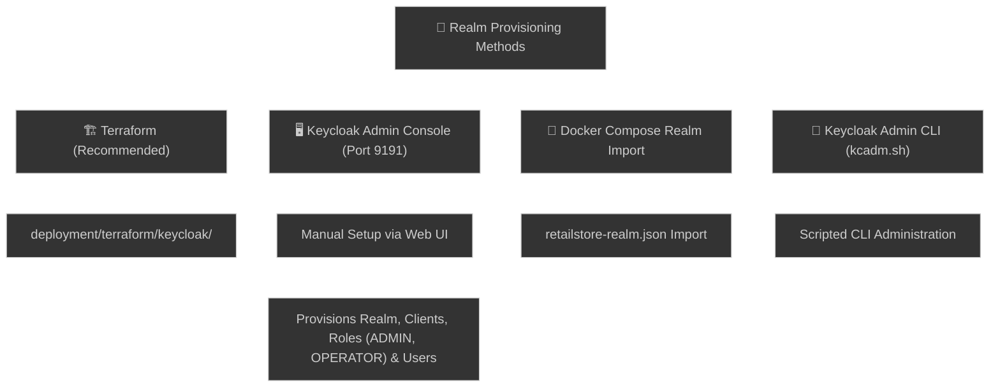
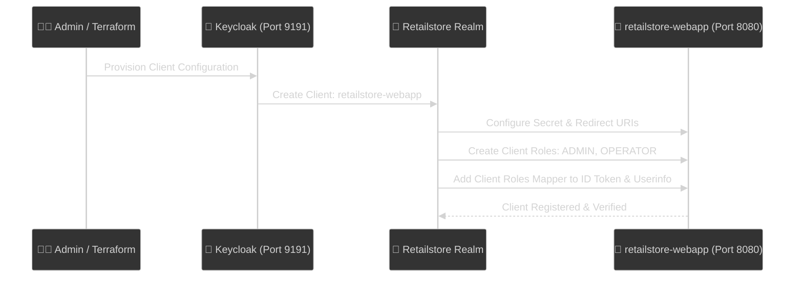
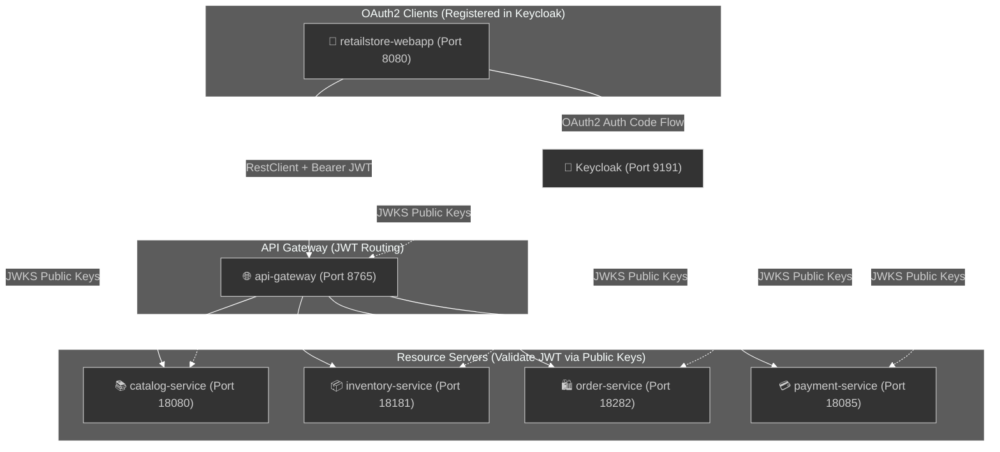
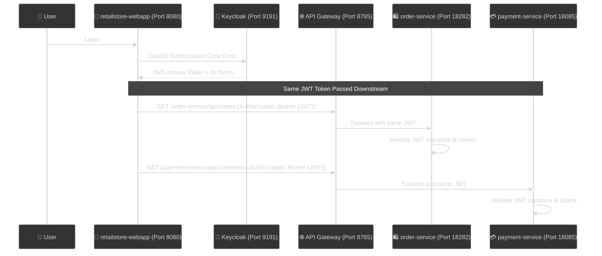

# 🔐 Keycloak Realm Configuration Deep Dive

## 📖 Overview

This document explains the realm configuration, client registration process, and token sharing across the microservices ecosystem built on **Java 25**, **Spring Boot 4.1.2**, and **Keycloak 26.x**.

---

## 🎯 Question 1: How is the Keycloak realm configured and provisioned?

### 🛠️ **Creation & Provisioning Methods**



### 📋 **Method 1: Terraform Realm Manager (Primary & Recommended)**

In modern deployments, realm configuration is managed declaratively using Terraform scripts located under `deployment/terraform/keycloak/`.
- Provisions realm `retailstore`
- Creates client `retailstore-webapp` (with redirect URIs and secret)
- Creates client roles **`ADMIN`** and **`OPERATOR`**
- Maps client roles into the ID token via the `roles` scope mapper
- Seeds users `retail` (with `ADMIN` and `OPERATOR` roles) and `raja`

Run with Docker Compose:
```shell
docker compose --profile terraform up terraform
```

### 📋 **Method 2: Keycloak Admin Console**

1. **Access Admin Console**: `http://localhost:9191/admin` (or `http://localhost:9191`)
2. **Login Credentials**: `admin` / `admin1234`
3. **Realm**: Select or create `retailstore`
4. **Configure Clients, Users, and Roles**:
   - Client: `retailstore-webapp`
   - Client Roles: `ADMIN` and `OPERATOR`
   - Scope Mapper: In `roles` scope, enable "Add to ID token" and "Add to userinfo" for the client roles mapper.

### 📋 **Method 3: Docker Compose with Keycloak 26.x**

```yaml
# deployment/docker-compose.yml
services:
  keycloak:
    image: quay.io/keycloak/keycloak:26.8.1
    command: [ 'start', '--http-port=9191' ]
    container_name: keycloak
    hostname: keycloak
    environment:
      - KC_BOOTSTRAP_ADMIN_USERNAME=admin
      - KC_BOOTSTRAP_ADMIN_PASSWORD=admin1234
      - KC_HOSTNAME=localhost
      - KC_HOSTNAME_URL=http://localhost:9191
      - KC_HOSTNAME_ADMIN_URL=http://localhost:9191
      - KC_PROXY=edge
      - KC_DB=postgres
      - KC_DB_URL=jdbc:postgresql://postgresql:5432/appdb
      - KC_DB_USERNAME=appuser
      - KC_DB_PASSWORD=secret
    ports:
      - "9191:9191"
      - "9000:9000"
```

**Key Points:**
- Keycloak 26.x listens on port **`9191`** (`--http-port=9191`).
- Management and metrics run on port **`9000`**.
- Reference export file for test suites is maintained at: `retail-store-webapp/src/test/resources/docker/realm-config/retailstore-realm.json`.

---

## 🎯 Question 2: Do we need to register `retailstore-webapp` in Keycloak?

### ✅ **YES - Client Registration is MANDATORY**



### 🔍 **Client Registration Details**

**Client Settings**:
```json
{
  "clientId": "retailstore-webapp",
  "name": "retailstore",
  "secret": "demo-throwaway-oauth-secret",
  "redirectUris": [
    "http://localhost:8080/login/oauth2/code/retailstore-webapp"
  ],
  "webOrigins": ["http://localhost:8080"],
  "standardFlowEnabled": true,
  "directAccessGrantsEnabled": true,
  "frontchannelLogout": true
}
```

### 🔐 **Roles Required on `retailstore-webapp`**

1. **`ADMIN` (Client Role)**:
   - Configured on `retailstore-webapp`
   - Required for managing inventory (`GET /inventory`, `PUT /inventory`) and creating products (`POST /api/products`)
   - Enforced by `@PreAuthorize("hasRole('ADMIN')")`

2. **`OPERATOR` (Client Role)**:
   - Configured on `retailstore-webapp`
   - Required for actuator observability endpoints: `/actuator/prometheus`, `/actuator/metrics`, `/actuator/metrics/**`
   - Enforced by `SecurityConfig`: `.requestMatchers("/actuator/prometheus", "/actuator/metrics", "/actuator/metrics/**").hasRole("OPERATOR")`

3. **`user` (Realm Role)**:
   - Automatically assigned to new accounts created through the registration page (`/registration`, `/api/register`).

4. **Client Role Mapper (Crucial Step)**:
   - In Keycloak under **Client Scopes** -> **`roles`** -> **Mappers** -> **`client roles`**:
   - **Add to ID token**: **ON**
   - **Add to userinfo**: **ON**
   - This ensures that Keycloak places `resource_access.retailstore-webapp.roles` inside the ID Token and UserInfo endpoint response, enabling Spring Security's `GrantedAuthoritiesMapper` to extract `ROLE_ADMIN` and `ROLE_OPERATOR`.

---

## 🎯 Question 3: Do we register other microservices as well?

### 🔄 **Two Approaches: Resource Server vs OAuth2 Client**



### 📋 **Current Project Architecture**

#### ✅ **Registered in Keycloak:**
- **`retailstore-webapp`** - OAuth2 Client (Authorization Code Flow with client secret)

#### ❌ **NOT Registered in Keycloak:**
- **`catalog-service`**, **`inventory-service`**, **`order-service`**, **`payment-service`** - Resource Servers (stateless JWT verification)
- **`api-gateway`** - Gateway and router (validates JWT tokens)

### 🔍 **Resource Server Configuration**

Backend services use JWT validation via `issuer-uri` without registering separate client credentials:

```properties
spring.security.oauth2.resourceserver.jwt.issuer-uri=http://localhost:9191/realms/retailstore
```

In `retailstore-webapp`, outgoing calls use Spring Boot 4.1.2 RestClient HTTP service clients (`@ImportHttpServices`) configured with `OAuth2ClientHttpRequestInterceptor` to attach the logged-in user's Bearer token.

---

## 🎯 Question 4: Are tokens the same across microservices?

### 🎫 **YES - Same JWT Token Used Everywhere**



### 🔍 **JWT Token Structure (Same for All Services)**

```json
{
  "header": {
    "alg": "RS256",
    "typ": "JWT",
    "kid": "realm-key-id"
  },
  "payload": {
    "iss": "http://localhost:9191/realms/retailstore",
    "aud": "retailstore-webapp",
    "sub": "user-uuid",
    "azp": "retailstore-webapp",
    "preferred_username": "retail",
    "email": "retailstore@gmail.com",
    "realm_access": {
      "roles": ["default-roles-retailstore", "user"]
    },
    "resource_access": {
      "retailstore-webapp": {
        "roles": ["ADMIN", "OPERATOR"]
      }
    },
    "scope": "openid profile roles",
    "exp": 1640995200,
    "iat": 1640991600
  }
}
```

### 🔍 **How `retailstore-webapp` Maps Keycloak Roles**

In `retail-store-webapp/src/main/java/com/example/retailstore/webapp/config/SecurityConfig.java`:

```java
@Bean
GrantedAuthoritiesMapper userAuthoritiesMapper() {
    return authorities -> {
        Set<GrantedAuthority> mappedAuthorities = new HashSet<>();
        authorities.forEach(authority -> {
            if (authority instanceof OidcUserAuthority oidcAuth) {
                Map<String, Object> resourceAccess = oidcAuth.getIdToken().getClaimAsMap("resource_access");
                if (resourceAccess == null && oidcAuth.getUserInfo() != null) {
                    resourceAccess = oidcAuth.getUserInfo().getClaimAsMap("resource_access");
                }
                if (resourceAccess != null) {
                    String clientId = oidcAuth.getIdToken().getClaimAsString("azp");
                    if (clientId == null) {
                        clientId = "retailstore-webapp";
                    }
                    Object clientAccess = resourceAccess.get(clientId);
                    if (clientAccess instanceof Map<?, ?> client) {
                        Object roles = client.get("roles");
                        if (roles instanceof Collection<?> roleCollection) {
                            roleCollection.stream()
                                    .filter(String.class::isInstance)
                                    .map(String.class::cast)
                                    .map(role -> new SimpleGrantedAuthority("ROLE_" + role))
                                    .forEach(mappedAuthorities::add);
                        }
                    }
                }
            }
            mappedAuthorities.add(authority);
        });
        return mappedAuthorities;
    };
}
```

---

## 📋 **Summary**

### **Key Points:**

1. **Realm Provisioning**: Provisioned declaratively via Terraform (`deployment/terraform/keycloak/`) with reference configuration in `retail-store-webapp/src/test/resources/docker/realm-config/retailstore-realm.json`.
2. **Ports**: Keycloak runs on port **`9191`**, RetailStore WebApp on port **`8080`**, API Gateway on port **`8765`**.
3. **Roles**:
   - **`ADMIN`**: Required for inventory (`/inventory`) and product creation (`/api/products`).
   - **`OPERATOR`**: Required for Prometheus/metrics Actuator endpoints (`/actuator/prometheus`, `/actuator/metrics`).
   - **`user`**: Realm role assigned upon registration.
4. **Client Registration**: Only `retailstore-webapp` is an OAuth2 Client; backend services are Resource Servers that validate JWTs via Keycloak's public keys.
5. **Token Propagation**: The same JWT token with user context and role claims propagates through API Gateway to backend microservices.