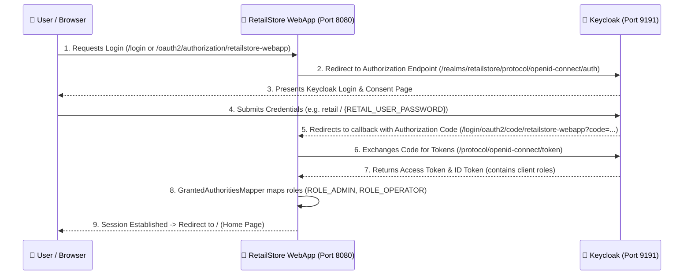

# Retail Store

Building RetailStore WebApp using Thymeleaf and Alpine.js.

Refer :: [YouTube Tutorial](https://www.youtube.com/watch?v=_2e7nfgH-u8)

## 🛠️ Tech Stack & Overview

- **Java Version**: Java 25
- **Spring Boot Version**: Spring Boot 4.1.2
- **Security**: Spring Security with OAuth2 Client & OpenID Connect (OIDC)
- **Identity Provider**: Keycloak 26.x (Port `9191`)
- **Web Application**: RetailStore WebApp (Port `8080`)
- **API Gateway**: Spring Cloud Gateway (Port `8765`)
- **Templating & Frontend**: Thymeleaf, Alpine.js, Tailwind CSS / Bootstrap

## Prerequisites and Startup Steps

Before starting the retailstore-webapp, ensure that the following prerequisites are met:

1. Java 25 and Docker / Docker Compose are installed on your system.
2. Build all services with Maven (if not already built):
   ```shell
   ./mvnw clean install -DskipTests
   ```
3. Start the entire microservice stack:
   ```shell
   cd deployment
   docker-compose up -d
   ```
   This will start all required services (including PostgreSQL, Keycloak on port 9191, API Gateway on port 8765, Kafka, and backend microservices) with proper dependencies and health checks.

4. Monitor the startup progress:
   ```shell
   docker-compose logs -f retailstore-webapp
   ```
   Wait until you see the message "Started RetailStoreWebappApplication" in the logs.

5. Access the webapp at [http://localhost:8080](http://localhost:8080)

Note: The docker-compose configuration includes health checks and dependency ordering, ensuring that retailstore-webapp starts only when Keycloak and dependent backend services are healthy.

## Keycloak Admin console

For accessing the Keycloak Admin Console, visit [Admin Console](http://localhost:9191) (or `http://localhost:9191/admin`) and log in with the admin credentials:

```plaintext
username: ${KC_BOOTSTRAP_ADMIN_USERNAME}
password: ${KC_BOOTSTRAP_ADMIN_PASSWORD}
```

## 🔐 Keycloak Security Configuration

To fully access all features of the application, users require specific client roles configured under the `retailstore-webapp` client:
- **`ADMIN`**: Grants administrative access to the Inventory UI (`/inventory`, `PUT /inventory`) and product creation (`POST /api/products`).
- **`OPERATOR`**: Grants access to Prometheus and Micrometer metrics Actuator endpoints (`/actuator/prometheus`, `/actuator/metrics`, `/actuator/metrics/**`).
- **`user`** (Realm Role): Assigned automatically upon self-registration (`/registration`, `/api/register`).

When using the Terraform manager (`deployment/terraform/keycloak/` or `docker compose --profile terraform up terraform`), both client roles (`ADMIN`, `OPERATOR`), seed users (`retail`, `raja`), and token mappers are provisioned automatically. If configuring manually in Keycloak:

### 1. Create the ADMIN and OPERATOR Client Roles
1. Open the Keycloak Admin Console (`http://localhost:9191`).
2. Select the **`retailstore`** realm.
3. Go to **Clients** -> click on **`retailstore-webapp`**.
4. Go to the **Roles** tab and click **Create Role**.
5. Name the role **`ADMIN`** (for application administration) or **`OPERATOR`** (for `/actuator/metrics` & `/actuator/prometheus` access) and click **Save**.

### 2. Map the Client Role to the ID Token
By default, Keycloak places client roles only inside the Access Token. To ensure `retailstore-webapp` can extract client roles into Spring Security `GrantedAuthority` during login:
1. On the left menu, go to **Client Scopes**.
2. Select and click on the **`roles`** scope in the list.
3. Go to the **Mappers** tab.
4. Click on the **`client roles`** mapper.
5. Toggle **ON** both **Add to ID token** and **Add to userinfo**.
6. Click **Save**.

### 3. Assign the Role to Your User
1. On the left menu, go to **Users**.
2. Search for your user (e.g., `retail` or `raja`) and click on the username.
3. Go to the **Role mapping** tab.
4. Click **Assign role**.
5. From the dropdown at the top, select **Filter by client roles** (or **Filter by clients**).
6. Find `ADMIN` (and/or `OPERATOR`), check the box, and click **Assign**.
   - Note: The pre-seeded `retail` user is granted both `ADMIN` and `OPERATOR` roles.

## Realm Configuration & Import

### Automated Provisioning via Terraform (Recommended)
Keycloak realm settings, clients, roles, and users are managed via Terraform scripts located in `deployment/terraform/keycloak/`. Docker Compose pulls the pre-built runner image (`dockertmt/mmv2-keycloak-terraform-runner:0.0.1-SNAPSHOT`) directly from DockerHub.

To execute Terraform via Docker Compose from the repository root:
```shell
docker compose -f deployment/docker-compose.yml --profile terraform up terraform
```

To refresh the snapshot image tag from DockerHub:
```shell
docker compose -f deployment/docker-compose.yml pull terraform
```

If you are developing or testing unpublished runner changes locally, build the image manually before running Compose:
```shell
docker build -t dockertmt/mmv2-keycloak-terraform-runner:0.0.1-SNAPSHOT -f deployment/terraform/Dockerfile deployment/terraform/
```

### Reference Realm File & Manual Export
A reference export of the realm configuration is maintained at:
`retail-store-webapp/src/test/resources/docker/realm-config/retailstore-realm.json`

To manually export the realm configuration, stop all Keycloak server instances first and keep PostgreSQL running. From the repository root, use a one-off container with the service's existing database settings and network:
```shell
docker compose -f deployment/docker-compose.yml stop keycloak
# Export the realm configuration and users while the server is stopped.
docker compose -f deployment/docker-compose.yml run --no-deps --name keycloak-export keycloak export --dir /tmp/keycloak-export --realm retailstore --users realm_file
# Copy the export from the exited container before removing it.
docker cp keycloak-export:/tmp/keycloak-export ./keycloak-export
docker rm keycloak-export
docker compose -f deployment/docker-compose.yml start keycloak
```

The export command exits when finished. Restart Keycloak after the export and copy succeed. See [Keycloak import and export](https://www.keycloak.org/server/importExport#_import_export_commands).

## UI & Credential Configuration

- **Web Application URL**: [http://localhost:8080](http://localhost:8080)
- **Keycloak Server URL**: [http://localhost:9191](http://localhost:9191)

Supply these values through environment variables or your secret store and apply them when provisioning Keycloak users. Rotate any previously published credentials used beyond isolated local development; replacing documentation examples does not rotate deployed credentials.

| Username | Password                   | Assigned Roles                                                  | Permissions / Purpose                                                                     |
|----------|----------------------------|-----------------------------------------------------------------|-------------------------------------------------------------------------------------------|
| `retail` | `${RETAIL_USER_PASSWORD}`               | `ADMIN`, `OPERATOR` (Client Roles), `default-roles-retailstore` | Full access: Storefront, Cart, Orders, Inventory (`ADMIN`), Actuator Metrics (`OPERATOR`) |
| `raja`   | `${RAJA_USER_PASSWORD}` | `default-roles-retailstore` (Realm Role)                        | Standard shopper: Storefront, Cart, Order creation and history                            |
| `${KC_BOOTSTRAP_ADMIN_USERNAME}` | `${KC_BOOTSTRAP_ADMIN_PASSWORD}`                | Master Realm Admin                                              | Keycloak Admin Console (`http://localhost:9191`)                                          |

## OIDC Authentication Sequence Diagram


