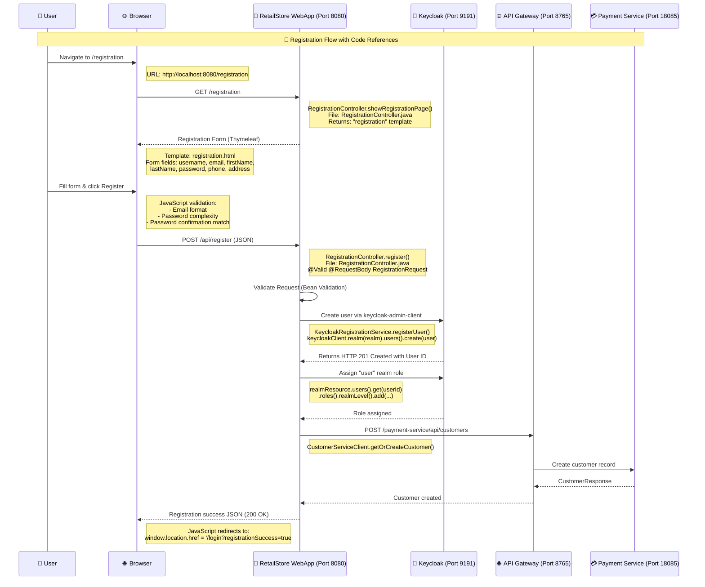
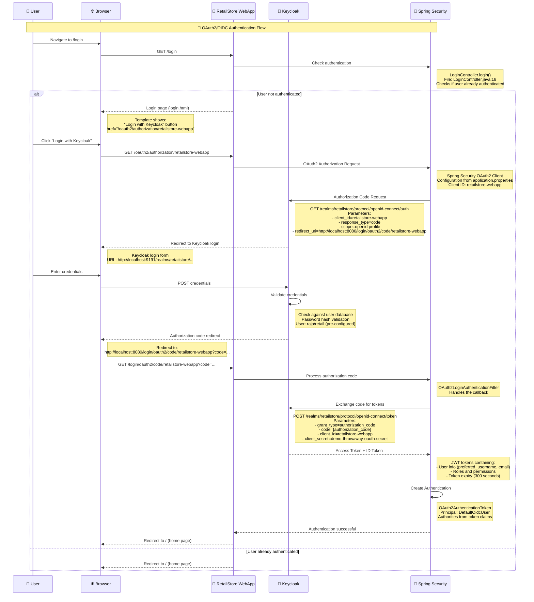
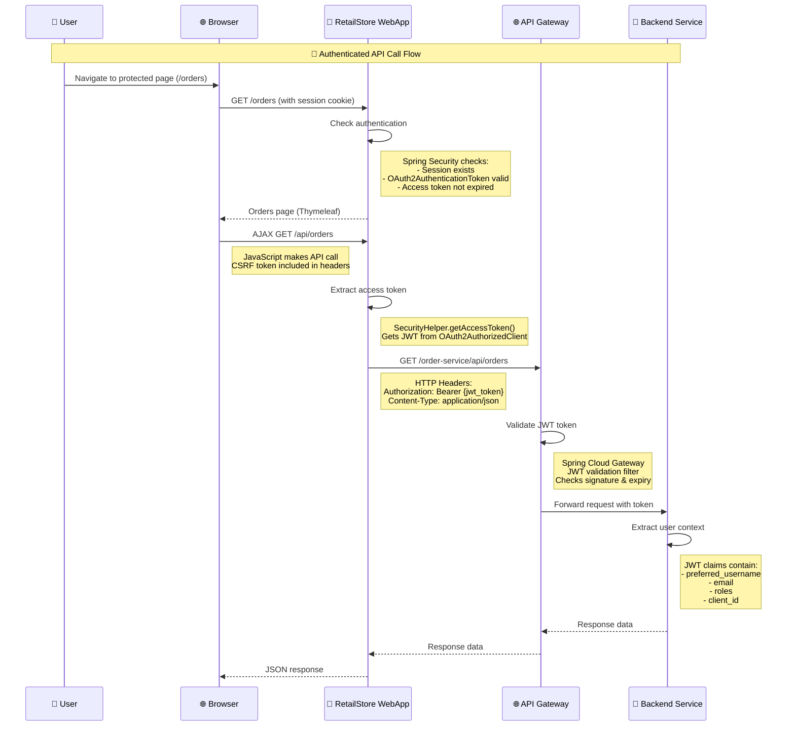
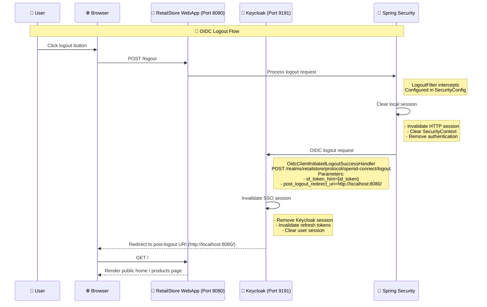
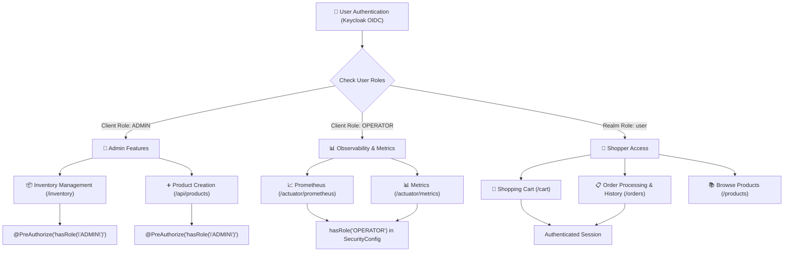

# 🔐 RetailStore WebApp - Authentication & Registration Deep Dive

## 📖 Overview

This document provides an in-depth analysis of the authentication and registration flows in the RetailStore WebApp built on **Java 25** and **Spring Boot 4.1.2**, mapping each sequence step to specific code components, configurations, and Keycloak integration points.

## 🏗️ Architecture Components

### Core Security Stack
- **Java 25**
- **Spring Boot 4.1.2** with **Spring Security** (OAuth2 Client & OIDC support)
- **Keycloak 26.x** as Identity Provider (Port `9191`)
- **RetailStore WebApp** (Port `8080`)
- **Keycloak Admin Client** (`keycloak-admin-client:26.0.12`) for user management
- **JWT Tokens** for stateless authorization
- **CSRF Protection** with cookie-based tokens (`CookieCsrfTokenRepository.withHttpOnlyFalse()`)
- **Role-based Access Control** (RBAC):
  - Client Roles on `retailstore-webapp`: `ADMIN` and `OPERATOR`
  - Realm Role: `user` (assigned on registration)

---

## 🔑 User Registration Flow - Code Mapping



### 🔍 Registration Code Components

#### 1. **RegistrationController.java**
```java
// Location: src/main/java/com/example/retailstore/webapp/web/controller/RegistrationController.java

@GetMapping("/registration")
public String showRegistrationPage() {
    return "registration"; // Maps to registration.html template
}

@PostMapping("/api/register")
public ResponseEntity<Map<String, String>> register(@Valid @RequestBody RegistrationRequest request) {
    logger.info("Received registration request for user: {}", request.username());
    registrationService.registerUser(request);
    CustomerRequest customerRequest = new CustomerRequest(
            request.username(),
            request.firstName(),
            request.lastName(),
            request.email(),
            request.phone(),
            request.address());
    CustomerResponse customerResponse = customerServiceClient.getOrCreateCustomer(customerRequest);
    logger.info("User {} registered successfully with id :{}", request.username(), customerResponse.customerId());
    return ResponseEntity.ok(Map.of("message", "User registered successfully"));
}
```

#### 2. **KeycloakRegistrationService.java**
```java
// Location: src/main/java/com/example/retailstore/webapp/services/KeycloakRegistrationService.java

public void registerUser(RegistrationRequest request) {
    UserRepresentation user = getUserRepresentation(request);
    RealmResource realmResource = keycloakClient.realm(realm);
    try (Response response = realmResource.users().create(user)) {
        if (response.getStatus() == 409) {
            throw new UserAlreadyExistsException("Username or email is already taken.");
        } else if (response.getStatus() >= 400) {
            throw new KeyCloakException("Failed to register user. Status: " + response.getStatus());
        }
        String userId = CreatedResponseUtil.getCreatedId(response);
        try {
            realmResource
                    .users()
                    .get(userId)
                    .roles()
                    .realmLevel()
                    .add(List.of(realmResource.roles().get("user").toRepresentation()));
        } catch (Exception e) {
            try {
                realmResource.users().get(userId).remove();
            } catch (Exception cleanupException) {
                e.addSuppressed(cleanupException);
            }
            throw e;
        }
    }
}
```

#### 3. **Security Configuration**
```java
// Location: src/main/java/com/example/retailstore/webapp/config/SecurityConstants.java

public static final String[] PUBLIC_URLS = {
    "/js/**",
    "/css/**",
    "/images/**",
    "/error",
    "/webjars/**",
    "/",
    "/actuator/health/**",
    "/actuator/info",
    "/products/**",
    "/api/products/**",
    "/api/register",  // Registration endpoint is public
    "/registration",  // Registration page is public
    "/login"         // Login page is public
};
```

---

## 🔐 Authentication Flow - Code Mapping



### 🔍 Authentication Code Components

#### 1. **SecurityConfig.java**
```java
// Location: src/main/java/com/example/retailstore/webapp/config/SecurityConfig.java

@Configuration(proxyBeanMethods = false)
@EnableWebSecurity
@EnableMethodSecurity
class SecurityConfig {
    private final ClientRegistrationRepository clientRegistrationRepository;

    SecurityConfig(ClientRegistrationRepository clientRegistrationRepository) {
        this.clientRegistrationRepository = clientRegistrationRepository;
    }

    @Bean
    SecurityFilterChain securityFilterChain(HttpSecurity http, GrantedAuthoritiesMapper userAuthoritiesMapper) {
        http.authorizeHttpRequests(c -> c.requestMatchers(SecurityConstants.PUBLIC_URLS)
                        .permitAll()
                        .requestMatchers("/actuator/prometheus", "/actuator/metrics", "/actuator/metrics/**")
                        .hasRole("OPERATOR")
                        .anyRequest()
                        .authenticated())
                .cors(Customizer.withDefaults())
                .csrf(csrf -> csrf.ignoringRequestMatchers("/api/register")
                        .csrfTokenRepository(CookieCsrfTokenRepository.withHttpOnlyFalse()))
                .oauth2Login(oauth2 -> oauth2.loginPage("/login")
                        .defaultSuccessUrl("/", true)
                        .userInfoEndpoint(userInfo -> userInfo.userAuthoritiesMapper(userAuthoritiesMapper)))
                .logout(logout -> logout.clearAuthentication(true)
                        .invalidateHttpSession(true)
                        .logoutSuccessHandler(oidcLogoutSuccessHandler()))
                .headers(headers -> headers.contentSecurityPolicy(csp -> csp.policyDirectives(
                        "default-src 'self'; script-src 'self' 'unsafe-eval'; style-src 'self' 'unsafe-inline'; img-src 'self' data: https://example.com; connect-src 'self'")));

        return http.build();
    }

    private LogoutSuccessHandler oidcLogoutSuccessHandler() {
        OidcClientInitiatedLogoutSuccessHandler oidcLogoutSuccessHandler =
                new OidcClientInitiatedLogoutSuccessHandler(this.clientRegistrationRepository);
        oidcLogoutSuccessHandler.setPostLogoutRedirectUri("{baseUrl}/");
        return oidcLogoutSuccessHandler;
    }

    @Bean
    GrantedAuthoritiesMapper userAuthoritiesMapper() {
        return authorities -> {
            Set<GrantedAuthority> mappedAuthorities = new HashSet<>();
            authorities.forEach(authority -> {
                if (authority instanceof OidcUserAuthority oidcAuth) {
                    Map<String, Object> resourceAccess = oidcAuth.getIdToken().getClaimAsMap("resource_access");
                    if (resourceAccess == null && oidcAuth.getUserInfo() != null) {
                        resourceAccess = oidcAuth.getUserInfo().getClaimAsMap("resource_access");
                    }
                    if (resourceAccess != null) {
                        String clientId = oidcAuth.getIdToken().getClaimAsString("azp");
                        if (clientId == null) {
                            clientId = "retailstore-webapp";
                        }
                        Object clientAccess = resourceAccess.get(clientId);
                        if (clientAccess instanceof Map<?, ?> client) {
                            Object roles = client.get("roles");
                            if (roles instanceof Collection<?> roleCollection) {
                                roleCollection.stream()
                                        .filter(String.class::isInstance)
                                        .map(String.class::cast)
                                        .map(role -> new SimpleGrantedAuthority("ROLE_" + role))
                                        .forEach(mappedAuthorities::add);
                            }
                        }
                    }
                }
                mappedAuthorities.add(authority);
            });
            return mappedAuthorities;
        };
    }
}
```

#### 2. **OAuth2 Configuration (application.properties)**
```properties
OAUTH2_SERVER_URL=http://localhost:9191
REALM_URL=${OAUTH2_SERVER_URL}/realms/retailstore

# OAuth2 Client Registration
spring.security.oauth2.client.registration.retailstore-webapp.client-id=retailstore-webapp
spring.security.oauth2.client.registration.retailstore-webapp.client-secret=${OAUTH2_CLIENT_SECRET:demo-throwaway-oauth-secret}
spring.security.oauth2.client.registration.retailstore-webapp.authorization-grant-type=authorization_code
spring.security.oauth2.client.registration.retailstore-webapp.scope[0]=openid
spring.security.oauth2.client.registration.retailstore-webapp.scope[1]=profile
spring.security.oauth2.client.registration.retailstore-webapp.scope[2]=roles
spring.security.oauth2.client.registration.retailstore-webapp.redirect-uri={baseUrl}/login/oauth2/code/retailstore-webapp

# OAuth2 Provider Configuration
spring.security.oauth2.client.provider.retailstore-webapp.issuer-uri=${REALM_URL}
```

#### 3. **SecurityHelper.java**
```java
// Location: src/main/java/com/example/retailstore/webapp/services/SecurityHelper.java

public String getUsername() {
    Authentication authentication = SecurityContextHolder.getContext().getAuthentication();
    if (authentication != null && authentication.getPrincipal() instanceof DefaultOidcUser principal) {
        return principal.getAttribute("preferred_username");
    }
    return null;
}

public String getLoggedInUserEmail() {
    Authentication authentication = SecurityContextHolder.getContext().getAuthentication();
    if (authentication != null && authentication.getPrincipal() instanceof DefaultOidcUser principal) {
        return principal.getAttribute("email");
    }
    return null;
}

public String getAccessToken() {
    Authentication authentication = SecurityContextHolder.getContext().getAuthentication();
    if (authentication instanceof OAuth2AuthenticationToken oauthToken) {
        OAuth2AuthorizedClient client = authorizedClientService.loadAuthorizedClient(
                oauthToken.getAuthorizedClientRegistrationId(), oauthToken.getName());
        if (client != null && client.getAccessToken() != null) {
            return client.getAccessToken().getTokenValue();
        }
    }
    return null;
}
```

---

## 🔒 Token Management & API Calls



### 🔍 Token Management Code

#### 1. **API Client Configuration (Spring Boot 4.1.2 RestClient & Interceptor)**
```java
// Location: src/main/java/com/example/retailstore/webapp/clients/ClientsConfig.java

@Configuration(proxyBeanMethods = false)
@ImportHttpServices({
    CatalogServiceClient.class,
    OrderServiceClient.class,
    CustomerServiceClient.class,
    InventoryServiceClient.class
})
class ClientsConfig {

    @Bean
    RestClientHttpServiceGroupConfigurer groupConfigurer(
            ObservationRegistry observationRegistry,
            ApplicationProperties applicationProperties,
            OAuth2AuthorizedClientManager authorizedClientManager) {

        OAuth2ClientHttpRequestInterceptor interceptor =
                new OAuth2ClientHttpRequestInterceptor(authorizedClientManager);

        return groups -> groups.forEachClient((group, builder) -> builder.baseUrl(applicationProperties.apiGatewayUrl())
                .defaultHeaders(httpHeaders -> {
                    httpHeaders.add(HttpHeaders.ACCEPT, MediaType.APPLICATION_JSON_VALUE);
                    httpHeaders.add(HttpHeaders.CONTENT_TYPE, MediaType.APPLICATION_JSON_VALUE);
                })
                .requestInterceptor(interceptor)
                .observationRegistry(observationRegistry)
                .build());
    }
}
```

---

## 🚪 Logout Flow



### 🔍 Logout Configuration
```java
// Location: src/main/java/com/example/retailstore/webapp/config/SecurityConfig.java

private LogoutSuccessHandler oidcLogoutSuccessHandler() {
    OidcClientInitiatedLogoutSuccessHandler oidcLogoutSuccessHandler =
        new OidcClientInitiatedLogoutSuccessHandler(this.clientRegistrationRepository);
    oidcLogoutSuccessHandler.setPostLogoutRedirectUri("{baseUrl}/");
    return oidcLogoutSuccessHandler;
}
```

---

## 🛡️ Role-Based Access Control



### 🔍 Role-Based Security Code

#### 1. **Method-Level Security (ADMIN Role)**
```java
// Location: src/main/java/com/example/retailstore/webapp/web/controller/InventoryController.java

@PreAuthorize("hasRole('ADMIN')")
@GetMapping("/inventory")
String showInventoriesPage(@RequestParam(defaultValue = "0") int page, Model model) {
    model.addAttribute("pageNo", page);
    return "inventory";
}

@PutMapping(value = "/inventory", consumes = MediaType.APPLICATION_JSON_VALUE)
@ResponseBody
@PreAuthorize("hasRole('ADMIN')")
InventoryResponse updateInventory(@Valid @RequestBody InventoryResponse inventoryResponse) {
    return inventoryServiceClient.updateInventory(
            inventoryResponse.id(), inventoryResponse.createInventoryUpdateRequest());
}

// Location: src/main/java/com/example/retailstore/webapp/web/controller/ProductController.java

@PreAuthorize("hasRole('ADMIN')")
@PostMapping(value = "/api/products", consumes = MediaType.APPLICATION_JSON_VALUE)
@ResponseBody
ProductResponse createProduct(@Valid @RequestBody ProductRequest productRequest) {
    return catalogServiceClient.createProduct(productRequest);
}
```

#### 2. **Filter Chain Authorization (OPERATOR Role)**
```java
// Location: src/main/java/com/example/retailstore/webapp/config/SecurityConfig.java

http.authorizeHttpRequests(c -> c
    .requestMatchers(SecurityConstants.PUBLIC_URLS).permitAll()
    .requestMatchers("/actuator/prometheus", "/actuator/metrics", "/actuator/metrics/**").hasRole("OPERATOR")
    .anyRequest().authenticated()
);
```

#### 3. **Keycloak Role Configuration (Terraform / JSON)**
```hcl
# Location: deployment/terraform/keycloak/roles.tf

resource "keycloak_role" "webapp_admin_role" {
  realm_id    = keycloak_realm.retailstore.id
  client_id   = keycloak_openid_client.retailstore_webapp.id
  name        = "ADMIN"
  description = "retail store Administrator"
}

resource "keycloak_role" "webapp_operator_role" {
  realm_id    = keycloak_realm.retailstore.id
  client_id   = keycloak_openid_client.retailstore_webapp.id
  name        = "OPERATOR"
  description = "retail store Operator"
}

resource "keycloak_role" "user_realm_role" {
  realm_id    = keycloak_realm.retailstore.id
  name        = "user"
  description = "User role"
}
```

---

## 🔧 Configuration Deep Dive

### 1. **Keycloak Client Configuration**
```json
{
  "clientId": "retailstore-webapp",
  "secret": "demo-throwaway-oauth-secret",
  "redirectUris": [
    "http://localhost:8080/login/oauth2/code/retailstore-webapp"
  ],
  "webOrigins": ["http://localhost:8080"],
  "standardFlowEnabled": true,
  "directAccessGrantsEnabled": true,
  "frontchannelLogout": true,
  "attributes": {
    "post.logout.redirect.uris": "http://localhost:8080"
  }
}
```

### 2. **JWT Token Structure**
```json
{
  "header": {
    "alg": "RS256",
    "typ": "JWT",
    "kid": "rsa-generated-key-id"
  },
  "payload": {
    "exp": 1640995200,
    "iat": 1640991600,
    "iss": "http://localhost:9191/realms/retailstore",
    "aud": "retailstore-webapp",
    "azp": "retailstore-webapp",
    "sub": "362b5bb3-0e0a-4ee6-9b59-53e2ca1adeac",
    "preferred_username": "retail",
    "email": "retailstore@gmail.com",
    "realm_access": {
      "roles": ["default-roles-retailstore", "user"]
    },
    "resource_access": {
      "retailstore-webapp": {
        "roles": ["ADMIN", "OPERATOR"]
      }
    },
    "scope": "openid profile roles"
  }
}
```

### 3. **CSRF Protection**
```java
// Location: src/main/java/com/example/retailstore/webapp/config/SecurityConfig.java

.csrf(csrf -> csrf
    .ignoringRequestMatchers("/api/register") // Registration endpoint exempt
    .csrfTokenRepository(CookieCsrfTokenRepository.withHttpOnlyFalse())
)
```

---

## 🚨 Error Handling & Security

### 1. **Exception Handling**
```java
// Location: src/main/java/com/example/retailstore/webapp/exception/GlobalExceptionHandler.java

@ExceptionHandler(KeyCloakException.class)
public ResponseEntity<Map<String, String>> handleKeycloakException(KeyCloakException ex) {
    return ResponseEntity.status(HttpStatus.INTERNAL_SERVER_ERROR)
        .body(Map.of("message", "Authentication service error"));
}
```

### 2. **Security Headers**
```json
// Keycloak Browser Security Headers
{
  "contentSecurityPolicy": "frame-src 'self'; frame-ancestors 'self'; object-src 'none';",
  "xFrameOptions": "SAMEORIGIN",
  "xContentTypeOptions": "nosniff",
  "xXSSProtection": "1; mode=block",
  "strictTransportSecurity": "max-age=31536000; includeSubDomains"
}
```

---

## 📊 Key Metrics & Monitoring

### Authentication Events
- **Login Success/Failure** rates
- **Token Refresh** frequency  
- **Session Duration** analytics
- **Role-based Access** patterns

### Security Monitoring
- **Failed Authentication** attempts
- **Token Expiry** handling
- **CSRF Attack** prevention
- **Session Hijacking** detection

---

## 🎯 Best Practices Implemented

1. **🔐 Secure Token Storage**: Tokens stored in OAuth2AuthorizedClient, not in browser
2. **🛡️ CSRF Protection**: Cookie-based CSRF tokens for form submissions
3. **⏰ Token Expiry**: Short-lived access tokens (5 minutes) with refresh capability
4. **🚪 Proper Logout**: OIDC-compliant logout with SSO session termination
5. **🔒 Role Separation**: Clear distinction between `user` (shopper), `ADMIN` (inventory/products), and `OPERATOR` (actuator metrics/Prometheus) roles
6. **📝 Audit Trail**: Comprehensive logging of authentication events
7. **🌐 CORS Configuration**: Proper cross-origin resource sharing setup
8. **🔧 Configuration Security**: Sensitive configs externalized via environment variables

---

## 🔍 Troubleshooting Guide

### Common Issues & Solutions

| Issue | Symptoms | Solution |
|-------|----------|----------|
| **Token Expired** | 401 Unauthorized on API calls | Implement token refresh logic |
| **CSRF Token Missing** | 403 Forbidden on form submission | Ensure CSRF token in request headers |
| **Role Access Denied** | 403 Forbidden on admin endpoints | Check user roles in Keycloak |
| **Redirect Loop** | Infinite redirects between login/home | Verify OAuth2 redirect URIs |
| **Session Timeout** | Unexpected logouts | Configure session timeout settings |

### Debug Configuration
```properties
# Enable OAuth2 debug logging
logging.level.org.springframework.security.oauth2=DEBUG
logging.level.org.springframework.security.web=DEBUG
```

This comprehensive documentation maps every authentication and registration flow step to specific code components, providing developers with a complete understanding of the security implementation in the RetailStore WebApp.