# RetailStore WebApp - Detailed Sequence Diagram

Built with **Java 25**, **Spring Boot 4.1.2**, and **Keycloak 26.x**.

## Complete User Journey Flow

```mermaid
sequenceDiagram
    participant User as 👤 User / Operator
    participant Browser as 🌐 Browser
    participant WebApp as 🛒 RetailStore WebApp<br/>(Port: 8080)
    participant Keycloak as 🔐 Keycloak<br/>(Port: 9191)
    participant Gateway as 🌐 API Gateway<br/>(Port: 8765)
    participant Catalog as 📚 Catalog Service<br/>(Port: 18080)
    participant Inventory as 📦 Inventory Service<br/>(Port: 18181)
    participant Payment as 💳 Payment Service<br/>(Port: 18085)
    participant Order as 🛍️ Order Service<br/>(Port: 18282)

    Note over User, Order: 🔐 User Registration Flow
    User->>Browser: Navigate to /registration
    Browser->>WebApp: GET /registration
    WebApp-->>Browser: Registration Form (Thymeleaf)
    User->>Browser: Fill registration form
    Browser->>WebApp: POST /api/register
    WebApp->>Keycloak: Create user via keycloak-admin-client
    Keycloak-->>WebApp: User created (HTTP 201)
    WebApp->>Keycloak: Assign realm role "user"
    Keycloak-->>WebApp: Role assigned
    WebApp->>Gateway: POST /payment-service/api/customers
    Gateway->>Payment: Create customer record
    Payment-->>Gateway: Customer created
    Gateway-->>WebApp: Customer response
    WebApp-->>Browser: Registration success (200 OK)

    Note over User, Order: 🔑 Authentication Flow (OAuth2 / OIDC)
    User->>Browser: Navigate to /login
    Browser->>WebApp: GET /login
    WebApp-->>Browser: Login page with OAuth2 button
    User->>Browser: Click "Login with Keycloak"
    Browser->>WebApp: GET /oauth2/authorization/retailstore-webapp
    WebApp->>Keycloak: Redirect to /realms/retailstore/protocol/openid-connect/auth
    Keycloak-->>Browser: Login & consent prompt
    User->>Keycloak: Submit credentials (e.g., retail / retail1234)
    Keycloak-->>WebApp: Redirect to /login/oauth2/code/retailstore-webapp with code
    WebApp->>Keycloak: Exchange code for tokens (/protocol/openid-connect/token)
    Keycloak-->>WebApp: Access Token + ID Token (with client roles: ADMIN, OPERATOR)
    WebApp->>WebApp: GrantedAuthoritiesMapper maps client roles to ROLE_ADMIN, ROLE_OPERATOR
    WebApp-->>Browser: Redirect to / (authenticated)

    Note over User, Order: 📚 Product Browsing & Creation Flow
    User->>Browser: Navigate to /products
    Browser->>WebApp: GET /products
    WebApp-->>Browser: Products page (Thymeleaf)
    Browser->>WebApp: GET /api/products?page=0 (AJAX)
    WebApp->>Gateway: GET /catalog-service/api/catalog?pageNo=0
    Gateway->>Catalog: Forward request
    Catalog-->>Gateway: PagedResult<ProductResponse>
    Gateway-->>WebApp: Product list
    WebApp-->>Browser: JSON product data
    Browser-->>User: Display products with Alpine.js
    
    opt Create Product (ADMIN Role Required)
        User->>Browser: Submit product creation form
        Browser->>WebApp: POST /api/products (JSON)
        WebApp->>WebApp: @PreAuthorize("hasRole('ADMIN')")
        WebApp->>Gateway: POST /catalog-service/api/catalog (with Bearer token)
        Gateway->>Catalog: Forward request
        Catalog-->>Gateway: ProductResponse
        Gateway-->>WebApp: ProductResponse
        WebApp-->>Browser: Product created
    end

    Note over User, Order: 📦 Inventory Management (ADMIN Role Required)
    User->>Browser: Navigate to /inventory (Admin role required)
    Browser->>WebApp: GET /inventory (with auth session)
    WebApp->>WebApp: @PreAuthorize("hasRole('ADMIN')")
    WebApp-->>Browser: Inventory page (Thymeleaf)
    Browser->>WebApp: GET /api/inventory?page=0 (AJAX)
    WebApp->>Gateway: GET /inventory-service/api/inventory?pageNo=0
    Gateway->>Inventory: Forward request
    Inventory-->>Gateway: PagedResult<InventoryResponse>
    Gateway-->>WebApp: Inventory list
    WebApp-->>Browser: JSON inventory data
    
    User->>Browser: Update inventory quantity
    Browser->>WebApp: PUT /inventory (with auth session)
    WebApp->>WebApp: @PreAuthorize("hasRole('ADMIN')")
    WebApp->>Gateway: PUT /inventory-service/api/inventory/{id}
    Gateway->>Inventory: Update inventory
    Inventory-->>Gateway: Updated inventory
    Gateway-->>WebApp: Success response
    WebApp-->>Browser: Updated inventory data

    Note over User, Order: 📊 Observability & Actuator Metrics (OPERATOR Role Required)
    User->>Browser: Access /actuator/prometheus or /actuator/metrics
    Browser->>WebApp: GET /actuator/prometheus (with auth session)
    WebApp->>WebApp: SecurityConfig: hasRole("OPERATOR")
    WebApp-->>Browser: 200 OK (Prometheus metrics exposition)

    Note over User, Order: 🛒 Shopping Cart & Order Flow
    User->>Browser: Add products to cart (client-side)
    Browser->>Browser: Store in localStorage (Alpine.js)
    User->>Browser: Navigate to /cart
    Browser->>WebApp: GET /cart (with auth session)
    WebApp->>WebApp: SecurityHelper.getUsername()
    WebApp->>Gateway: GET /payment-service/api/customers/name/{username}
    Gateway->>Payment: Get customer by name
    Payment-->>Gateway: CustomerResponse
    Gateway-->>WebApp: Customer details
    WebApp-->>Browser: Cart page with customer info

    User->>Browser: Proceed to checkout
    Browser->>WebApp: POST /api/orders (with auth session + order data)
    WebApp->>WebApp: SecurityHelper.getAccessToken()
    WebApp->>Gateway: GET /payment-service/api/customers/name/{name}
    Gateway->>Payment: Get customer details
    Payment-->>Gateway: CustomerResponse
    Gateway-->>WebApp: Customer data
    WebApp->>Gateway: POST /order-service/api/orders<br/>(with Bearer token)
    Gateway->>Order: Create order with customer ID
    
    Note over Order: Order Service processes:<br/>- Validates inventory<br/>- Creates order record<br/>- Publishes events to Kafka
    
    Order-->>Gateway: OrderConfirmationDTO
    Gateway-->>WebApp: Order confirmation
    WebApp-->>Browser: Order success response
    Browser-->>User: Order confirmation

    Note over User, Order: 📋 Order History Flow
    User->>Browser: Navigate to /orders
    Browser->>WebApp: GET /orders (with auth session)
    WebApp-->>Browser: Orders page (Thymeleaf)
    Browser->>WebApp: GET /api/orders (AJAX with auth session)
    WebApp->>WebApp: SecurityHelper.getAccessToken()
    WebApp->>Gateway: GET /order-service/api/orders<br/>(with Bearer token)
    Gateway->>Order: Get user orders
    Order-->>Gateway: PagedResult<OrderResponse>
    Gateway-->>WebApp: Orders list
    WebApp-->>Browser: JSON orders data

    User->>Browser: Click on specific order
    Browser->>WebApp: GET /api/orders/{orderNumber}
    WebApp->>Gateway: GET /order-service/api/orders/{orderNumber}<br/>(with Bearer token)
    Gateway->>Order: Get order details
    Order-->>Gateway: OrderResponse
    Gateway-->>WebApp: Order details
    WebApp->>Gateway: GET /payment-service/api/customers/{customerId}
    Gateway->>Payment: Get customer details
    Payment-->>Gateway: CustomerResponse
    Gateway-->>WebApp: Customer info
    WebApp->>WebApp: orderResponse.updateCustomerDetails()
    WebApp-->>Browser: Complete order details
    Browser-->>User: Display order details

    Note over User, Order: 🚪 Logout Flow
    User->>Browser: Click logout
    Browser->>WebApp: POST /logout
    WebApp->>WebApp: Clear session & SecurityContext
    WebApp->>Keycloak: OIDC logout request (/protocol/openid-connect/logout)
    Keycloak-->>WebApp: Logout confirmed
    WebApp-->>Browser: Redirect to {baseUrl}/ (http://localhost:8080/)
    Browser-->>User: Logged out
```

## Key Architecture Components

### 🔐 Security & Authentication (Spring Boot 4.1.2 & Java 25)
- **OAuth2 / OIDC**: Keycloak integration via Authorization Code Flow.
- **JWT Tokens**: Verified via Keycloak JWKS endpoint (`http://localhost:9191/realms/retailstore/protocol/openid-connect/certs`).
- **Required Roles**:
  - **`ADMIN`** (Client Role): Restricts access to `/inventory` (`GET`/`PUT`) and product creation (`POST /api/products`) via `@PreAuthorize("hasRole('ADMIN')")`.
  - **`OPERATOR`** (Client Role): Restricts access to Actuator endpoints (`/actuator/prometheus`, `/actuator/metrics`, `/actuator/metrics/**`) via `hasRole("OPERATOR")` in `SecurityConfig`.
  - **`user`** (Realm Role): Granted to registered shoppers for store browsing, cart, and orders.
- **Role Mapping**: `GrantedAuthoritiesMapper` in `SecurityConfig.java` maps Keycloak client roles from `resource_access.retailstore-webapp.roles` to `ROLE_ADMIN` and `ROLE_OPERATOR`.
- **CSRF Protection**: Cookie-based CSRF tokens (`CookieCsrfTokenRepository.withHttpOnlyFalse()`), with `/api/register` exempt.

### 🌐 Communication Patterns
- **API Gateway**: Single entry point (`http://localhost:8765`) routing to all backend services.
- **HTTP Service Clients**: Declarative HTTP interfaces (`@ImportHttpServices`) with `RestClientHttpServiceGroupConfigurer` and `OAuth2ClientHttpRequestInterceptor`.
- **Bearer Token**: Downstream calls automatically attach the authenticated user's JWT access token.

### 🎨 Frontend Technology
- **Thymeleaf**: Server-side HTML rendering.
- **Alpine.js**: Client-side interactivity and state management.
- **LocalStorage**: Client-side cart persistence.

## Service Endpoints Summary

| Service         | Base URL                 | Key Endpoints / Notes                                                                                              |
|-----------------|--------------------------|--------------------------------------------------------------------------------------------------------------------|
| **WebApp**      | `http://localhost:8080`  | `/products`, `/cart`, `/orders`, `/inventory` (`ADMIN`), `/actuator/prometheus` & `/actuator/metrics` (`OPERATOR`) |
| **Keycloak**    | `http://localhost:9191`  | Realm: `retailstore`, Master Admin: `http://localhost:9191/admin`                                                  |
| **API Gateway** | `http://localhost:8765`  | Routes requests to backend microservices                                                                           |
| **Catalog**     | `http://localhost:18080` | `/api/catalog` (products)                                                                                          |
| **Inventory**   | `http://localhost:18181` | `/api/inventory` (stock levels)                                                                                    |
| **Payment**     | `http://localhost:18085` | `/api/customers` (customer mgmt)                                                                                   |
| **Order**       | `http://localhost:18282` | `/api/orders` (order processing)                                                                                   |