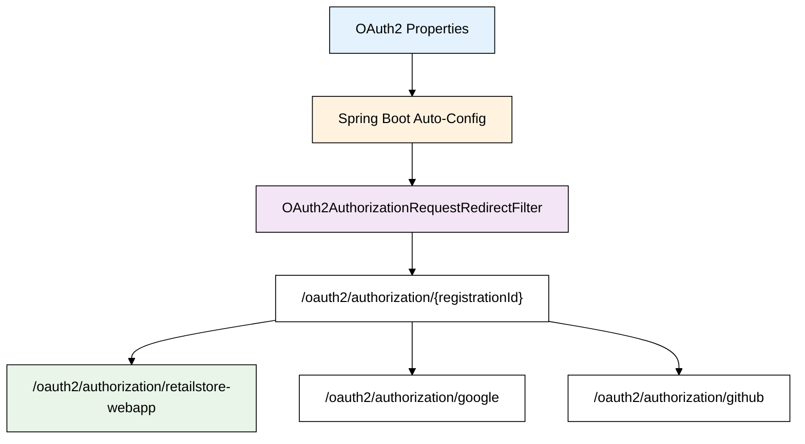
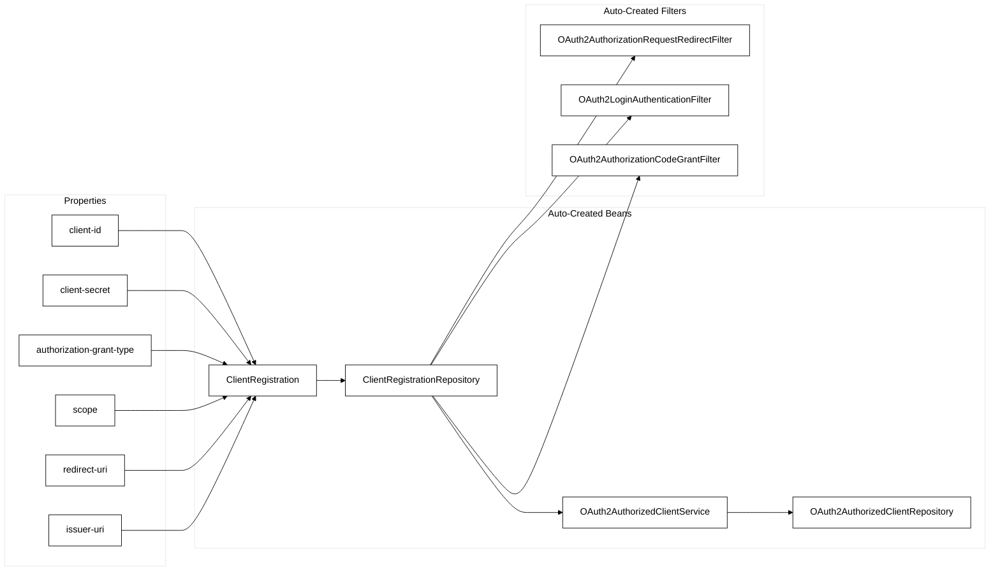
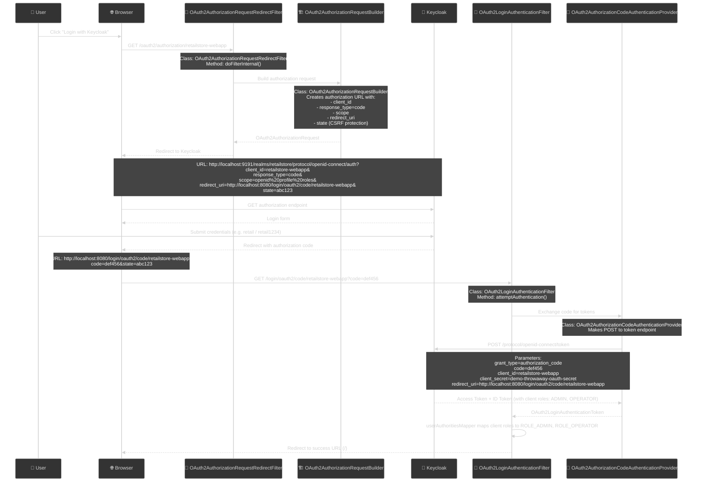

# 🔍 Spring Security OAuth2 Auto-Configuration Deep Dive

## 📖 Overview

This document explains the mechanics behind Spring Security OAuth2 auto-configuration in the RetailStore WebApp built on **Java 25** and **Spring Boot 4.1.2**, revealing how properties automatically configure endpoints, filters, token exchange, and role mappings with **Keycloak 26.x**.

---

## 🎯 Question 1: Where does `/oauth2/authorization/retailstore-webapp` come from?

### 🔧 **Spring Boot Auto-Configuration Magic**

When you define OAuth2 client registration properties in `application.properties`:
```properties
OAUTH2_SERVER_URL=http://localhost:9191
REALM_URL=${OAUTH2_SERVER_URL}/realms/retailstore

spring.security.oauth2.client.registration.retailstore-webapp.client-id=retailstore-webapp
spring.security.oauth2.client.registration.retailstore-webapp.client-secret=${OAUTH2_CLIENT_SECRET:demo-throwaway-oauth-secret}
spring.security.oauth2.client.registration.retailstore-webapp.authorization-grant-type=authorization_code
spring.security.oauth2.client.registration.retailstore-webapp.scope[0]=openid
spring.security.oauth2.client.registration.retailstore-webapp.scope[1]=profile
spring.security.oauth2.client.registration.retailstore-webapp.scope[2]=roles
spring.security.oauth2.client.registration.retailstore-webapp.redirect-uri={baseUrl}/login/oauth2/code/retailstore-webapp

spring.security.oauth2.client.provider.retailstore-webapp.issuer-uri=${REALM_URL}
```

Spring Boot **automatically registers** the OAuth2 authorization endpoint pattern:
```
/oauth2/authorization/{registrationId}
```
For registration ID `retailstore-webapp`, this produces:
```
/oauth2/authorization/retailstore-webapp
```

### 📍 **Auto-Generated Endpoints**



### 🔍 **Behind the Scenes Code**

Spring Security automatically registers this filter:

```java
// This happens automatically when OAuth2 properties are detected
@Configuration
@EnableWebSecurity
public class OAuth2ClientAutoConfiguration {
    
    @Bean
    public OAuth2AuthorizationRequestRedirectFilter oauth2AuthorizationRequestRedirectFilter() {
        return new OAuth2AuthorizationRequestRedirectFilter(
            OAuth2AuthorizationRequestRedirectFilter.DEFAULT_AUTHORIZATION_REQUEST_BASE_URI
        );
        // DEFAULT_AUTHORIZATION_REQUEST_BASE_URI = "/oauth2/authorization"
    }
}
```

### 📝 **How to Find Available Endpoints**

You can discover all auto-generated OAuth2 endpoints:

```java
// Add this to any controller for debugging
@RestController
public class DebugController {
    
    @Autowired
    private ClientRegistrationRepository clientRegistrationRepository;
    
    @GetMapping("/debug/oauth2-endpoints")
    public Map<String, String> getOAuth2Endpoints() {
        Map<String, String> endpoints = new HashMap<>();
        
        clientRegistrationRepository.forEach(registration -> {
            String registrationId = registration.getRegistrationId();
            endpoints.put(registrationId, "/oauth2/authorization/" + registrationId);
        });
        
        return endpoints;
        // Output: {"retailstore-webapp": "/oauth2/authorization/retailstore-webapp"}
    }
}
```

---

## 🎯 Question 2: What do OAuth2 Properties Actually Do?

### 🏗️ **Property-to-Bean Mapping**



### 📋 **Detailed Property Breakdown**

#### 1. **Client Registration Properties**
```properties
# Creates ClientRegistration bean with these values
spring.security.oauth2.client.registration.retailstore-webapp.client-id=retailstore-webapp
spring.security.oauth2.client.registration.retailstore-webapp.client-secret=${OAUTH2_CLIENT_SECRET:demo-throwaway-oauth-secret}
spring.security.oauth2.client.registration.retailstore-webapp.authorization-grant-type=authorization_code
spring.security.oauth2.client.registration.retailstore-webapp.scope[0]=openid
spring.security.oauth2.client.registration.retailstore-webapp.scope[1]=profile
spring.security.oauth2.client.registration.retailstore-webapp.scope[2]=roles
spring.security.oauth2.client.registration.retailstore-webapp.redirect-uri={baseUrl}/login/oauth2/code/retailstore-webapp
```

**Equivalent Java Configuration:**
```java
@Bean
public ClientRegistrationRepository clientRegistrationRepository() {
    ClientRegistration registration = ClientRegistration.withRegistrationId("retailstore-webapp")
        .clientId("retailstore-webapp")
        .clientSecret("demo-throwaway-oauth-secret")
        .authorizationGrantType(AuthorizationGrantType.AUTHORIZATION_CODE)
        .scope("openid", "profile", "roles")
        .redirectUri("{baseUrl}/login/oauth2/code/retailstore-webapp")
        .authorizationUri("http://localhost:9191/realms/retailstore/protocol/openid-connect/auth")
        .tokenUri("http://localhost:9191/realms/retailstore/protocol/openid-connect/token")
        .userInfoUri("http://localhost:9191/realms/retailstore/protocol/openid-connect/userinfo")
        .jwkSetUri("http://localhost:9191/realms/retailstore/protocol/openid-connect/certs")
        .build();
    
    return new InMemoryClientRegistrationRepository(registration);
}
```

#### 2. **Provider Configuration**
```properties
# Auto-discovers OAuth2 endpoints from Keycloak issuer
spring.security.oauth2.client.provider.retailstore-webapp.issuer-uri=http://localhost:9191/realms/retailstore
```

**What happens automatically:**
Spring makes HTTP GET to: `http://localhost:9191/realms/retailstore/.well-known/openid-configuration`
Response contains:
```json
{
  "authorization_endpoint": "http://localhost:9191/realms/retailstore/protocol/openid-connect/auth",
  "token_endpoint": "http://localhost:9191/realms/retailstore/protocol/openid-connect/token",
  "userinfo_endpoint": "http://localhost:9191/realms/retailstore/protocol/openid-connect/userinfo",
  "jwks_uri": "http://localhost:9191/realms/retailstore/protocol/openid-connect/certs"
}
```

### 🔄 **Project Security Filter Chain & Role Mapping (`SecurityConfig.java`)**

In `retailstore-webapp`, the application customizes the security filter chain to enforce RBAC:

```java
@Bean
SecurityFilterChain securityFilterChain(HttpSecurity http, GrantedAuthoritiesMapper userAuthoritiesMapper) {
    http.authorizeHttpRequests(c -> c.requestMatchers(SecurityConstants.PUBLIC_URLS)
                    .permitAll()
                    .requestMatchers("/actuator/prometheus", "/actuator/metrics", "/actuator/metrics/**")
                    .hasRole("OPERATOR")
                    .anyRequest()
                    .authenticated())
            .cors(Customizer.withDefaults())
            .csrf(csrf -> csrf.ignoringRequestMatchers("/api/register")
                    .csrfTokenRepository(CookieCsrfTokenRepository.withHttpOnlyFalse()))
            .oauth2Login(oauth2 -> oauth2.loginPage("/login")
                    .defaultSuccessUrl("/", true)
                    .userInfoEndpoint(userInfo -> userInfo.userAuthoritiesMapper(userAuthoritiesMapper)))
            .logout(logout -> logout.clearAuthentication(true)
                    .invalidateHttpSession(true)
                    .logoutSuccessHandler(oidcLogoutSuccessHandler()))
            .headers(headers -> headers.contentSecurityPolicy(csp -> csp.policyDirectives(
                    "default-src 'self'; script-src 'self' 'unsafe-eval'; style-src 'self' 'unsafe-inline'; img-src 'self' data: https://example.com; connect-src 'self'")));

    return http.build();
}

@Bean
GrantedAuthoritiesMapper userAuthoritiesMapper() {
    return authorities -> {
        Set<GrantedAuthority> mappedAuthorities = new HashSet<>();
        authorities.forEach(authority -> {
            if (authority instanceof OidcUserAuthority oidcAuth) {
                Map<String, Object> resourceAccess = oidcAuth.getIdToken().getClaimAsMap("resource_access");
                if (resourceAccess == null && oidcAuth.getUserInfo() != null) {
                    resourceAccess = oidcAuth.getUserInfo().getClaimAsMap("resource_access");
                }
                if (resourceAccess != null) {
                    String clientId = oidcAuth.getIdToken().getClaimAsString("azp");
                    if (clientId == null) {
                        clientId = "retailstore-webapp";
                    }
                    Object clientAccess = resourceAccess.get(clientId);
                    if (clientAccess instanceof Map<?, ?> client) {
                        Object roles = client.get("roles");
                        if (roles instanceof Collection<?> roleCollection) {
                            roleCollection.stream()
                                    .filter(String.class::isInstance)
                                    .map(String.class::cast)
                                    .map(role -> new SimpleGrantedAuthority("ROLE_" + role))
                                    .forEach(mappedAuthorities::add);
                        }
                    }
                }
            }
            mappedAuthorities.add(authority);
        });
        return mappedAuthorities;
    };
}
```

---

## 🎯 Question 3: Which Code Makes Authorization Code Request?

### 🔍 **The Complete Flow with Actual Classes**



### 🔍 **Exact Classes and Methods**

#### 1. **Authorization Request Creation**
```java
// File: OAuth2AuthorizationRequestRedirectFilter.java (Spring Security)
public class OAuth2AuthorizationRequestRedirectFilter extends OncePerRequestFilter {
    
    @Override
    protected void doFilterInternal(HttpServletRequest request, HttpServletResponse response, 
                                  FilterChain filterChain) throws ServletException, IOException {
        
        // Matches: /oauth2/authorization/{registrationId}
        if (this.authorizationRequestMatcher.matches(request)) {
            
            // Get client registration from repository
            ClientRegistration clientRegistration = this.clientRegistrationRepository
                .findByRegistrationId(registrationId);
            
            // Build authorization request
            OAuth2AuthorizationRequest authorizationRequest = 
                OAuth2AuthorizationRequest.authorizationCode()
                    .clientId(clientRegistration.getClientId())
                    .authorizationUri(clientRegistration.getProviderDetails().getAuthorizationUri())
                    .redirectUri(resolveRedirectUri(request, clientRegistration))
                    .scopes(clientRegistration.getScopes())
                    .state(this.stateGenerator.generateKey()) // CSRF protection
                    .build();
            
            // Save request in session for later validation
            this.authorizationRequestRepository.saveAuthorizationRequest(authorizationRequest, request, response);
            
            // Redirect to Keycloak
            this.authorizationRedirectStrategy.sendRedirect(request, response, 
                authorizationRequest.getAuthorizationRequestUri());
        }
    }
}
```

#### 2. **Authorization Code Exchange**
```java
// File: OAuth2LoginAuthenticationFilter.java (Spring Security)
public class OAuth2LoginAuthenticationFilter extends AbstractAuthenticationProcessingFilter {
    
    @Override
    public Authentication attemptAuthentication(HttpServletRequest request, 
                                             HttpServletResponse response) throws AuthenticationException {
        
        // Extract authorization code from callback
        String code = request.getParameter("code");
        String state = request.getParameter("state");
        
        // Validate state parameter (CSRF protection)
        OAuth2AuthorizationRequest authorizationRequest = 
            this.authorizationRequestRepository.loadAuthorizationRequest(request);
        
        // Create authentication token
        OAuth2AuthorizationCodeAuthenticationToken authenticationRequest = 
            new OAuth2AuthorizationCodeAuthenticationToken(
                clientRegistration, 
                new OAuth2AuthorizationExchange(authorizationRequest, authorizationResponse)
            );
        
        // Delegate to authentication provider
        return this.getAuthenticationManager().authenticate(authenticationRequest);
    }
}
```

#### 3. **Token Exchange with Keycloak**
```java
// File: OAuth2AuthorizationCodeAuthenticationProvider.java (Spring Security)
public class OAuth2AuthorizationCodeAuthenticationProvider implements AuthenticationProvider {
    
    @Override
    public Authentication authenticate(Authentication authentication) throws AuthenticationException {
        
        OAuth2AuthorizationCodeAuthenticationToken authorizationCodeAuthentication = 
            (OAuth2AuthorizationCodeAuthenticationToken) authentication;
        
        // Prepare token request
        OAuth2AuthorizationCodeGrantRequest authorizationGrantRequest = 
            new OAuth2AuthorizationCodeGrantRequest(
                authorizationCodeAuthentication.getClientRegistration(),
                authorizationCodeAuthentication.getAuthorizationExchange()
            );
        
        // Make HTTP POST to Keycloak token endpoint
        OAuth2AccessTokenResponse accessTokenResponse = 
            this.accessTokenResponseClient.getTokenResponse(authorizationGrantRequest);
        
        // Create authenticated token
        OAuth2LoginAuthenticationToken authenticationResult = 
            new OAuth2LoginAuthenticationToken(
                authorizationCodeAuthentication.getClientRegistration(),
                authorizationCodeAuthentication.getAuthorizationExchange(),
                accessTokenResponse.getAccessToken(),
                accessTokenResponse.getRefreshToken()
            );
        
        return authenticationResult;
    }
}
```

### 🔍 **HTTP Request Details**

#### **Step 1: Authorization Request**
```http
GET /realms/retailstore/protocol/openid-connect/auth?client_id=retailstore-webapp&response_type=code&scope=openid%20profile%20roles&redirect_uri=http%3A%2F%2Flocalhost%3A8080%2Flogin%2Foauth2%2Fcode%2Fretailstore-webapp&state=abc123 HTTP/1.1
Host: localhost:9191
```

#### **Step 2: Token Exchange**
```http
POST /realms/retailstore/protocol/openid-connect/token HTTP/1.1
Host: localhost:9191
Content-Type: application/x-www-form-urlencoded

grant_type=authorization_code&
code=def456&
client_id=retailstore-webapp&
client_secret=demo-throwaway-oauth-secret&
redirect_uri=http%3A%2F%2Flocalhost%3A8080%2Flogin%2Foauth2%2Fcode%2Fretailstore-webapp
```

---

## 🚀 **Downstream Token Propagation with RestClient**

In Spring Boot 4.1.2, outgoing HTTP calls to backend microservices automatically attach the user's Bearer token using `OAuth2ClientHttpRequestInterceptor` configured in `ClientsConfig.java`:

```java
@Configuration(proxyBeanMethods = false)
@ImportHttpServices({
    CatalogServiceClient.class,
    OrderServiceClient.class,
    CustomerServiceClient.class,
    InventoryServiceClient.class
})
class ClientsConfig {

    @Bean
    RestClientHttpServiceGroupConfigurer groupConfigurer(
            ObservationRegistry observationRegistry,
            ApplicationProperties applicationProperties,
            OAuth2AuthorizedClientManager authorizedClientManager) {

        OAuth2ClientHttpRequestInterceptor interceptor =
                new OAuth2ClientHttpRequestInterceptor(authorizedClientManager);

        return groups -> groups.forEachClient((group, builder) -> builder.baseUrl(applicationProperties.apiGatewayUrl())
                .defaultHeaders(httpHeaders -> {
                    httpHeaders.add(HttpHeaders.ACCEPT, MediaType.APPLICATION_JSON_VALUE);
                    httpHeaders.add(HttpHeaders.CONTENT_TYPE, MediaType.APPLICATION_JSON_VALUE);
                })
                .requestInterceptor(interceptor)
                .observationRegistry(observationRegistry)
                .build());
    }
}
```

This guarantees that:
1. User identity and roles (`ADMIN`, `OPERATOR`, `user`) are forwarded to API Gateway (`http://localhost:8765`) and downstream microservices.
2. Token refreshing is handled automatically by `OAuth2AuthorizedClientManager`.

---

## 🔧 **How to Debug OAuth2 Flow**

### 1. **Enable Debug Logging**
```properties
logging.level.org.springframework.security.oauth2=DEBUG
logging.level.org.springframework.security.web.authentication=DEBUG
logging.level.org.springframework.web.client.RestTemplate=DEBUG
```

### 2. **Custom Filter for Request Inspection**
```java
@Component
public class OAuth2DebugFilter implements Filter {
    
    private static final Logger logger = LoggerFactory.getLogger(OAuth2DebugFilter.class);
    
    @Override
    public void doFilter(ServletRequest request, ServletResponse response, FilterChain chain) 
            throws IOException, ServletException {
        
        HttpServletRequest httpRequest = (HttpServletRequest) request;
        String requestURI = httpRequest.getRequestURI();
        
        // Log OAuth2 related requests
        if (requestURI.startsWith("/oauth2/") || requestURI.startsWith("/login/oauth2/")) {
            logger.info("OAuth2 Request: {} {}", httpRequest.getMethod(), requestURI);
            logger.info("Query String: {}", httpRequest.getQueryString());
            
            // Log all parameters
            httpRequest.getParameterMap().forEach((key, values) -> 
                logger.info("Parameter: {} = {}", key, Arrays.toString(values))
            );
        }
        
        chain.doFilter(request, response);
    }
}
```

### 3. **Inspect Auto-Configuration**
```java
@RestController
public class OAuth2InspectionController {
    
    @Autowired
    private ClientRegistrationRepository clientRegistrationRepository;
    
    @GetMapping("/debug/client-registrations")
    public Map<String, Object> inspectClientRegistrations() {
        Map<String, Object> registrations = new HashMap<>();
        
        clientRegistrationRepository.forEach(registration -> {
            Map<String, Object> details = new HashMap<>();
            details.put("clientId", registration.getClientId());
            details.put("authorizationGrantType", registration.getAuthorizationGrantType());
            details.put("redirectUri", registration.getRedirectUri());
            details.put("scopes", registration.getScopes());
            details.put("authorizationUri", registration.getProviderDetails().getAuthorizationUri());
            details.put("tokenUri", registration.getProviderDetails().getTokenUri());
            
            registrations.put(registration.getRegistrationId(), details);
        });
        
        return registrations;
    }
}
```

---

## 📋 **Summary**

### **Key Takeaways:**

1. **`/oauth2/authorization/{registrationId}`** is **auto-generated** by Spring Security based on your properties.
2. **OAuth2 properties** automatically create **beans, filters, and endpoints** - no manual configuration needed.
3. **Authorization code requests** are handled by **`OAuth2AuthorizationRequestRedirectFilter`**.
4. **Token exchange** is handled by **`OAuth2AuthorizationCodeAuthenticationProvider`**.
5. **Role Mapping**: Keycloak client roles (`ADMIN`, `OPERATOR`) in the token's `resource_access` claim are mapped to `ROLE_ADMIN` and `ROLE_OPERATOR` via `GrantedAuthoritiesMapper`.
6. **Token Propagation**: Spring Boot 4.1.2 declarative HTTP interfaces use `OAuth2ClientHttpRequestInterceptor` to seamlessly propagate the Bearer token to API Gateway and downstream microservices.

### **The Magic Formula:**
```
Properties → Auto-Configuration → Beans → Filters → Endpoints → OAuth2 Flow & Downstream Propagation
```

This auto-configuration is what makes Spring Security OAuth2 in Spring Boot 4.1.2 so powerful - you get an enterprise-grade OAuth2 client implementation with role mapping and token propagation with minimal boilerplate!